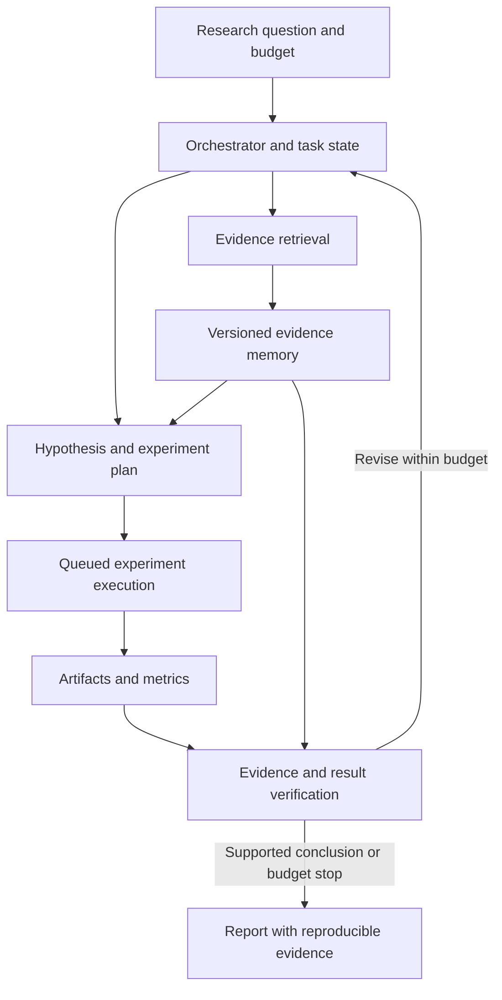

# Microsoft Applied Scientist：按研究问题、数据和训练准备

[返回目录](../README.md)

Hongxiang Zhang · 2026-11-03 · 依据上传的 HZ_resume(3).pdf

本文的五个论文项目都按同样三问组织：**要解决什么问题，为什么这样做；数据从哪来、标签怎么得到；模型怎样训练、什么时候停。** 推理时方法也回答三问，但明确说明没有新增模型训练，其数据主要用于推理输入、调参或评估。

先用中文部分把机制讲明白。已报告的实验、公开代码示例和建议的新实验分开表述；没有用建议设置补写历史实验。

## 项目 1：ATAR — Attention-Aligned Reasoning

### 1. 这个问题要解决什么？Motivation 与 insight

长 reasoning 中，模型可能逐渐偏离原问题，或者没有按照当前子目标执行。历史越来越长时，原问题、当前 plan 和先前推理混在一起；即使生成了一个正确 plan，后续 action 也可能漏掉它的要求。

**Insight：reasoning 的结构本身提供了可以自动定位的 anchors。** 原始问题是 global objective，当前 plan 是 local objective。生成下一 plan 时强调原问题；执行当前 action 时同时强调原问题和当前 plan。这样将“强调哪里”变成随步骤变化的选择，而不是始终强调一段固定文本。

ATAR 的贡献是这种结构化、动态的 anchor 选择与强度控制；SPA／PASTA 是已有 steering 后端。默认 SPA 通过原始输入与 masked 输入的 logits 差异增强指定内容的影响，并不是直接修改 attention heads。[P1, P6]

### 2. 数据从哪里来？怎么标注？

**ATAR 不训练新的 backbone 或 controller，因此没有新增监督训练集，也没有为训练人工标注 reasoning steps。** 推理时从模型输出中解析 plan/action，并使用模型生成 token 的 probabilities 构造 confidence signal。

| 数据／信号 | 来源与用途 |
|---|---|
| 原问题 Q | benchmark／用户输入，定义 global objective |
| 当前 plan | 模型按结构化格式生成，定义 local objective，不是 oracle plan |
| Token probabilities | 生成过程中的模型输出，用于估计局部不稳定性；不是答案正确率标签 |
| 标准答案 | 用于评估最终答案，不是训练一个新模型的 targets |
| 评估任务 | GSM8K、AQuA、MATH-500、StrategyQA、T4D、BBH |

训练与调参不同：无需训练新模型，也仍然需要选择 steering 配置；调参使用什么 development data、是否与最终评估隔离，应按实际实验说明。[P1]

### 3. 怎么训练／运行？什么时候停？

**没有参数更新，所以不涉及 optimizer、training epochs 或 best training checkpoint。** 实际执行是一个 plan/action 的自回归生成过程：

1. 生成 plan，anchors 为原问题。
2. 生成对应 action，anchors 为原问题与当前 plan。
3. 根据 confidence 调节 steering strength，继续下一步。
4. 生成最终答案，或按生成终止条件／长度预算结束。

论文将步骤 confidence 写为 token probabilities 的 harmonic mean：

$$
c=\frac{m}{\sum_{k=1}^{m}1/p_k},\qquad \omega_j=\omega/c.
$$

低概率 token 对 harmonic mean 影响较大，因此不稳定步骤得到更强干预。它也可能被罕见但正确的 token 影响；高置信错误同样可能漏掉。v3 写明 strength clipping，但更新时序、概率来自干预前还是干预后、clip 数值及 cache 实现仍要以实际代码为准。

**评估与泛化怎么接上：** 用相同 reasoning structure 去掉 steering 的消融检查增量；在不同模型、任务和后端上检验。训练免费不等于计算免费，SPA 的 masked forward pass 增加成本。不能由同 family／size 的性能比较推出它普遍替代 reasoning-model training。[P1]

## 项目 2：ActLCD — Active Layer-Contrastive Decoding

### 1. 这个问题要解决什么？Motivation 与 insight

Layer-contrastive decoding 希望利用深浅层输出差异改善生成。问题是：**对每个 token 都开启 contrast，不一定对每个 token 都有益。** 一些预测本来就合理，持续干预可能改变正常输出；而早期 token 的改变还会影响后续 prefix。

**Insight：将“是否干预”本身作为一个决策。** 保持 backbone LLM 不变，让一个较小的 controller 根据当前生成的内部信号，在 ordinary decoding 和 layer-contrastive decoding 之间选择。这样研究的是何时使用已有干预，而非重新训练 backbone 的事实知识。[P2]

“生成具有顺序依赖”是这个设计的动机；现有 offline annotations 是否充分识别了动作对未来的因果效果，是另一个需要诚实说明的问题。

### 2. 数据从哪里来？怎么标注？

数据来自 LLM 已生成的输出及其运行日志，而不是人工从头写一套 activation trajectories。[P2, Appendix A]

1. **生成与记录。** 对输入问题生成输出；在选择的层记录 top-5 token candidates、对应概率等内部信号。
2. **Span annotation。** 将生成文本、参考答案／来源信息提供给 GPT-4o，标出其中 hallucinated spans。
3. **Token alignment。** 将 spans 匹配回生成 token，处理 subword 对齐，形成 token-level binary labels。
4. **Controller examples。** 用当前 token 对应的内部特征作为 state，以 binary annotation 作为 activation supervision 的 proxy，组织成 offline sequences／transitions。

**一条样本要能讲清：** 当前 prefix 的内部信号 → 一个 0/1 activation label；Q-learning 另需要 state、action、reward、next state 和 terminal flag。

有两个重要边界。第一，GPT-4o annotation 和字符串对齐会引入 label noise。第二，**“这里出现 hallucination”不等于已通过反事实实验确定“这里开启 contrast 一定能修复”**。现有标签是干预收益的 proxy。

公开 llama 训练示例按 sequences 做 80/20 划分，features 取列名包含 token_id 或 prob 的数值列；这不能自动等同于 prompt-group holdout，也不能自动称为 dense hidden-state embeddings。实际实验数据量、prompt grouping 和 feature schema 以真实配置为准。[C2]

### 3. 怎么训练？什么时候停？

**训练的是 controller，不是 backbone；方法是 BC 加 offline constrained Q-learning，不是 PPO。**

第一阶段，Behavior Cloning 网络输入 state，输出两个动作的 logits，使用 annotated action 的 cross-entropy。它学习离线数据中哪些 activation actions 有支持。

第二阶段，训练 Q-network。只在 BC 概率超过阈值的允许动作中 bootstrap：

$$
A_\phi(s')=\{a':\pi_\phi(a'\mid s')>\tau\},\qquad
y=r+\gamma(1-d)\max_{a'\in A_\phi(s')}Q_{\bar\theta}(s',a'),
$$
$$
L_Q=(Q_\theta(s,a)-y)^2.
$$

推理时仍先筛选允许动作，再选择 Q 值最高者；若没有动作通过阈值，公开实现回退到 BC 最可能的动作。行为约束意在缓解 offline extrapolation，不能保证消除分布变化问题。

| 设置 | 可核对的事实 |
|---|---|
| Backbone | 冻结，不用 controller loss 更新 |
| Controller | 公开示例为 MLP＋ReLU；BC、Q 和 target Q 分开 |
| 公开 llama 示例 | hidden widths 1024/1024/512/512/256/256；AdamW；lr=3e-4；batch=1024；γ=1；BC threshold=.3 |
| 示例停止 | BC 固定 35 epochs，Q 固定 130 epochs，保存最终模型；不是已证明采用 validation early stopping |
| Q target 更新 | 示例每 200 steps hard copy；论文文字另描述 Polyak-style 更新，须以产生结果的版本为准 |

**Reward 要按版本讲。** 论文写 TP +1、TN +2、FP −1、FN −5；公开脚本的环境类与 TransitionDataset 又有其他值。因此不能把不同来源的默认值拼成一套“实际实验”。[P2, C2]

**停止规则的口述：** 当前公开示例是 fixed-budget training。若重新设计，会按 prompt 分组留出 development data，监控 activation 指标及生成后的 factuality、informativeness 和 latency，再冻结 checkpoint 做独立测试。这是设计建议，不补成已执行的流程。

**泛化边界：** 多模型／多任务中的方法效果，与单一 controller 的 zero-shot transfer 要分开。公开调用包含 task-specific checkpoints，不能仅据此声称 controller 可直接迁移到任意模型或领域。[C1]

## 项目 3：Agent-Radar — Multi-Agent Context Relevance

### 1. 这个问题要解决什么？Motivation 与 insight

多 agent 的历史同时包含有用证据、重复内容、过时结论和对别的角色有用的信息。更多 agent 和轮数可能增加信息量，也增加当前 agent 找到正确上下文的难度。

**Insight：多 agent 历史具有来源、结构和时间，不应只当作一个扁平的文本集合。** 当前 receiver 的 query、消息来源在 communication graph 中的距离，以及消息的时间，都可以帮助决定哪些句子值得强调。

Agent-Radar 使用这些信号选择 sentence-level anchors，再用 steering 增强它们的影响。完整 transcript 与原有 topology 保留；因此它不是 context compression，也不是直接减少输入 token 数。[P3]

### 2. 数据从哪里来？怎么标注？

**不额外训练模型，不构建新的监督 labels。** 输入来自 MAS 正常运行产生的通信历史：句子文本、source agent、round、communication graph，以及当前 query。

- 用预训练 sentence encoder（默认 all-MiniLM-L6-v2）计算 sentence/query similarity。
- graph distance 来自通信图；temporal age 来自消息轮数。
- 不需要为每句话人工标注“重要／不重要”；选择依赖显式 scoring rule。
- Benchmarks 的参考答案用于评估：HotpotQA、2Wiki、MuSiQue 看 F1，MATH-500、MMLU-Pro 看 accuracy。

论文在 MuSiQue 上选择 decay／threshold，再用于其他实验。需要明确 development 与 final test 的边界，不能因为没有模型训练就忽略参数选择中的过拟合。[P3, Appendix A]

### 3. 怎么训练／运行？什么时候停？

**没有新增训练 loss 或训练 checkpoint。** 对来自 agent j、round τ 的句子 s，在 receiver i、round t 的 score 为：

$$
\operatorname{score}(s)=\cos(\operatorname{Enc}(s),\operatorname{Enc}(q_i))\lambda_s^{d_G(j,i)-1}\lambda_t^{t-\tau-1}.
$$

direct neighbors 和 self critiques 的 spatial weight 特别设为 1。取 score≥θ 的句子作为 anchors，并始终加入当前 query。默认 λs=λt=.92，θ=.65。选中的内容只用于决定 steering，未选句子仍在 transcript 中。

然后调用 SPA 后端生成 agent response，继续 MAS 原有协调过程。什么时候结束由所接入框架的任务完成条件／round budget 决定；本方法不新增一个“训练停止”步骤。

**为什么这样做仍有局限：** relevance、recency、proximity 都不是 truth。旧的约束或远处专家信息可能被低估；乘法和阈值还会让足够旧／远的信息失去显式 anchor 机会。它仍然存在原始上下文中。

**怎么验证：** 对比 retrieval-only、不同 retrieval backend、去 spatial／temporal decay，以及不同 MAS／topology／backbone；总成本要报告。表中 MAS 968.8→1196.5 秒／task，约 +23.5%，不能把保留完整历史的设计称为节省上下文的方案。[P3]

## 项目 4：FLARE — Fine-Grained Diagnostic Feedback

### 1. 这个问题要解决什么？Motivation 与 insight

执行失败能告诉 LLM“程序错了”，却经常不能准确告诉它“应该从哪里改”。让模型反复整体重写，可能保留根本错误，也可能引入新的无关修改。

**Insight：用一个轻量诊断器提供位置线索，再把它与 execution feedback 结合。** 位置预测有不确定性，因此每轮围绕 top-k suspicious lines 生成不同候选，用 public tests 选择下一程序。最终任务是提高 repair success；localization 是辅助任务，不是终点。[P4]

### 2. 数据从哪里来？怎么标注？

主训练数据是已有 Collu-Bench。FLARE v2 报告使用 13,130 samples，其中 10,504 train、2,626 test；它们来自 11 个 LLM 在 HumanEval、MBPP、HumanEval-Java、Defects4J、SWE-bench 上生成的 buggy programs。

**Collu-Bench 的 first-bug labels 主要由自动流程构造，而不是所有样本都人工逐 token 标注：**

1. 为原问题收集参考正确程序；在部分较简单任务上额外生成多种通过测试的实现。
2. 规范化 user-defined identifiers，降低变量命名差异的影响。
3. 将错误程序与规范化后的多个正确程序比较，找到每次比较的 first mismatch，并映射回原始生成 token。
4. 在候选参考中取最靠后的 first-mismatch index，作为该错误程序的 localization target。[D1]

这个标签仍可能受等价正确程序覆盖不足影响，因此是带噪声的自动定位 supervision，不是语义根因的完美 oracle。Collu-Bench 原始公开版本的样本总数与 FLARE 使用子集不同，面试中沿用 FLARE 实验数字，并说明来源版本。

每个 FLARE 训练样本包含：generated code、generator token probabilities、token types，以及 first buggy token index。先将 subwords 对齐到 lexical units，再把 target 映射到对应 unit index j*。

另外，FLARE 在 100 个 failed LiveCodeBench programs 上做了人工 fault-line annotation，用于独立定位评估；标注者不看各方法的预测。它与 Collu-Bench 主训练 labels 是两套来源。[P4]

### 3. 怎么训练？什么时候停？

从头训练一个 diagnostic encoder，**不微调负责代码生成的 LLM**。

| 环节 | 设计 |
|---|---|
| 输入 | 256 维 lexical token embedding＋128 维 type embedding＋128 维 confidence projection，共 512 维 |
| 编码器 | 加 positional encoding；6-layer、8-head bidirectional Transformer |
| 输出 | 每个 lexical unit 的 logit sj |
| Target | 该程序的 first buggy lexical-unit position j* |
| Loss | softmax over positions 的 CE：−log softmax(s)[j*]；padding positions 应被 mask |
| 优化 | AdamW、lr=1e-4、batch=32、固定 15 epochs |
| 模型选择 | 按 validation 上预测 position 的 exact-match accuracy 选 best checkpoint |

confidence 在主文中定义为对齐 subword probabilities 的乘积；附录比较 log-space features。实际 projection 输入的数值形式需按实现确认。

**训练什么时候停？** 已报告的是 15-epoch budget＋validation checkpoint selection；没有足够信息证明用了 patience early stopping。validation 如何从 training pool 中划出、按何种 group、最佳 epoch 是几，按实际记录回答。推荐协议是 problem-aware split，但不能把推荐写成已执行的实验。

**推理什么时候停？** 每行对 unit scores 做 max pooling，选 top-k 行分别生成完整 revision；通过全部 public tests 或到达 N=5 上限就结束。默认 k=10。hidden tests 只用于最终 evaluation。最终输出一个程序，因此 report Pass@1，同时披露内部 candidate budget。

**泛化怎么接上：** 先检查不同问题的隔离；若要声称 unseen-generator transfer，需要专门 generator-held-out 实验。在多个 generator 上共享 localizer，是可应用性的证据，不能自动当作严格 unseen-generator 证据。定位有效还必须转化成 downstream repair 收益。[P4]

## 项目 5：LLAMAFUZZ — LLM-Enhanced Greybox Fuzzing

### 1. 这个问题要解决什么？Motivation 与 insight

随机 bit-level mutation 在结构化输入中容易破坏格式，导致程序很早拒绝输入，难以探索深层逻辑。手写 grammar 又需要格式知识和额外维护。

**Insight：让 LLM 从有价值的 mutation pairs 中学习结构相关变换，同时保留高吞吐 fuzzer 的探索与执行反馈。** LLM 负责提出候选；coverage／crash feedback 判断候选是否值得继续探索。慢的 GPU mutation 与快的 CPU fuzzing 通过异步队列结合。[P5]

这是一个带 target-specific adaptation 的系统设计。价值需要通过额外 coverage、bug finding 和资源成本评估；并不要求一个 checkpoint 零样本处理任意程序与格式。

### 2. 数据从哪里来？怎么标注？

数据来自 FuzzBench 的历史实验和 AFL++ 运行日志。筛选出引起新路径、hit-count 变化或 crash 等 interesting behavior 的 mutation，保留 original seed 与 mutated seed 的配对。

| 内容 | 说明 |
|---|---|
| 输入 x | original seed，以及 mutation task 的提示 |
| Target y | 与其配对的、经 fuzzing feedback 筛选的 mutated seed |
| “标注”来源 | execution／coverage feedback 的自动筛选，不是人工为每条样本写 mutation 答案 |
| Binary representation | 转成 hexadecimal；按 byte 对应的两个 hex 字符组织；BPE 仍可能继续切分 |
| 文本输入 | 文本 seed 直接配提示 |
| 规模 | 论文约 10,000 samples per target；实验 seeds 排除出 fine-tuning data |

一条概念样本是“mutate this original seed → target mutated seed”。公开训练代码读取 CSV 的 context 字段；实际 instruction／input／output 如何拼接，要与 CSV 保持一致，不能把概念格式当作已核验的模板。

排除 evaluation seeds 只处理一部分 replay 风险。还需要区分 seed lineage、program 和 format 的 overlap。论文另做了将训练 seeds 加给 AFL++ 的对照，以检验收益是否仅来自直接回放。[P5, §5.1]

### 3. 怎么做 SFT？什么时候停？

从 LLaMA-2-7B-Chat 开始，冻结基座权重，通过 LoRA 学习根据原 seed 生成 mutation。论文条件生成目标可写为：

$$
L_{\mathrm{SFT}}=-\sum_t\log p_\theta(y_t\mid x,y_{<t}).
$$

teacher forcing 使用真实 mutation 的前缀预测下一个 token；causal mask 不让当前位置看到未来 token。**Loss masking 要与实际代码分开讲：** 公开示例将 context 文本交给 SFTTrainer，没有显式配置 response-only collator；不能据此声称实际只在 response tokens 上计算 loss。[C4]

| 设置 | 论文／公开示例 |
|---|---|
| Adapter | LoRA r=8、alpha=16、dropout=.05；公开脚本 target modules 为 q_proj、v_proj |
| 基座 | 4-bit NF4；量化 matmul 配 BF16；公开 Trainer 另设 fp16=True，不能简单描述为全链路 BF16 |
| Optimizer | 论文为 AdamW；脚本使用 paged_adamw_32bit |
| 训练预算 | 20 epochs，per-device batch=1，max length=1400；公开 gradient accumulation=1 |
| 学习率 | 2e-4，cosine schedule，30 warm-up steps |
| Validation | 公开示例没有传 eval_dataset，也没有 early-stopping callback |
| 保存 | 训练结束保存 final model／adapter |

**什么时候停？** 当前配置是固定 20 epochs 后停止并保存 final checkpoint，不是按 test coverage 反复选择最佳 epoch。若重做，可按 seed lineage 留出 validation，结合生成质量和短预算 fuzzing utility 选配置，再独立测完整 benchmark；这是建议协议。

部署时 GPU worker 生成 mutations，CPU fuzzer 持续执行与变异；interesting seeds 再进入队列。训练停止与 fuzzing campaign 的时间／资源 budget 是两种停止条件。

**泛化边界：** 新 seeds、新 programs、新 formats 是不同结论。当前实验可以支持被测 targets 内的适配价值，不能自动推出跨 program／format 的 zero-shot transfer。下一步可做 program-held-out，并比较 multi-target training 与 target-specific adaptation 的 quality-cost tradeoff。

## 训练深挖：面试官连续追问时如何回答

### 先分清你在不同项目里训练了什么

| 项目 | 学习任务 | 训练输入和 target | 真实停止／checkpoint 信息 |
|---|---|---|---|
| FLARE | 从头训练诊断 encoder | buggy program 的 lexical／type／confidence features → 首个 buggy position | 15 epochs；validation localization accuracy 选 best；validation 划分和 best epoch 待确认 |
| LLAMAFUZZ | 对 pretrained LLM 做 LoRA SFT | original seed → mutation seed；target 由 fuzzing feedback 筛选 | 固定 20 epochs、final checkpoint；独立 validation／动态早停未充分报告 |
| ActLCD | BC + offline constrained Q-learning | logged model features → activation labels／offline transitions | 公开 llama 示例 BC 35、Q 130 epochs；实际实验配置需核对 |
| ATAR／Agent-Radar | inference-time control | 冻结模型加结构／检索／steering | 不训练新 backbone，调参仍需独立 development data |

### 按“一个具体样本”回答，比只罗列超参数更有说服力

以 FLARE 为例，先描述一个 buggy program：模型生成的 code、每个 subword 的 probability、已有标注指向某个 buggy token。解释如何把它对齐到 lexical-unit index j*，如何构造 512 维输入，如何把 padding positions mask，再说明 softmax over positions 与 CE。

接着讲训练：mini-batch、forward、loss、backward、optimizer step、validation、checkpoint selection。最后讲独立 downstream repair evaluation。面试官可以沿任一步继续追问，而你始终在解释同一份样本。

以 LLAMAFUZZ 为例，样本是 original seed x 与一个被 fuzzing feedback 选中的 mutated seed y。解释输入序列、输出序列、二进制编码、causal mask 和 LoRA 参数更新，再说明 final coverage／bug metrics 如何检验模型是否真正有用。

### 如果问“你说 SFT，到底怎么训练？”

标准 conditional SFT 将任务说明和输入组成 prompt x，将正确输出作为 response y。训练时可以 teacher-force y 的前缀，并预测其下一个 token；causal mask 保证当前位置看不到未来 target。

对于 response-only loss，概念目标为：

$$
L_{\mathrm{SFT}}=-\frac{1}{\sum_i |y_i|}\sum_i\sum_{t=1}^{|y_i|}\log p_\theta(y_{i,t}\mid x_i,y_{i,<t}).
$$

只在 response 的有效 tokens 上累积 loss；prompt 和 padding 的 labels 可设为 ignore index。不同实现也可能对完整序列算 loss、按样本平均或按 token 平均；这些会改变 weighting，必须说明自己的真实实现。teacher forcing 使用 ground-truth prefix，推理使用自身生成 prefix，可能存在 exposure mismatch。

若用 LoRA，只更新适配参数，原始 backbone 冻结。优化时仍要通过网络计算 activation 与梯度，不能将“冻结参数”误解成“不做反向传播”。需要说明 target modules、rank、alpha、dropout、optimizer、effective batch、sequence length 和 precision。

训练步骤的通用骨架是：

1. 固定 dataset version，去重并完成 group-aware splits。
2. 构造 prompt／response，tokenize，检查 label masking、EOS、padding、truncation。
3. 在小 batch 上检查 shape、loss 和梯度，确认可训练参数与预期一致。
4. 运行 optimizer／scheduler；按固定间隔在独立 validation 上评估。
5. 保存满足预先规则的 checkpoints；选择后冻结设置，做最终 held-out evaluation。

这是标准解释；具体项目的实际 label masking、gradient accumulation、scheduler 和 seed 要按日志补全。

### 数据与标注：需要准备的 10 个追问

1. **一条样本是什么？** 不要只回答“代码”或“文档”；给 input、target、metadata 和一个实际例子。
2. **source unit 是什么？** 一个 problem、repository、seed lineage、user、PPT deck？split 应在恰当单位上进行。
3. **数据如何进入训练集？** 人工采样、LLM generation、真实运行日志、weak supervision、成功案例筛选分别说明。
4. **label 如何产生？** 原始标注、专家审核、自动 execution、LLM judge、heuristic proxy；它和真实目标有何差距？
5. **是否只保留成功样本？** 可能造成 selection bias，模型只学到既有搜索分布中的成功路径。
6. **一致性如何检查？** 标注指南、双人复标／分歧仲裁、重复样本、错误类型抽查；没做过的不声称已做。
7. **负例与类别不平衡？** 正负样本如何定义，sampling／weighting 是否改变线上分布或 calibration？
8. **泄漏如何查？** 同题不同代码、同 deck 不同 slide、同 seed 后代、近重复、时间信息以及生成器 overlap。
9. **多大数据量足够？** 学习曲线和关键 slices；没有适用于所有任务的固定数量。
10. **train 很好而部署不好？** 查分布、预处理、confidence feature 可用性、label proxy、模型版本、上下文长度和任务指标。

### “什么时候停？”其实是三个问题

| 问题 | 回答应该包含什么 |
|---|---|
| 什么时候停止参数更新？ | 固定训练预算，或预定义 validation improvement／patience／budget 条件；说明实际采用哪一种 |
| 用哪个 checkpoint？ | 按 validation 指标选择，不能看 test 再决定；记录选择规则和 best epoch |
| 怎么知道足够可用？ | 独立 task-level evaluation、关键 slices、失败成本、稳定性、延迟和资源门槛 |

**对 FLARE 的真实口述：** “We trained for a fixed budget of fifteen epochs and selected the checkpoint with the best validation localization accuracy. I distinguish that from early stopping. To judge whether it was useful, we evaluated downstream repair success on separate benchmarks.”

**对 LLAMAFUZZ 的真实口述：** “The reported setup used twenty epochs and saved the final checkpoint. If I redesigned the pipeline, I would define a held-out validation protocol for seed lineages and compare generation quality and short-budget fuzzing utility before the final benchmark evaluation.”

**设计题中的 early stopping：** 先定义 validation metric 和最小有意义改善量，再定评估频率与 patience；patience 不是通用固定常数。训练 loss 下降而 validation 不升，检查过拟合和 label mismatch；validation 波动大，先检查样本量、分组、随机性，而非立即根据单次下降停止。

对于生成系统，NLL 可以是训练监控信号，最终是否可用仍要看 task success。对于 FLARE，localization accuracy 是 proxy；对于 LLAMAFUZZ，mutation NLL／validity 也不是最终 bug-finding utility。

### 可以主动补充的研究判断

“I would separate optimization progress from model selection and deployment readiness. A lower training loss tells me that the model fits the training objective better. It does not establish that the objective captures the downstream task or that the selected checkpoint generalizes.”

## 泛化性：怎样设计验证、怎样选择 checkpoint

### “确保泛化”先变成一个具体可检验的问题

泛化要先指定目标：同分布的新问题、未见 generator、新 repository、新领域、更长上下文，还是未来时间的数据？有限实验可以支持一个明确范围内的结论，不能保证任意分布下都有效。

对 FLARE，至少区分三个层面：**未见过的 coding problems、未见过的 generator LLM、不同 benchmark／应用场景。** 在五个 base LLM 上共用一个 localizer，说明方法可用于这些 generator；若它们出现在训练来源中，则不足以支持严格 unseen-generator generalization。

### 一个可用于面试的完整回答

1. **先防止评估失真。** 按原问题／repository 等单位分组，近重复和同题不同生成结果不跨 train／validation／test；学习型 preprocessing、feature selection 和 resampling 只拟合 training 部分。[G1–G2]
2. **让评估对应目标分布。** 若声称跨 generator，就设置 generator-held-out；若声称新 repo，则设置 repository-held-out；若面向未来数据，则使用 forward time split。不能用普通随机 CV 替代这些测试。
3. **控制过拟合。** 合理模型容量、weight decay／dropout、validation-based selection 或 early stopping。它们是控制手段，本身不构成泛化证据。
4. **检验稳定性。** 多次初始化／seeds，报告平均值、波动和任务级置信区间；查看长度、语言、错误类型和 generator 等 slices。多个 seeds 检验训练随机性，不等价于新的分布测试。
5. **验证最终任务。** FLARE 同时检查 localization 和 final repair，候选预算与成本均披露。防止把 proxy metric 改善当成终点。
6. **明确结论边界。** 哪些轴已经测过、哪些是计划，分别说明。若只对所测模型与 benchmark 有证据，就限定在这个范围。

### 各项目适合怎样验证泛化

以下是设计建议；已有实验范围以前文原始论文为准。

| 项目 | 最应该防止的泄漏／过拟合 | 强验证设计 |
|---|---|---|
| FLARE | 同一题不同代码跨 split；generator confidence 分布差异 | problem／repo grouping；专门 generator-held-out；不同 benchmark 的 downstream repair |
| LLAMAFUZZ | 同一 seed 的近似后代跨 split；target-specific memorization | seed-lineage grouping；分别评估新 seed、新 program、新 format，三者不要混称 |
| ActLCD | 同 prompt 的 trajectories 跨 split；按 task 训练的 controller 被称为通用 | prompt-group holdout；新 task／model 的 transfer 单独测，明确是否重新训练 |
| ATAR | 在测试题上选择 strength／prompt；只测一种难度 | 固定开发集选设置；新任务、长上下文、措辞变化、不同 backbone 与 precision |
| Agent-Radar | 调参 benchmark 与最终证据混用；只在某种 topology 有效 | 独立 dev/test；新 topology、agent 数、轮数与 backbone；固定设置评估 |

### validation 比例、超参数和最佳 epoch 是三种选择

**有常用起点，但没有一套通用最优值。** 可以用 80/20 或 90/10 作为 development pool 内的 train/validation 设计候选；有 group 的数据应先保证隔离，样本数未必精确满足比例。比例要使 validation 足够稳定，也保留足够训练数据。

FLARE 已报告的 lr=1e-4、batch=32、15 epochs 可作为复现实验的起点。[P4] 若重新设计，可在此附近做小范围搜索；例如 lr∈{3e-5,1e-4,3e-4} 是一个**说明方法的候选网格**，不是声称这些值是普遍最优或已经跑过。

最佳 epoch 则由 validation curve 决定，不是预先套一个“大家常用的 epoch”。例如固定训练 15 epochs，每 epoch 保存一个 checkpoint，按 validation Top-1 localization accuracy 选择；若第 9 epoch 最好，便选第 9 个——这个“第 9”只是示例，不是 FLARE 的真实 best epoch。

### 不用 cross-validation，也能选 checkpoint

一个清晰的单次 holdout protocol 是：

1. 保留 test 不参与任何选择。
2. 在 training pool 内按 problem／repo 分出 validation。
3. 固定配置训练，每个 epoch 验证并保存。
4. 按预定义 validation 指标选择 checkpoint；可以跑满预算，也可以额外设定 early stopping。
5. 所有设置冻结后，再做独立 test 和 downstream evaluation。

若沿用 FLARE 的 10,504 training samples，可在其中按组留出 validation，原 2,626 test samples 继续独立保留；新评估还应检查 split 之间的问题重叠。这里是建议协议，不是补写论文未报告的实际划分。

### Cross-validation 主要选配置，而不是挑一个“最高分 fold checkpoint”

每个超参数都跑全部fold 看平均效果 每次都是重新训练一个模型 选好超参数之后一般用全部训练数据重训一个最终的模型 然后在独立测试集测试

### ActLCD 被问“controller 泛化差怎么办？”

先限定结论：方法在适配后的任务上有效，不等于同一个 policy 可直接迁移到任意 task／backbone。内部概率特征、输出风格和 hallucination 分布都会变；benchmark-specific checkpoint 还引入适配成本。

接着给实证路径：先做 prompt-group holdout，再分别测新任务、新模型；比较 frozen controller、少量重新标注后的 adaptation，以及不使用 controller／始终开启 contrast 的强基线。数据少时先查特征归一化、label noise 和 annotation-to-action mismatch，再决定是否扩大 controller。最终看生成质量与成本，而不只看 proxy activation accuracy。

“I would not claim that one unchanged controller transfers to every task or backbone. The demonstrated claim is that adaptive activation can be useful in the evaluated settings. Transfer needs its own experiment because the state features and intervention benefits can change. I would compare a frozen controller, limited adaptation, and strong decoding baselines on grouped held-out prompts. If adaptation is necessary, I would report its annotation and training cost together with the generation-quality benefit.”

### LLAMAFUZZ 被问“SFT 泛化差，为什么还值得做？”

SFT 是训练方式，不直接决定所有泛化结论。这里的监督集中在 particular target 的 interesting mutations，确实可能学到 target／format-specific patterns。可以承认这种范围，论证在这个范围内的任务价值：适配成本能否换来额外 coverage 或 bug finding。不能用“LLM 本身有常识”作为跨格式泛化证据。

设计上分别测 seed-held-out、program-held-out、format-held-out；每种比较保持总资源预算可比，并纳入 seed replay、base LLM、不微调 mutation、multi-target SFT 与少量 target adaptation。若只在已适配 target 有收益，就报告这项结论，不扩大成通用 mutator。增加多样性、降低训练量或加 regularization 可能有帮助，但是否有效仍需要验证。

## 开放式系统设计：Auto Research Agent

### 一开始先把题目收敛

面试中可以澄清四点：研究任务是 literature review、复现还是运行新实验；能访问哪些论文、代码和数据；时间／费用／GPU 预算；交付物和成功标准是什么。随后明确一个可执行假设，例如：**给定一个 ML 问题，检索证据、复现 baseline、运行少量受控实验，并输出可复现的结论和研究报告。**

核心设计是一个可持久化的执行流程，配合需要推理的 agent 和确定性工具。先建立清晰的 orchestrator；有独立检索或实验时再并行，不必默认每一个步骤都建立一个独立对话 agent。

### 各组件负责什么

| 组件 | 职责 | 关键设计 |
|---|---|---|
| Orchestrator | 管理任务状态、调用工具、执行计划、预算与停止条件 | step 有类型、状态和持久化结果；显式 plan revision，避免只有一条无限增长 chat history |
| Evidence service | 搜论文、解析全文、定位原始证据 | claim 关联 source、位置、版本；搜索摘要仅用于筛选，关键结论回原文 |
| Planner | 将问题分解为假设与可检验实验 | 先定义 baseline、data split、metric、预算；计划是可修改状态而非一段不可检查文字 |
| Memory | 保存事实、经验、有效范围与来源 | 区分观察、假设和已验证结果；版本改变时失效依赖项 |
| Experiment service | 检出代码、准备数据、提交和监控任务 | 固定 commit／environment／data hash／config／seed；用 job handle 管理长任务 |
| Verifier | 核对引用、执行状态、实验结果和结论 | 检查真实 artifacts；训练成功、metric 数值、baseline fairness 与统计解释分别验证 |
| Report writer | 汇总可证实的结果与未解决问题 | 每个重要 claim 有 evidence；没有跑完的实验标为未完成 |

### 一次完整执行可以这样讲

以“提高跨 generator 的 code fault localization”为例：

1. **定义目标。** 限定 generator-held-out test，主要指标包括 localization 和 downstream repair；预算包含 localizer training 与 repair calls。
2. **检索与证据整理。** 从论文原文确认已有方法、数据和评估设置；保存 claim 与证据位置，记录不一致和未知项。
3. **复现 baseline。** 先运行现成 baseline 并检查与预期差距，未通过数据／执行 sanity checks 时不批量扩展实验。
4. **形成一个具体假设。** 例如 confidence normalization 是否改善未见 generator 上的泛化。先确定变量、控制项、seeds、验证集和选择规则。
5. **提交实验。** Experiment service 返回 job ID；agent 释放当前执行资源，后续根据持久化状态监控，而非一直在 chat 中等待。
6. **核验。** 用结构化 artifacts 读取指标，检查异常、失败作业、数据泄漏和 budget；在同任务比较改进，给出适当的不确定性估计。
7. **迭代或停止。** 有明确可检验的下一假设且预算允许时再实验；达到预算、证据充分或连续迭代没有进展时交付现有结果与未决问题。

### 需要持久化的数据

| 对象 | 至少包含 |
|---|---|
| Task | question、scope、deliverable、budget、status |
| Hypothesis | claim、evidence refs、planned comparison、acceptance rule |
| Evidence | source URI／file、位置、version、retrieved_at、可信范围 |
| Experiment | code commit、data version、config、seed、environment、job ID、metrics、artifact paths |
| Agent step | prompt／model／tool versions、action、observation refs、cost、status |
| Memory item | fact／procedure type、source、validity scope、dependencies、verification status |

### 面试官最可能继续追问的系统问题

**1. 如何避免 agent 编造论文或实验结果？** 文献引用需匹配真实 metadata 和原文证据；结果从 execution artifacts 读取。verifier 的角色是核对可观察依据，不能只让另一个 LLM 对同一段文本表示同意。

**2. Memory 怎么设计？** raw documents、structured facts、experiment records 与可复用程序经验分开。向量检索解决语义匹配；版本、实体、时间和依赖可由结构化 metadata／graph 维护。graph 是否值得引入，要用具体查询和 baseline 证明。

**3. 如何处理冲突？** 保留来源与时间，判断是定义／范围不同还是新版本覆盖旧版本；未能解决的冲突作为不确定项呈现。不能只靠“最新的一条就是对的”。

**4. 多 agent 如何协调？** orchestrator 分配有类型任务；worker 输入包含 scope、输出 schema、工具与预算。共享 evidence store，避免所有历史反复广播；对可并行的搜索／独立 runs 使用队列。

**5. 任务跑一半失败怎么办？** step checkpoint、明确错误类型、有限重试。experiment key 可由 commit＋data＋config＋seed 形成；先查询同 key 作业状态，避免重复提交昂贵任务。训练中断可从有效 checkpoint 恢复，而非无限从头重跑。

**6. 如何扩展到多人同时使用？** API／orchestrator 与 worker 分离；durable task queue；按用户／项目做预算和资源配额；GPU jobs 由 scheduler 分配；工具调用超时与并发限额；job 与结果可追踪。

**7. 如何控制成本？** caching、重复检测、小模型 routing、先跑低成本 pilot、按预期信息收益扩展实验。需要比较这些策略对最终研究质量的影响；不能只优化 token 数。

**8. 什么时候结束？** 预算、最大迭代、任务特定 acceptance criteria，以及重复无进展条件。达到预算时交付有证据的部分结论，而非为了凑出成功报告补写不存在结果。

**9. Agent 如何评估？** 任务完成、实验可复现、引用正确、结论被证据支持、无效实验比例、成本和用时。可从有已知答案的复现任务开始，再引入专家评估的开放任务。与单 agent＋tools、简单 workflow、无 memory／无 verifier 变体比较。

**10. 怎么确认 novelty？** 系统检索、相近工作对比和专家判断可以降低遗漏概率；未检索到工作不能证明它不存在。将 novelty claim 保持在证据可支持的范围。

## 开放式建模：给你一些数据，训练模型完成 XX

### 先建立一个适用于不同任务的回答骨架

**任务定义 → 数据与标签审计 → 防泄漏划分 → baseline → 模型与目标 → 训练与选择 → 独立评估 → 失败分析与迭代。**

开头澄清输入、输出、单标签／多标签／生成任务、现有标签、线上分布、错误成本和延迟预算。然后给一个能落地的初版，并说明什么证据会让你升级复杂度。

### 具体案例：5,000 条 PPT 文本，20 类分类

**首先确认样本单位。** 一条是 slide 还是整个 deck？同 deck 的 slides 若跨 train/test，会泄漏主题、模板和客户信息。20 类是否互斥，是否有 unknown 类，label 是否一致，类别数量是否不平衡？平均每类 250 条不等于实际均衡。

**数据审计与标注。** 检查抽取／OCR、空文本、近重复、模板、语言、类别混淆和 label noise。人工制定类别定义，抽查容易混淆的类别；若用 LLM 辅助标注，需要专家审核和独立的高质量评测集。类别定义和 example 不应偷偷来自 test 错误分析。

**划分。** 优先按 deck／客户／来源等分组，并尽可能保持类别覆盖；若实际部署是未来数据，再做 temporal evaluation。数据不足时用 group-aware cross-validation 选择方案，另保留最终 test。70/15/15 只是可能方案，不是必须比例。

**三个逐渐升级的 baseline。**

| 路线 | 怎样做 | 为什么值得比较 |
|---|---|---|
| Keyword／传统文本 | 规则或 keywords 做最低成本基线；进一步 TF-IDF＋logistic regression／linear SVM | 易排查、低延迟，对高区分度术语可能很强 |
| Embedding | frozen text embeddings＋监督 classifier；另比较 label descriptions／class prototypes 的 nearest-neighbor 方法 | 小数据迁移学习；embedding 路线不只等于语义 nearest neighbor |
| Fine-tuning | 小型 pretrained encoder 加 classification head；若确需生成或复杂指令能力，再比较 LLM LoRA SFT | 测试任务适配是否值得额外训练和推理成本 |

**如何训练 encoder classifier。** 文本 tokenizer 得到 ids／mask；encoder 得到 representation；pooling 后输出 20 logits；单标签使用 CE。冻结 encoder 仅训 head 是一个便宜起点，也可联合微调。按 validation macro-F1 选配置和 checkpoint，监控 train/validation gap。实际 optimizer、lr、batch、max length 根据模型和资源试小范围实验，并说明 effective batch。

**如果选择 LLM SFT。** prompt 包含任务说明、训练时允许使用的类别定义与文本；response 是规范化 class ID。用 causal next-token loss 训练 response。检查 class ID 的 tokenization、输出约束和无效输出。对单一分类决策，还应与直接 classification head 比较 latency 与 accuracy，避免不必要的长文本生成。

**指标。** 单标签多类任务主看 macro-F1、per-class precision／recall、confusion matrix，辅以 accuracy／weighted-F1；按业务代价决定主指标。若需要置信度做拒答，评估 calibration、coverage 和 error tradeoff。多标签任务需改为逐类 sigmoid／BCE 与适当指标，不能沿用单标签 softmax 假设。

**何时停。** 在预定 budget 内按独立 validation 的主指标选 checkpoint；若采用 early stopping，说明 min_delta／patience／评估间隔。最终 test 不参与模型／阈值／epoch 选择。除了平均分，还检查短文本、模板化文本、少数类和新来源。

**结果不够好怎么办？** 先看 error slices：标签混淆、OCR／抽取错误、输入截断、样本太少或领域差异。优先修复高频数据问题、补标高信息量样本，再判断更复杂模型是否能解决观察到的错误。

## A research direction：我想继续研究的两个问题

这部分表达研究兴趣，不包装成已经完成的项目，也不预设问题已有通用解法。可以先讲其中一个，再根据面试官兴趣展开另一个。

### 1. Multi-agent interaction：agent 之间应该交换什么？

**我的出发点。** MCP 让模型通过标准接口使用 tools 和 resources。多 agent 协作也需要清晰的交互抽象：一个 agent 应该向另一个 agent 暴露什么，怎样表达自己的发现、假设、证据、依赖和状态，接收者又怎样理解和验证？

这里需要区分两层。A2A 已经涉及 agent discovery、task lifecycle 和 message exchange，也支持结构化内容；不能说 agent-to-agent 完全没有协议，或只能交换自然语言。更有研究价值的问题是：**在这些接口之上，什么信息表示最有利于协作？** 传输接口、任务管理与模型之间的语义理解，并不是同一个问题。

| 工作 | 已核对的内容 | 与这个方向的关系 |
|---|---|---|
| **ThoughtComm — Thought Communication in Multiagent Collaboration**，NeurIPS 2025 | 研究从内部表示提取／建模 latent thoughts，并在 agents 间通信 | 与“agent 直接交换 thought”的记忆很接近 |
| **LatentMAS — Latent Collaboration in Multi-Agent Systems**，ICML 2026 | 研究 training-free latent collaboration，包括 latent thought generation 与共享 latent working memory | 也是候选；尤其接近“传 hidden representations，而非先写成文本”这一印象 |

**我想继续问的问题。** Natural language 灵活、跨模型使用方便，也容易检查；但消息可能冗长、含糊或省略假设。结构化消息可以显式表达 claim、evidence、scope、confidence、dependencies 和 task status。Latent representations 可能绕开部分文本表达瓶颈，但会带来跨模型空间兼容、可解释性和验证问题。并不预设最终应全部使用 latent communication；更可能需要按任务选择表示，或让可验证的结构化内容与 latent information 配合。

**一个可以开始做的实验。** 设计 agents 各持有部分互补证据、必须通信才能解决的任务。固定 backbone、agent 数、topology 和工具条件，比较 natural language、typed messages、latent communication 与 hybrid。分别控制计算预算并报告实际成本；latent tensors 的 bytes、生成／接收开销也要算，不能只看少了多少文本 tokens。除了 final correctness，还看遗漏的关键约束、错误传播、latency 和接收方对证据的使用情况。通过删除、打乱或替换消息，检查系统是否真的依赖通信传来的信息。

**与既有项目的连接。** Agent-Radar 研究哪些已有上下文应被强调；这个方向进一步研究协作信息本身应如何表示、共享和验证。两者有关，但后者不是对前者已有能力的描述。

### 2. Long-horizon memory／knowledge base：怎样持续保留和找回有效知识？

**先肯定 RAG。** RAG 是很好的起点：它把模型与外部知识连接起来，让新知识不必全部通过参数更新进入模型，也让回答有机会基于可追溯的来源。在很多任务中，先把 retrieval 做好，比立即设计一个复杂 agent 系统更有价值。[R5]

**我觉得还没有充分解决的部分。** 在长任务里，agent 不只读取一个静态语料库，还会不断产生观察、决定、假设、纠正和经验。检索一条语义相似的 memory，并不能确定它现在是否有效、是否属于这个实体与任务、是否已被后来的信息取代。失败也不总在 retriever：需要的信息可能从未写入，摘要时可能丢了条件，重复条目可能放大过时结论，或者知识之间的冲突没有被表示出来。

这并不是说所有 RAG 都只有向量 top-k。Metadata filtering、reranking、hybrid retrieval、temporal／graph methods 都能改善检索。我的研究问题是：**如何让写入、表示、更新、整合、失效与读取共同服务于长期任务，而不是只对固定文本块做一次相关性排序？** LongMemEval 对 temporal reasoning、knowledge updates、abstention 等能力的区分，也说明平均检索相关性不足以覆盖 memory 的所有要求。[R6]

**一个具体例子。** 企业分析 agent 先得到“收入按表 A 的字段 x 计算”，随后数据团队把当前流程迁到表 B，但历史报表仍使用表 A。只保留最新说法会破坏历史问题；只按语义相似度检索又容易取回过时流程。Memory 需要保留来源、适用时间／版本和范围，retrieval 再根据当前问题选择合适的知识。一个最新时间戳不能代替有效性判断。

**我想探索的设计。** 保留原始证据与来源，构建可更新的 facts／procedures，并记录适用范围和必要依赖；让短期 working memory 服务当前计划，长期 store 保存可复用知识。研究何时写入、何时合并、哪些内容应被标为 superseded，以及更新怎样影响后续检索。是否需要 graph、学习型 policy 或复杂 consolidation，应由基线实验决定。

**怎样评估。** 使用包含知识更新、相同名称不同 scope、旧约束仍有效、部分信息冲突的长任务。比较 full history、summary＋retrieval、带 metadata／时间过滤的 RAG，以及拟议方法。在独立测试中测 task completion、stale-memory errors、关键约束遗漏、source correctness、abstention 和成本，观察任务拉长后表现如何变化。不要只测“能否回忆某句话”，还要看检索到的信息是否改善下一步决策。
