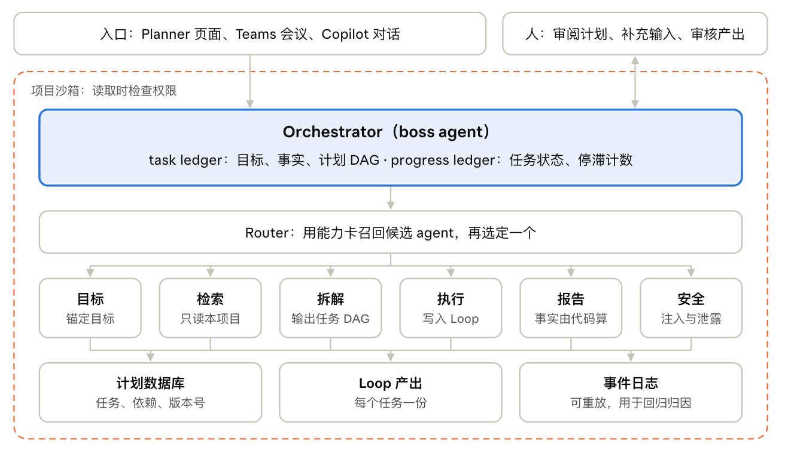
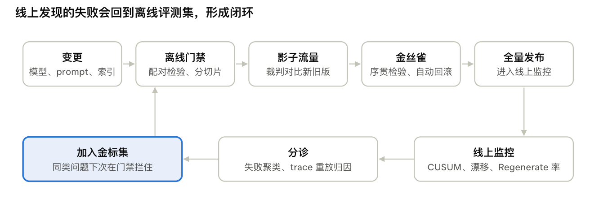

# Research System Design 面试准备：Planner Agent 组

[返回目录](../README.md)

Nov 3, 2026 · @Hz

## 答题框架

Research 向的系统设计题，和工程题的区别在于最后要落到“哪里还没解决、我会怎么做实验”。下面的时间按 45 分钟一题分配；如果是 30 分钟，把第 3 步和第 4 步各压缩一半。

1. 澄清（3 到 5 分钟）：用户是谁、从哪个入口进来、规模和延迟要求、成功怎么衡量、有哪些硬约束（隐私、沙箱、成本）。
2. 基线（3 分钟）：先说最简单的方案，通常是一个 agent 加工具，再说它在哪里会崩。这一步证明你不是为了多 agent 而多 agent。
3. 架构（10 到 15 分钟）：组件、数据流、状态存在哪里、人在哪里介入。边讲边画。
4. 深挖（10 分钟）：挑面试官关心的一到两个难点讲透，而不是每个点都点到为止。
5. 评估与监控（5 到 8 分钟）：离线指标、线上指标、回归门禁。三位面试官里至少有一位一定会问这部分。
6. 研究问题（3 到 5 分钟）：说出一个假设，以及验证它的实验、指标和消融。这一步是 research 岗和工程岗拉开差距的地方。

**每个设计决定都用同一个句式**：我选了 X，放弃了 Y，因为约束 Z；如果 Z 变了，我会改用 Y。

**可以直接用的英文过渡句**

- Before designing, can I check a few assumptions about users and constraints?
- Let me start with the simplest baseline and show where it breaks.
- The hardest part here is X, so let me go deeper there.
- Here is how I would know this works, offline and online.
- The open research question I would want to test is X; the experiment would be Y, measured by Z.

## 题 1：设计 goal→plan→execute 的多 agent 系统

核心设计有三点：orchestrator 把计划状态存在 LLM 之外，按需调用专职 agent，人在三个节点介入。题面大致会是：Design an agent that turns a project goal into a plan and executes tasks alongside humans.

**澄清问题**

- 入口：Planner 页面、Teams 会议、Copilot 对话都要支持吗？
- 规模：一个计划有多少任务？同时有多少个 agent 任务在跑？
- 成功的标准：是计划被采纳，还是 agent 交付的产出被接受？
- 约束：数据是否只能来自项目内部？是否允许访问 web？

**基线及其问题**：一个 agent 配上读 SharePoint、建任务、写 Loop 三个工具。它会在这几个地方出问题：计划一大，上下文就太长；一个 prompt 同时管拆解和写作；无法按步骤限权；任务没法并行；出了错也很难定位是哪一步。

**架构（图见下方）**

1. 入口与会话层：统一接收来自 Planner、Teams 和 Copilot 的请求。
2. Orchestrator：维护 task ledger（目标、已知事实、计划 DAG）和 progress ledger（每个任务的状态、停滞计数）。
3. Router 与 agent 注册表：先召回候选 agent，再选定一个。
4. 专职 agent：目标、检索、拆解、执行、报告、安全。
5. 状态层：计划数据库、Loop 产出、事件日志。
6. 项目沙箱：每个项目一个，每次读取时检查权限。



虚线框是项目沙箱，不碰个人 Copilot 数据；orchestrator 持有计划状态，agent 之间只通过状态层和引用交换信息。

**数据流**

1. 用户给出目标和文件。检索 agent 只在当前项目的 SharePoint 里取资料。
2. 拆解 agent 按 schema 输出任务 DAG。
3. 一段确定性的校验代码检查：DAG 无环（拓扑排序）、依赖都存在、负责人是项目成员、日期晚于其依赖。
4. 用户审阅并修改计划，这是第一个人工节点。
5. 分给 agent 的任务异步执行：执行 agent 按“规划、行动、反思”循环写 Loop。缺信息时返回“需要输入”，这是第二个人工节点。
6. 完成后通知用户审核。评论加 Regenerate 会触发局部重生成，这是第三个人工节点。

**任务 schema**：重点是验收标准（acceptance）字段。有了它，执行 agent 知道何时算完成，验证和评估也有了抓手。

```json
{
  "id": "T7",
  "title": "竞品定价调研",
  "goal_ref": "G1",
  "depends_on": ["T3"],
  "assignee": {"type": "agent", "id": "executor.research"},
  "due": "2026-12-01",
  "inputs": ["sp://site/docs/brainstorm.docx"],
  "acceptance": "表格列出 5 个竞品的价格档位和来源",
  "status": "in_progress",
  "version": 4
}
```

**关键决定**

| 决定             | 选择                             | 理由                     | 什么情况下改                            |
| ---------------- | -------------------------------- | ------------------------ | --------------------------------------- |
| 状态存哪里       | 外部数据库加事件日志             | 长任务可以恢复，可以重放 | 只有单轮对话时可以简化                  |
| 编排模式         | Magentic 型 orchestrator         | 任务开放，需要重规划     | 流程固定的功能（状态报告）用 sequential |
| agent 之间传什么 | 引用加结构化要点                 | 省 token，读取时检查权限 | 小计划可以直接传全文                    |
| 执行方式         | 异步、持久化执行                 | 任务要跑几分钟到几小时   | 秒级任务可以同步                        |
| 人的介入点       | 计划生成后、需要输入时、产出审核 | 对应产品里的三种交互     | 低风险任务可以自动通过                  |

**深挖点**

- 长任务：持久化执行（断点保存与恢复），工具调用幂等，重试不会生成重复任务。
- 人和 agent 并发修改：版本号检查，冲突时人的修改优先。
- 重规划：progress ledger 发现停滞就触发外环改计划；改动较大时先让用户确认。

**研究问题**：假设是“带验收标准的任务，执行 agent 更容易做对，也更容易评估”。实验设计是对两种拆解 prompt 做 A/B，看 agent 任务的首次接受率和 Regenerate 轮数。进一步，可以把用户对计划的修改当作偏好数据，用来改进拆解。

> The orchestrator keeps the plan as an external ledger, so long tasks survive restarts and every step can be replayed. Each task carries an acceptance criterion, which gives the executor a stopping rule and gives us something to evaluate against.

## 题 2：模型升级后怎么保证不变差（回归监控）

这道题问的是：你们要把 agent 里的模型或 prompt 换成新版本，怎么保证它没有变差；上线以后如果变差了，怎么尽快发现。“回归”就是以前做得好的事，改动之后做坏了。题面大致是：We want to upgrade the model behind the agent. How do you make sure nothing gets worse, and how would you catch it in production?



上一行是一次变更要走的路；下一行是线上发现问题后怎么回流，金标集是闭环的落点。

**答题三步**

1. 上线前，在固定测试集上比较新旧版本。测试集（图里的金标集）由三部分组成：真实样例、难例、以前出过错的例子。新旧版本跑同一批输入，用规则检查加 LLM 裁判打分。除了看总分，还要分类看（不同模板、不同语言），因为总分不变时，某一类可能已经变差了。
2. 上线时，先放一小部分流量。比如先给 5% 的用户用新版本，对比两组用户的指标，变差就自动回滚。
3. 上线后，持续盯几个指标：用户点 Regenerate 的比例、点踩比例、报错率、延迟和成本。指标突然变差就告警。然后看出错的例子，找出是哪个 agent 出的问题，修好后把这些例子加回测试集。

**被追问时可以补的两点**

- 输出不确定：同一个输入要跑几次，看平均值和波动，不能只跑一次。
- 怎么找到是哪个 agent 坏了：把出错的运行记录重放，每次只把一个 agent 换回旧版本。哪个换回去以后结果变好，问题就出在哪个。这和 FLARE 先定位、再修复是一个思路。

> Before release, I compare the old and new versions on a fixed test set, broken down by category. Then I ship to a small slice of traffic and roll back if metrics drop. After release, I watch the regenerate rate, thumbs-down rate, errors, latency and cost, and every failure I find goes back into the test set.

## 题 3：设计一个检索系统

题面大致是：How would you design retrieval for the agent? 答题顺序是先问规模，再讲“召回加重排”两阶段，最后讲权限和评估。

1. 先问清楚：文档有多少、更新多频繁、延迟要求多少、有没有权限限制。规模决定后面怎么选。
2. 召回（粗筛，要快）：
   - 数据量大时，先用 BM25 或 TF-IDF 这类稀疏检索。它便宜、快，能精确匹配人名、任务编号这类词。
   - 再加一路向量检索（dense），补上“意思相同、用词不同”的情况。
   - 两路结果用 RRF 按排名合并。数据量小的话，可以只用向量检索。
3. 重排（精排，要准）：对召回的前 50 到 100 个结果，用 cross-encoder 或 LLM 重新打分排序，只保留前几个。
4. 交给模型：去掉重复内容，每段附上来源 ID，方便引用和核对。
5. 权限：只在用户有权限的文档里搜。在 Planner 里就是每个项目一个沙箱。
6. 评估：检索本身看 recall@k 和 nDCG；端到端看回答有没有依据。

**加分点**：像“哪些任务延期了”这种结构化问题，直接查数据库，不走向量检索。

> I would first ask about corpus size, update rate and latency. At scale, I use two stages: cheap sparse retrieval such as BM25 plus dense retrieval, merged with RRF, then a cross-encoder or LLM reranker on the top 100. Search runs only over documents the user can access, and structured questions go to the database instead.

## 题 4：多 agent 之间怎么通信，怎么优化

题面大致是：How should agents in the system talk to each other, and what would you improve? 答题顺序是：先讲现在大家怎么通信，再讲各家的思路，然后指出问题，最后给出你的优化。

**1. 现在的通信方式**

- 框架内部有三种：
  - 共享对话：所有 agent 在同一个群聊里，看同一份消息历史。AutoGen 和 Magentic-One 是这样。
  - 主管派活：orchestrator 给每个 worker 一份独立的任务描述，worker 只回结果，互相看不到。Anthropic 的 Research 系统、OpenAI 的 agents-as-tools 是这样。
  - 转交（handoff）：一个 agent 把整个对话交给另一个 agent 接着做。
- 跨框架、跨公司靠协议：
  - A2A 管 agent 和 agent 之间。每个 agent 发布一张 AgentCard，说明自己能做什么、怎么调用。任务有状态，比如进行中、需要输入、已完成，结果以消息和产物的形式返回，底层是 HTTP、JSON-RPC 和 SSE。它由 Linux 基金会托管，2026 年已发布 1.0。
  - MCP 管 agent 和工具之间，不是 agent 之间的协议。

**2. 各家的思路**

- Anthropic：每个 subagent 有独立的上下文，并行跑。适合以“读”为主的调研任务，代价是 token 用量大约是普通聊天的 15 倍。
- Cognition：要尽量共享完整上下文，因为每个动作背后都有隐含的决策；多个 agent 同时“写”会互相冲突。
- A2A：把 agent 当黑盒，只暴露能力和任务接口，不暴露内部状态。好处是不同厂商可以解耦，也更安全。

**3. 问题在哪**

- 共享全部历史：token 随 agent 数和轮数增长，无关信息还会分散模型的注意力。
- 摘要或剪枝：不可逆，删掉的信息下游再也找不回来。
- 黑盒协议：A2A 只规定怎么传，不管传什么。传什么还是靠人写 prompt 来决定，上下文在交接时容易丢。

**4. 你的优化**

- 每个 agent 不读全部历史，也不读摘要，而是按需从共享历史里取相关的部分。打分时综合相关性、时间衰减和来源衰减。历史完整保留，每次只取一部分，所以信息不会永久丢失。
- 对开源模型，还可以在句子粒度上做 attention steering，把注意力引到选出的内容上。
- 证据：你的论文在五个 benchmark 上最多提升 7.64 个点，agent 数和轮数增加时依然稳定。
- 落到生产：消息里只放引用，接收方按需检索，可以直接叠在 A2A 消息之上。
- 怎么评估：每个任务的 token 和成功率，以及 agent 数从 10 增加到 100 时这两个数怎么变。

> Agents today either share one conversation, get isolated briefs from an orchestrator, or hand off control. Across vendors, A2A standardizes how they talk but not what context they pass. Sharing everything is costly and distracting, and summaries lose information for good. I let each agent retrieve the relevant slice of the full shared history, which kept accuracy stable as agents and rounds grew.

## 可以提的实习研究方向

被问到“如果来实习，你想做什么”时，提前两个就够，并把选择权交给对方。每个方向都能在一段实习期内产出一篇论文加一个可以上线的改进。

| 方向                       | 要解决的问题                      | 你已有的基础      | 实习产出                                       | 主指标               |
| -------------------------- | --------------------------------- | ----------------- | ---------------------------------------------- | -------------------- |
| 长任务里的目标锚定         | 执行 agent 写长文档时偏离任务目标 | ATAR              | 度量目标漂移的评测集；白盒和黑盒两种锚定方法   | 首次接受率、漂移分数 |
| 生产规模的选择性上下文共享 | 42 个以上 agent 之间传什么        | 多 agent 通信论文 | 真实 trace 上的策略对比和接入方案              | 每任务 token、成功率 |
| 评论定位的局部重生成       | 多人评论后整篇重写把好内容改坏    | FLARE             | 编辑局部性指标、局部重生成流水线、偏好数据     | 到接受的轮数         |
| 用变异自动生成回归用例     | 评测集覆盖不到的失败              | LLAMAFUZZ         | 对目标、文档和评论做变异的生成器，接入发布门禁 | 新发现的失败数       |

**推荐的说法**：第一和第三个方向最贴近演示里的产品功能；第四个最贴近做回归监控的面试官。看对方对哪个感兴趣，就沿着哪个往下讲。

> I would pick one of two: goal anchoring for long-running executors, building on ATAR, or comment-localized regeneration, building on FLARE. Both would produce a new metric, a method, and an online A/B test.

## 反问清单

每位面试官问一个和他方向相关的问题，最后再问一个关于实习安排的。

- Agent 编排：The Ignite 2024 demo mentioned a pool of 42 agents on MARS. Has that pool grown or consolidated, and how much of the orchestration moved into Copilot Chat, Work IQ and the Planner MCP server?
- Agent 编排：How does the boss agent decide when to replan versus ask the user for input?
- 回归监控：When you swap a model, which signal catches regressions first, offline judges or online signals like the regenerate rate? How do you keep the judge itself from drifting?
- 回归监控：How do you attribute an end-to-end regression to a single agent?
- 检索：The 2024 design kept project grounding separate from personal Copilot data. Now that Planner Agent is backed by Work IQ, which has personal memory, how is the project sandbox preserved?
- 检索：Do agents and people use the same retrieval stack, or does the agent path optimize for evidence completeness?
- 实习：What would a successful internship look like, a paper, a shipped improvement, or both?

## Sources

- Ignite 2024 BRK285 文字稿（你上传的文件）：boss agent、42 个 agent 的池子、MARS、项目沙箱、评论加 Regenerate、状态报告的语气控制
- [Unleashing the power of agents in Microsoft Planner（Planner Blog）](https://techcommunity.microsoft.com/blog/plannerblog/unleashing-the-power-of-agents-in-microsoft-planner/4304794)
- [Bringing AI assistance to basic plans（Planner Blog，2026 年 3 月）](https://techcommunity.microsoft.com/blog/plannerblog/bringing-ai-assistance-to-basic-plans-in-microsoft-planner/4500074)
- [Planner, Copilot and Agents: AI Assisted Projects with Work IQ（2026 年 4 月讲稿）](https://adoption.microsoft.com/files/microsoft-365-community-conference/2026/pdf/MS13%20-%20Planner,%20Copilot%20and%20Agents_%20AI%20Assisted%20Projects%20with%20Work%20IQ.pdf)
- [Microsoft Agent Framework 编排模式（Microsoft Learn）](https://learn.microsoft.com/en-ca/agent-framework/workflows/orchestrations)
- [Magentic-One（AutoGen 文档）](https://microsoft.github.io/autogen/stable/user-guide/agentchat-user-guide/magentic-one.html)
