# 第一部分：机器学习八股文

[返回目录](../README.md)

## Machine Learning

### ML 基础概念

#### 1. Overfitting / Underfitting

**过拟合**指模型与数据的匹配程度过高，将训练数据一些正常的起伏、波动、异常值也当作是数据的特征，导致模型对新数据的泛化能力变差。具体的表现为在训练集上表现非常优秀，而在验证集/测试集中表现非常差。
 - 解决过拟合的方法一般有：1) 适量减少特征的数量；2) 添加**正则化项**(Regularization)。正则化，顾名思义，目的是为了降低特征对于预测结果的影响能力。常见的正则化项有L1正则项和L2正则项。详见正则化。

 **欠拟合**与过拟合相反，指的是模型缺乏足够的泛化能力。
 - 解决欠拟合的方法有：1) 增加训练轮数；2) 增加模型特征；3) 减少正则项。

#### 2. Bias / Variance trade-off

 偏差(Bias)指模型预测结果与真实值的差异程度，描述了模型的拟合能力；方差(Varience)指模型面对不同数据集时的差异程度，描述了数据扰动对模型的影响。
 一般来说，越简单模型的偏差越高，方差越低；越复杂模型的偏差越低，方差越高。这同样也对应着模型的过拟合与欠拟合。

 权衡偏差与方差的常见方法有**交叉认证**(Cross-Validation)。K折交叉验证的基本方法为：将训练集平均分为$k$份，每次训练取其中一份作为验证集，剩下$k-1$份作为训练集，重复$k$次，直到每一份小数据集都被作为过验证集。最终的损失为$k$次训练的损失取平均。

### 正则化 Regularization

#### 1. L1 vs L2

 - L1正则化，又称**LASSO**、L1范数，是所有参数的绝对值之和。
     $$
         \lVert x \lVert_1=\sum_{i=1}^m\lvert x_i \lvert
     $$

 - L2正则化，又称**Ridge**，岭回归，是所有参数的平方和的平方根。

     $$
         \lVert x \lVert_2=\sqrt{\sum_{i=1}^m x_i^2}
     $$

 - 两种范数都有助于降低过拟合风险。L1范数可以用于**特征选择**，但不能直接求导，因此不能使用常规的梯度下降法/牛顿法等进行优化（常见方法有坐标轴下降法和 Lasso 回归法）；L2范数方便求导。

#### 2. L1范数的稀疏性 / 为何L1正则化可以用于特征选择？

 L1范数相比于L2范数，更容易得到**稀疏解**，即L1范数可以将不重要的特征参数优化至**0**.

 - 如何理解？
 > 假设损失函数 $L$ 与某个参数 $x$ 的关系如下图所示：此时最优点位于红色点处，$x<0$.
 >
 > 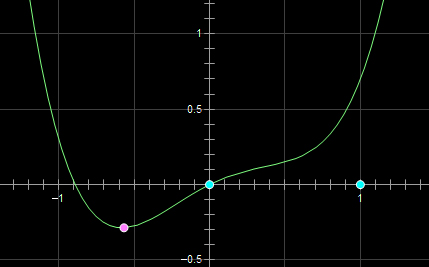
 >
 > 这时施加 L2 正则化，新的损失函数 $(L+Cx^2)$ 如下图黄线所示，可以看到最优的 $x$ 在蓝点处，$x$ 的绝对值减小了，但依然非零。
 >
 > 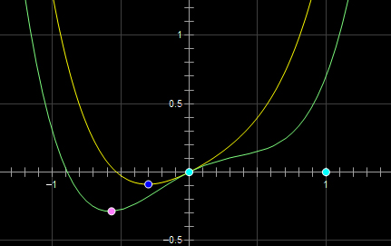
 >
 > 而如果施加 L1 正则化，则新的损失函数 $(L+C\lvert x \lvert)$ 如下图绿线所示，最优的 $x$ 就变成了 0。
 >
 > 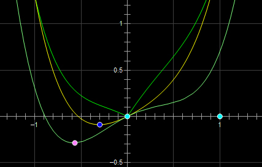
 >
 > 略加推导可以得到，当施加 L2 正则化时，当且仅当损失函数原本的导数为 0 时，损失函数才会在 $x=0$ 处极小；而施加 L1 正则化时，参数 $C$ 与损失函数的导数仅需满足 $C>\lvert L \lvert$ 的关系，$x=0$ 便会成为损失函数的一个极小值点。
 >
 > 上面只分析了一个参数 $x$。事实上 L1 正则化会使得许多参数的最优值变成 0，使得模型变得稀疏。利用这样的特性，我们便可以使用L1正则化来帮助筛选特征。

### 机器学习中的评估指标 Metrics

#### 1. ROC 曲线 / AUC 面积

 ROC 曲线(Receiver Operating Characteristic)与 AUC (Area Under ROC Curve)是面对**不平衡分类问题**时最常用的评估指标。要了解 ROC 是什么，首先我们根据混淆矩阵再定义两个指标：True Positive Rate(TPR) 以及 False Positive Rate(FPR).

 $$
     TPR = R = \frac{TP}{TP+FN}, \qquad
     FPR = \frac{FP}{TN+FP},
 $$
 正常来说，一个好的模型应该满足高 TPR 和低 FPR。对于任意一个训练好的模型，在给定测试数据上我们都能计算出它的 TPR 和 FPR。以 FPR 为横坐标，TPR 为纵坐标，我们可以将任意模型的一对 (FPR, TPR) 画在该坐标图中，如下图所示。同时我们将由该坐标轴构成的空间称为 ROC 空间。图1中假设有 A、B、C、D、E 共计五个模型。在 ROC 空间中，模型越靠近左上角，表明模型效果越好。

 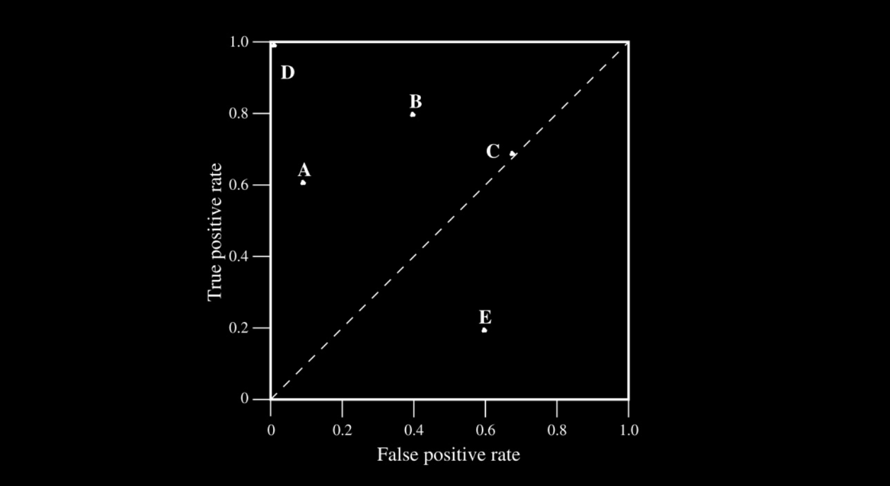

 在二分类问题的大多数情况中（尤其是神经网络中），我们判定一个样本是正类和负类的依据是设置一个阈值，超过该阈值的样本被标记为正类，反之则为负类。一般而言，这个阈值被设置为0.5。那么如果我们尝试使用不同的阈值来划分正负类，我们就能得到多组 (FPR, TPR)。我们可以根据这些坐标近似地在 ROC 空间中画出一条曲线，即 **ROC 曲线**。只要 (FPR, TPR) 点足够多，我们可以计算出曲线下的面积，即 **AUC面积**，如下图所示。

 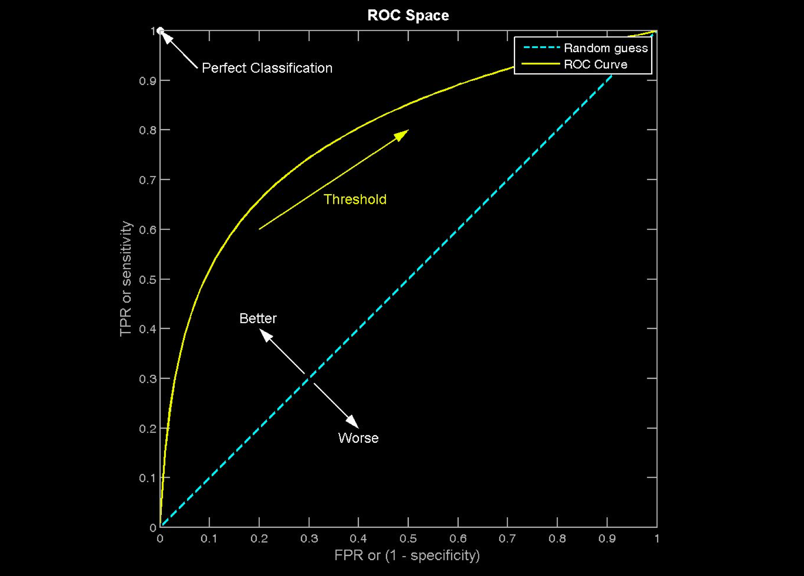

### Loss与优化

#### 1. 凸优化问题

 对于一个优化问题，如果其目标函数是**凸函数**，且可行域是**凸集**（集合中任意两点连线上的任意点都在集合内），那么它就是一个凸优化问题。

 定义域 $\mathbb{D}$ 是一个凸集的函数 $f$ 是凸函数，当且仅当对于任意的 $x,y \in \mathbb{D}$ 和 $\theta \in [0,1]$，都有：

 $$
     f(\theta x+(1-\theta)y) \le \theta f(x)+(1-\theta) f(y)
 $$

 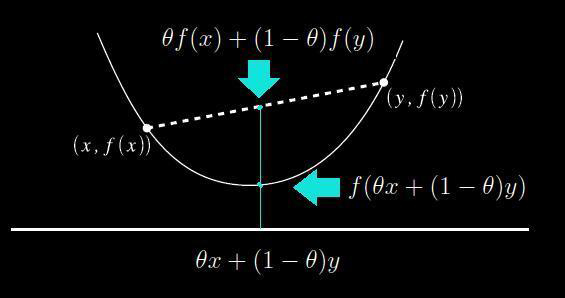

 数学中强调凸优化问题的重要性，在于凸优化问题的**局部最优解**必然也是其**全局最优解**。这个特性使得我们可以使用贪心算法、梯度下降法、牛顿法等方法来求解凸优化问题。事实上，我们求解许多非凸优化问题，也是通过将其拆解为若干个凸优化问题，再分别进行求解。

#### 2. MSE / MSELoss

 均方误差 (Mean Square Error, MSE)，是回归任务中最常见的度量指标。

 $$
     E(f;D)=\sum_{i=1}^m (f(x_i) - y_i)^2
 $$

#### 3. 以 MSELoss 为损失函数的逻辑回归是凸优化问题吗？

 **不是**。逻辑回归将线性模型通过 sigmoid 非线性函数映射为分类问题，其 MSE 是一个非凸函数，优化时可能得到局部最优解而得不到全局最优解，所以以 MSELoss 为损失函数的逻辑回归不是凸优化问题。

#### 4. 线性回归，最小二乘法与最大似然估计的关系？

 求解线性回归常用的方法有**最小二乘法 (OLS)**和**最大似然估计 (MLE)**。

 - 最小二乘法以预测值和真实值的平方和作为损失函数 (MSELoss)。

     $$
         J(w)=\sum_{i=1}^m (h_w(x_i) - y_i)^2
     $$

 - 最大似然估计在已知 $x$ 与 $y$ 的情况下，以**概率最大**的角度，估计模型可能性最大的参数 $h_w$。设误差 $\epsilon_i = y_i - h_w(x_i)$， 由于 $\epsilon_i$ 符合高斯分布，可得概率密度函数：

     $$
         p(\epsilon_i) = \frac{1}{\sigma \sqrt{2\pi}} e^{-\frac{(\epsilon_i)^2}{2\sigma^2}}
     $$

     将 $\epsilon_i = y_i - h_w(x_i)$ 代入，可得：

     $$
         p(y_i | h_w(x_i)) = \frac{1}{\sigma \sqrt{2\pi}} e^{-\frac{(y_i - h_w(x_i))^2}{2\sigma^2}}
     $$

     则似然函数公式如下：

     $$
         \begin{aligned}
             L(h_w(x_i)) &= \prod_{i=1}^m p(y_i | h_w(x_i))\\
             &= \prod_{i=1}^m \frac{1}{\sigma \sqrt{2\pi}} e^{-\frac{(y_i - h_w(x_i))^2}{2\sigma^2}} \\
         \end{aligned}
     $$

     等号两边取对数，不影响函数的极值点。

     $$
         \begin{aligned}
             \log L(h_w(x_i)) &= \sum_{i=1}^m \log \frac{1}{\sigma \sqrt{2\pi}} e^{-\frac{(y_i - h_w(x_i))^2}{2\sigma^2}}\\
             &= m \log \frac{1}{\sigma \sqrt{2\pi}} - \frac{1}{2\sigma^2} \sum_{i=1}^m (y_i - h_w(x_i))^2
         \end{aligned}
     $$

     我们知道 $h_w(x)$ 是关于权重 $w$ 的函数，不妨设为 $l(w)$。因此有：

     $$
         \begin{aligned}
             l(w) = m \log \frac{1}{\sigma \sqrt{2\pi}} - \frac{1}{2\sigma^2} \sum_{i=1}^m (y_i - h_w(x_i))^2
         \end{aligned}
     $$

     去除前面的常数项和常数系数，可以看到与最小二乘法的的公式一致，之后求解过程同最小二乘法。因此得出结论，最小二乘法与最大似然估计从两个不同的角度出发，得到一致的结果。

#### 5. 相对熵与交叉熵 Ralative-Entropy / Cross-Entropy

 我们常用**信息量**来量化数据中的信息。设事件 $x_0$ 发生的概率为 $p(x_0)$，则其信息量为：

 $$
     I(x_0) = -\log p(x_0)
 $$

 **熵** (Entropy) 被用来度量一个系统的混乱程度，代表一个系统中所有事件信息量的期望。熵越大，该系统的不确定性也越大。

 $$
     H(X) = -\sum_{x \in X}p(x_i) \log p(x_i)
 $$

 **相对熵** (Ralative Entropy)，又称 **KL 散度** (Kullback-Leibler Divergence)，是两个随机分布 $p$ 与 $q$ 之间的对数差值的期望。
 $$
     D_{KL}(p||q)=\sum_{x\in X} p(x)\log\frac{p(x)}{q(x)}=-\sum_{x\in X} p(x)[\log q(x) - \log p(x)]
 $$

 **交叉熵** (Cross-Entropy)，与 KL 散度类似，是两个随机分布 $p$ 与 $q$ 之间距离的另一种度量。

 $$
     CEH(p,q)=−\sum_{x \in X}p(x)logq(x)
 $$

 > **为何在机器学习中常使用交叉熵而不是 KL 散度作为损失函数？**
 >
 > 可以看到，相对熵、交叉熵之间存在以下关系：
 >
 >    $$
 >       D_{KL}(p||q) = CEH(p,q) - H(p)
 >    $$
 >
 > 在机器学习中，可以将 $p$ 看作真实分布，$q$ 为预测分布。则当 $p$ 的分布已知时，$H(p)$ 为常数，交叉熵与 KL 散度等价。

 ***在分类问题中***，常使用交叉熵作为损失函数，公式表达如下：

 * 二分类问题中，交叉熵损失函数为:
     $$
         L = -\frac{1}{N} \sum_i [y_i \log(p_i) + (1 - y_i) \log (1 - p_i)]
     $$
 * 多分类问题中，交叉熵损失函数为：
     $$
         L = -\frac{1}{N} \sum_i \sum_c^M [y_{ic} \log (p_{ic})]
     $$
     其中，$M$ 为类别数量。

### 朴素贝叶斯 Naive Bayes

#### 1. Generative Model vs Discriminative Model 生成模型 / 判别模型

 生成模型通过学习联合概率 $P(X,Y)$，即特征 $x$ 与类别 $y$ 同时出现的概率，再对每一个类别求条件概率，取概率最大的类别作为预测结果，即 $P(Y|X) = \frac{P(X,Y)}{P(X)}$。
  - 生成模型能学习到更多信息，如每个特征的边缘分布 $p(x)$；
  - 生成模型收敛速度快，且对小规模数据或稀疏数据表现较好；
  - 生成模型不容易出现过拟合现象；
  - 生成模型的效果一般没有判别模型好。

 判别模型则是通过学习条件概率，即直接预测特征 $x$ 下类别 $y$ 的概率。
  - 判别模型的分类边界更加灵活，能够拟合更加复杂的边界；
  - 只用学习分类的信息，问题得到简化；
  - 准确率普遍较生成模型较高。

### 支持向量机 Support Vector Machine, SVM

#### 1. SVM 的核心思想？

 SVM 是定义在特征空间中的线性分类器，目标是使得分隔超平面两边的数据点离超平面的**间隔最大**。当数据线性可分时，可以通过**硬间隔最大化**来学习一个线性的超平面；当数据近似线性可分时，则可以通过加上一个松弛变量，通过**软间隔最大化**来学习超平面；当线性不可分时，也可以使用核函数，将输入空间映射到高维的特征空间。

#### 2. 硬间隔最大化

 首先定义超平面 $(w,b)$ 关于样本点 $(x_i,y_i)$ 的**函数间隔**为 $\hat{\gamma}_i=y_i(wx_i+b)$ 但是，如果成比例地改变 $w$ 和 $b$ 的值，函数间隔会发生改变，但其超平面并没有变。为了解决这个问题，引入**几何间隔**为超平面与样本点的直线距离 $\gamma_i=y_i(\frac{w}{||w||}x_i+\frac{b}{||w||})$。硬间隔最大化的优化目标就是找到合适的超平面 $(w,b)$，使得点到超平面的间隔最大，即：
 $$
     \max_{w,b} \gamma, \text{s.t.,} y_i(\frac{w}{||w||}x_i+\frac{b}{||w||}) \geq \gamma, i=1,2,...,N
 $$
 我们可以将这个优化问题转化为：
 $$
     \min_{w,b} \frac{1}{2}||w||^2, \text{s.t.,} y_i(wx_i+b)-1 \geq 0,i=1,2,...,N
 $$
 可以使用拉格朗日乘子将该问题转换为对偶问题，这样可以便于求解：
 $$
     \min_\alpha \frac{1}{2}\sum_i^N \sum_j^N \alpha_i \alpha_j y_iy_j(x_i\cdot x_j)-\sum_i^N \alpha_i, \text{s.t.,} \sum_i^N \alpha_i y_i=0, \alpha_i \geq 0,i=1,2,...,N
 $$
 转换为对偶问题还可以便于引入**核技巧**来解决非线性问题，即将内积 $(x_i\cdot x_j)$ 用核函数 $K(x_i,x_j)=\phi(x_i)\cdot\phi(x_j)$ 来代替。

#### 3. 软间隔最大化

 在现实中数据并不可能总是线性可分（可能存在噪音点、离群点等脏数据），线性不可分意味着有些样本点 $(x_i,y_i)$ 不能满足函数间隔大于 1 的约束条件。为了使得模型更加鲁棒，我们需要将硬间隔转换为软间隔。对于每一个样本点，我们引进一个松弛变量 $\xi_i$，使得函数间隔加上松弛变量大于 1，即 $y_i(wx_i+b)\geq1-\xi_i$。

 同时，添加一个惩罚参数 $C$，目标函数变为 $\frac{1}{2}||w||^2 + C\sum_i^N \xi_i$。惩罚参数的添加是使得**函数间隔尽可能大，而误分类点尽可能少**，惩罚参数是调和二者的系数。当 $\xi_i = 0$ 时，样本点在间隔之外；当 $0 <\xi_i < 1$ 时，分类正确，样本点在超平面与间隔边界之间；当 $\xi_i > 1$ 时，样本点被误分。

#### 4. Hinge Loss 合页损失函数

 Hinge Loss 的图像如图所示，横轴是函数间隔 $\hat{\gamma}_i=y_i(wx_i+b)$，当间隔 $\hat{\gamma}_i\geq 1$ 时，表示正确分类，损失值为 0；当间隔 $\hat{\gamma}_i < 0$ 时分类错误；当间隔 $0 < \hat{\gamma}_i < 1$ 时，分类正确，但样本点在间隔边界与超平面之间。Hinge Loss 对这样的样本点也会进行惩罚，提高了样本点的利用率，这使得 SVM 对训练样本数的依赖大大减少。

 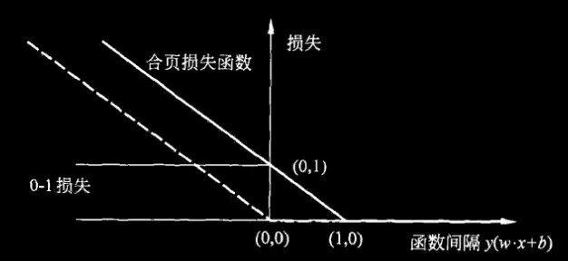

### 什么是线性回归？

线性回归是一种基础的预测模型，它假设目标变量（真实值）可以通过输入特征的**线性组合**来解释和预测。简单来说，它试图在数据点中找到一条“最佳拟合线”（或高维空间中的平面），使得所有的点到这条线的误差最小。

$$y = X\beta + \epsilon$$

- **$y$**：真实值（目标变量）。
- **$X$**：特征矩阵（包含所有的输入特征，通常第一列全为1用来吸收截距）。
- **$\beta$**：待估计的系数向量（即特征的权重）。
- **$\epsilon$**：随机噪声（特征未能解释的部分）。

**一句话理解：真实值 = 特征的线性组合 + 噪声。**

### 如何找到“最佳拟合”？（OLS 最小二乘法）

为了找到最合适的参数 $\beta$，线性回归通常使用 **普通最小二乘法（OLS, Ordinary Least Squares）**。它的目标是让所有预测值与真实值之间的“残差平方和”最小化：

$$\hat{\beta} = \arg\min_{\beta} \Vert{}y - X\beta\Vert{}_2^2$$

把误差平方有两个主要好处：

1. 正负误差不会互相抵消。
2. 对较大的误差会给予更重的惩罚。

如果矩阵 $X^\top X$ 可逆，该问题有一个优美的闭式解（解析解）：

$$\hat{\beta} = (X^\top X)^{-1}X^\top y$$

*几何意义：这相当于把真实的 $y$ 投影到特征 $X$ 张成的空间里，使得残差与预测平面垂直，意味着“特征里再也榨不出更多信息了”。*

### 逻辑回归 Logistic Regression, LR

#### 1. 逻辑回归的核心思想？

 逻辑回归主要用于分类问题，对于所给数据集，认为可以用一条直线将数据线性分类。逻辑回归与线性回归的最主要区别在于逻辑回归主要关注于分类概率与输入向量的关系，即 $P(Y=1)$ 与 $x$ 的直接关系，然后通过概率值来判断是否属于某一类别。

 逻辑回归主要考虑二分类问题。给定数据集：

 $$
     D=(x_1,y_1), (x_2,y_2),...,(x_N,y_N), x_i\in R^n
 $$

 由于 $w^T x+b$取值连续，因此可以用它来拟合条件概率 $p(Y=1|x)$. 最理想的函数其实是：

 $$
     p(Y=1|x)=
     \begin{cases}
         0, & z < 0\\
         0.5, & z = 0 \\
         1, & z > 0
     \end{cases}
     , z = w^T x + b
 $$

 但是，这个函数不可微，因此，我们使用 sigmoid 函数来拟合概率：

 $$
     y=\frac{1}{1+e^z}, z=w^T x + b
 $$

 将 $y$ 视为类后验概率估计，则重写公式有：

 $$
     P(Y=1|x)=\frac{1}{1+e^z}, z=w^T x + b,\\
 $$

 $$
     z = \ln\frac{P(Y=1|x)}{1-P(Y=1|x)}
 $$

 因此，逻辑回归实际上是**使用线性回归模型的预测值来逼近分类任务的对数几率**，其优点有：

 - 不仅能够预测出类别，还能预测出属于该类别的概率，对于一些需要预测概率的任务很适用；
 - 对数几率函数在任意阶都是**连续可导的凸函数**，因此可以使用许多优化算法求解。

给定 $x_i$，假设 $Y_i\sim\operatorname{Bernoulli}(p_i)$，$p_i=\sigma(w^\top x_i+b)$。独立样本的 likelihood 是：

$$
L(w,b)=\prod_i p_i^{y_i}(1-p_i)^{1-y_i}.
$$

取负对数得到 LOSS-5。再利用 sigmoid，可将单样本 loss 写成：

$$
\ell_i(z_i)=\log(1+e^{z_i})-y_i z_i.
$$

合并截距到特征中后，梯度与 Hessian 为：

$$
\nabla_w\mathcal L=X^\top(p-y),\qquad
\nabla_w^2\mathcal L=X^\top RX,
\quad R_{ii}=p_i(1-p_i)\ge0.
$$

对任意 $v$，$v^\top X^\top RXv=\sum_iR_{ii}(x_i^\top v)^2\ge0$，因此 loss 对参数凸。凸不代表一定有有限、唯一的 MLE：完全可分数据下，无正则化系数可能发散。

#### 2. 逻辑回归的损失函数与梯度

 设：$P(Y=1|x) = p(x), P(Y=0|x) = 1 - p(x)$，则似然函数可以写为：

 $$L(w) = \prod[p(x_i)]^{y_i}[1-p(x_i)]^{1-y_i}$$

 为了方便求解，一般取对数似然函数：

 $$
 \begin{aligned}
     l(w) = \ln L(w) & = \sum[y_i\ln p(x_i) + (1-y_i)\ln (1-p(x_i))] \\
     & = \sum[y_i\ln\frac{p(x_i)}{1-p(x_i)} + \ln(1-p(x_i))] \\
     & = \sum[y_i z_i - \ln(1 + e^{z_i})]
 \end{aligned}
 $$

 使用梯度下降法求解时，取似然函数的**相反值**进行优化，求其梯度为：

 $$
 \begin{aligned}
     \frac{\partial J(w)}{\partial w_j} & = -\sum_i \frac{\partial [y_i z_i - \ln(1 + e^{z_i})]}{\partial z_i} \cdot \frac{\partial z_i}{\partial w_j} \\
     & = -\sum_i (y_i - p(x_i)) \cdot x_j
 \end{aligned}
 $$

 权重更新为：

 $$w_j := w_j + \eta(\sum_i (y_i - p(x_i)) \cdot x_j),\text{ for }i\text{ in range}(n)$$

#### 3. 与 SVM 的区别？

 - 同样是更加关注于分类边界附近的数据点，不同之处在于，LR 通过非线性映射减小离分类平面远的数据点的权重，提升离分类平面近的数据点的权重；而 SVM 则是完全只关注于分类错误的点以及靠近分类平面的数据点，而不关注那些离分类平面较远的普通样本。
 - LR 是参数模型，而 SVM 是非参数模型。参数模型的前提是假设数据符合某种分布（如 LR 假设数据服从伯努利分布），该分布由一些参数决定。依赖数据分布会使得 LR 模型在样本不均衡时影响分类效果；而非参数模型不直接依赖于分布。
 - LR 能够产生概率，而 SVM 不能直接产生概率。

### 决策树 Decision Tree

#### 1. 什么是决策树？

 决策树以树状的结构对数据特征进行分类。建立一棵树，树上的每一个节点都是一个决策的判断，记为**分支**。将数据输入决策树，当在某节点数据不再分裂，则形成一个叶子节点，完成最终的分类。

#### 2. 如何确定分类的指标？

 简要来说，我们在每次选择划分特征时，都会选择**对分类最有帮助**的特征来作为接下来的划分特征。具体来说，我们通过计算特征的**熵**来评价特征的重要程度。
 **熵** (Entropy) 被用来度量一个系统的混乱程度，代表一个系统中所有事件信息量的期望。
 $$
     H(X) = -\sum_{x \in X}p(x_i) \log p(x_i)
 $$
 $$
     H(X|A) = -\sum_{i=1}^d p(A=a_i)H(X|A=a_i)
 $$
 熵越大，该系统的不确定性也越大。构造树的基本思想时随着树深度的增加，节点的熵迅速降低。熵降低的速度越快越好，以便生成一个高度尽可能**矮**的决策树。

 首先，我们根据分类的 label，计算不选择任何特征时，系统的熵值 $H(D)$。随后，我们分别计算考虑了各个特征之后，系统的熵值。我们计算每个特征的**信息增益** $Gain(D|A) = H(D) - H(D|A)$，并选择信息增益最大的特征作为新节点的划分特征。

#### 3. 决策树的分类

 - ID3。使用**信息增益**作为特征选择的评估方式。缺点主要是：当遇到稀疏特征时（如用户 ID），由于每项特征的样本比较少，可能会出现信息增益特别大的情况，导致决策树错误选择该稀疏特征作为划分特征。通常来说，ID3决策树偏向选择那些取值较多的特征属性。
 - C4.5。使用**信息增益率**作为特征选择的评估方式。信息增益率计算方式如下：
     $$
         GainRatio(D|A) = \frac{Gain(D|A)}{H(A)} = \frac{H(D)-H(D|A)}{H(A)}
     $$
     然而，信息增益率偏向选择取值较少的特征。因此，C4.5决策树会选择信息增益大于平均水平的特征来进行信息增益率的计算。此外，C4.5相对于ID3决策树，增加了对连续值和缺失值的处理过程。
 - CART。对于分类问题，CART 决策树使用 **Gini 系数**作为评估标准；而对于回归问题，CART 决策树使用 **MSE** 作为评估标准。公式如下：
     $$
         Gini(X) = \sum_{x\in X} p(x_i)(1-p(x_i))
     $$
     $$
         Gini(X|A) = \sum_{i=1}^d p(A=a_i) Gini(X|A=a_i)
     $$

#### 4. 随机森林 Random Forest, RF

 使用 **Bagging 算法**，即有放回采样地选取 $n$ 个样本，建立 $m$ 个决策树分类器。多个分类器采用**投票机制**来产生最终的分类结果。
 随机森林的“随机”有两重含义：
 - 样本随机选择，即 $n < \lVert D\rVert$，在每个决策树中选择一部分样本，有利于增加模型对离群点、噪音点的鲁棒性。
 - 特征随机选择，每个决策树中只挑选一部分特征进行分类，有利于筛选不重要的特征或无效的特征。

### XGBoost

#### 1. Boosting 思想

 当每个弱分类器的分类效果不理想时，我们可以尝试将多个不同的弱分类器组合起来，形成效果更好的强分类器。Boosting 着重于减小模型的 **bias**。Boosting 与 Bagging 的区别如下：
 - 样本选择上，Bagging 在每次训练中是通过 Bootstrap 有放回选取不同的数据，每轮训练的数据集是独立的；Boosting 中每轮的训练集不变，只是训练集中每个样本的权重在训练中发生变化，样本的权重根据上一轮的分类结果进行调整。
 - 模型预测上，Bagging 中每个模型的权重相等，通过投票或取均值的方式进行结合；Boosting 中每个弱分类器都有对应的权重，对于分类误差小的分类器分配更大的权重。
 - 计算方式上，Bagging 的各个模型可以并行训练；Boosting 中每个模型只能串行训练，因为后一个模型的样本权重需要通过上一轮的训练结果来调整。
 - *Bagging 着重于减小模型的 Variance；Boosting 着重于减小模型的 bias。*

 > **为何说 Bagging 是减小 Variance，Bagging 是减小 bias？**
 >
 > 在 Bagging 中，对样本重采样，每个子样本训练一个强（甚至过强）模型，最后取平均。由于子样本之间的相似程度高，多个模型的类型、结构与分布也非常相似，故多个模型有着近似的效果。而经过 Bagging 后，可以有效减小子模型的过拟合情况，因此可以显著降低模型的 Variance。
 > 在 Boosting 中，把许多个弱分类器组合成一个强的分类器，着重于提高弱模型的性能，即着重降低模型的 bias。而 Variance 则不在 Boosting 的考虑范围之内。在 Boosting 中，多个模型有着同样的优化目标，并且通过在每一轮中的不断优化，能够达到降低 bias 的目的。
 >

#### 2. XGBoost 基本原理

 在第 $t$ 轮训练中，在**保留前 $t-1$ 轮训练结果**的前提下，加入一棵树 $f_t$，使得目标函数**尽可能地降低**。用公式表达如下：
 $$
     \begin{aligned}
         Obj_t & = \sum_{i=1}^n l(y_i, \hat{y}_i^t) \\
         & = \sum_{i=1}^n l(y_i, \hat{y}_i^{t-1} + f_t(x_i)) \\
     \end{aligned}
 $$
 设损失函数为 MSE，则原目标函数写为：
 $$
     \begin{aligned}
         Obj_t &= \sum_{i=1}^n (y_i - (\hat{y}_i^{t-1} + f_t(x_i)))^2 \\
         & = \sum_{i=1}^n[2(\hat{y}_i^{t-1} - y_i)f_t(x_i)+f_t(x_i)^2] + \sum_{i=1}^n ({y_i - \hat{y}_i^{t-1}})^2
     \end{aligned}
 $$
 其中，$\sum_{i=1}^n ({y_i - \hat{y}_i^{t-1}})^2$ 与本轮无关，可以视为常数，$(\hat{y}_i^{t-1} - y_i)$ 一般被叫做**残差**，表示了上一轮预测值与真实值之间的差异，也是 XGBoost 算法在每一轮中预测的主要目标。即，将上一轮的训练结果看作一个整体，而新的一轮则对残差值进行预测。

 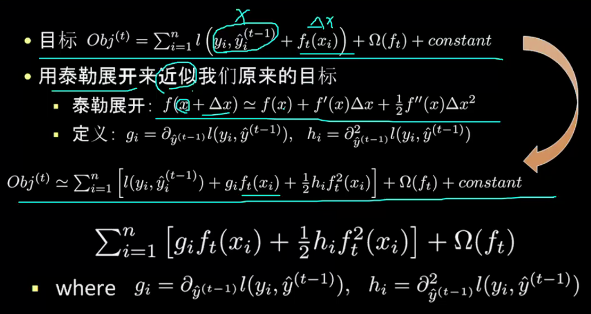

 此外，XGBoost 在每个叶子节点上都增加了正则化项 $\Omega(f_t) = \gamma T + \lambda\frac{1}{2}\sum^T_{j=1} w_j^2$，其中，$T$ 代表叶子节点数量，$\lambda\frac{1}{2}\sum^T_{j=1} w_j^2$ 为 L2 正则化项。

## Deep Learning

### DL 基础概念

#### 1. 为什么神经网络需要偏置项？

 对于神经网络中的每一个神经元，都有 $y_i = W^TX_i + b$。这个式子本质上就是要用这个函数在空间中划分决策面。而如果没有偏置项，那么划分的超平面就只能经过原点。偏置项的加入使得神经网络的拟合更加灵活，如果没有偏置项，训练可能难以收敛或出现其他 bug。

 > **在所有场合都可以使用偏置项吗？**
 >
 > 不是。例如在卷积层之后，如果要添加 Batch Normalization 层，最好不添加偏置项，因为不起作用，且会占用显卡内存。
 >
 > 在 BN 中，有一步关键操作为：
 >
 > $$
 >       \hat{x_i} = \frac{x_i - \mu_\mathcal{B}}{\sqrt{\sigma^2_{\mathcal{B}} + \epsilon}}
 > $$
 >
 > 其中，$\mu_\mathcal{B}$ 为均值，$\sigma^2_{\mathcal{B}}$ 为方差。在该操作中，偏置项在计算中会被抵消掉，故偏置项不起作用。

#### 2. Back Propagation

 BP 神经网络是由一个输入层、一个输出层和若干个隐藏层构成的。输入信号从输入层进入，经过隐藏层计算，并由输出层输出。将输出的结果和真实值进行比对得到训练的误差。该误差沿着输出层，经过隐藏层，最终传播到输入层的权值参数。由于误差传播方向和训练方向相反，故称“反向传播”。

 反向传播是为了解决神经网络无法直接应用梯度下降法的问题。由于梯度下降法只能用于“能够通过得到误差”的情况，例如逻辑回归。但隐藏层并不存在所谓“误差”，因此只能通过先将误差反向传播到隐藏层，应用链式法则得到求导函数，再使用梯度下降法进行优化。反向传播算法可以看作是梯度下降法在链式法则（Chain Rule）中的应用。

#### 3. 梯度消失和梯度爆炸问题

 在反向传播的梯度更新中，若更新的梯度一直小于 0，就可能触发连乘效应，在之后的传播中越传越小，导致靠近输入层的权值几乎不更新，训练收敛速度变慢，这便是**梯度消失**。与之相反，若梯度过大则会触发**梯度爆炸**，以致于溢出，出现梯度为 NaN 的问题。

 > 当激活函数为 Sigmoid 时，容易触发梯度消失问题。因为 Sigmoid 函数的导数最大值只有 0.25，如图所示。
 >
 > 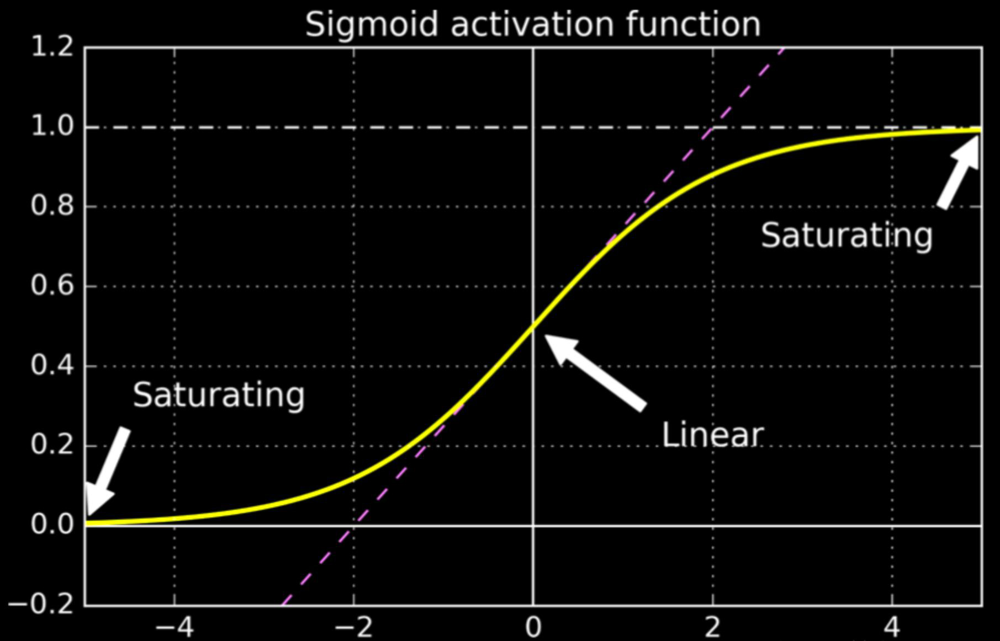

 常见的缓解梯度消失 / 梯度爆炸的方法有：
 - 使用其他**激活函数**，如ReLU等；
 - 用更合理的**权值初始化**方式，如 Xavier 初始化，He 初始化。这两种初始化方法都能保证在传播时权值的方差不变。
 - **Batch Normalization**. 梯度的更新与 $x$ 的值也有关系，因此用 BN 限制 $x$ 的分布也有利于缓解梯度消失 / 梯度爆炸问题；
 - 对权重进行**正则化**（L1、L2）；
 - 使用 **ResNet 网络**。ResNet 通过添加 Shortcut Connections，使得层与层之间可以跨层连接，减少了梯度消失 / 梯度爆炸的问题。
 - 通过**梯度截断**（Gradient Truncation）手动防止梯度爆炸。

#### 4. 能不能将神经网络的所有权值都初始化为 0？

 不能。事实上，不能将神经网络的所有权值都设置为同一值。否则，在神经网络的更新中，两权值的更新将一模一样。多个相同的神经元相当于只有一个神经元，会使得神经网络无法拟合。

 因此，一般我们选择随机初始化，或是使用其他初始化方法，如 Xavier 初始化，He 初始化。这两种初始化方法都能保证在传播时权值的方差不变。

#### 5. 在深度学习中缓解过拟合问题

 深度学习中防止过拟合常见的方法有：

 - 获取更多、质量更高的数据
   - 采集新的数据
   - 数据增强（图片镜像、翻转等）
   - 利用对抗网络生成数据
 - 正则化（L1、L2）
 - Dropout
 - Early Stopping
 - 集成学习，如 Bagging、Boosting 等。

#### 6. Dropout 是什么？

 Dropout 是在每次训练过程中都随机舍弃一些神经元之间的连接。这样做可以降低对部分上层神经元的依赖关系，迫使模型去学习一些更具有鲁棒性的特征，使得模型泛化能力更强。

 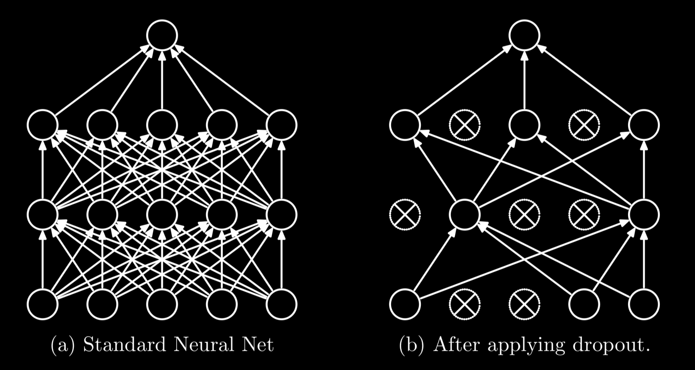

#### 7. Dropout 和 Batch Normalization 在训练和预测中的区别？

 Dropout 在训练时采用，是为了减少神经元对部分上层神经元的依赖，减少过拟合的风险。而在预测中，应该用训练完成的模型，不需要 Dropout。

 对于 BN，在训练时使用每一批数据的均值和方差进行计算，对每一批数据单独进行归一化。但在测试时，可能不存在 batch 的概念（例如预测单条数据）。因此在测试时，一般使用所有训练数据的均值和方差进行计算。

 > **为什么不在训练的时候使用所有训练数据的均值和方差？**
 >
 > 因为在训练中使用所有数据的均值和方差容易出现过拟合现象。
 >
 > BN 的原理就是将每一批数据都归一到相同的分布。而每一批数据的均值和方差都不相同，这个差别能够增加模型的鲁棒性，在一定程度上减少模型的过拟合现象。
 >
 > 也正是因此，当应用 BN 时，一般要求将训练集完全打乱，并用一个较大的 batch size，否则，一批数据可能无法较好得代表训练集的分布，会影响模型训练的效果。

#### 8. 常见的 Non-Linear Activation Function 及其优缺点

 非线性激活函数是神经网络与感知机网络最大的区别，即将非线性特性引入到网络中。如果不用非线性激活函数，则每一层都是上一层的线性变换，无论网络有多少层，输出都是输入的线性组合。而加入非线性层后，神经网络便拥有了学习非线性关系的能力，这使得神经网络可以逼近任意形状的函数。

|   函数名   |                     函数表达式                     | 优点                                                               | 缺点                                                                                                                                                                     |
| :--------: | :------------------------------------------------: | :----------------------------------------------------------------- | :----------------------------------------------------------------------------------------------------------------------------------------------------------------------- |
|  Sigmoid   |      $\displaystyle f(z)=\frac{1}{1+e^{-z}}$       | 1. 将输入转换为 (0, 1) 的区间。                                    | 1. 在神经网络反向传播中可能出现梯度消失问题； 2. 函数均值不为 0，使得权值总往同一方向更新， 收敛速度慢。                                                           |
|    tanh    | $\displaystyle f(z)=\frac{e^z-e^{-z}}{e^z+e^{-z}}$ | 1. 将输入转换为 (0, 1) 的区间； 2. 解决 Sigmoid 均值非 0 问题。 | 1. 依然存在梯度消失问题； 2. 幂函数计算复杂，训练时间大。                                                                                                             |
|    ReLU    |                  $f(z)=max(0,x)$                   | 1. 解决了梯度消失的问题； 2. 计算与收敛速度快。                 | 1. 函数均值不为 0； 2. Dead ReLU Problem. 当 $x<0$ 时梯度为 0，且 该神经元之后的神经元梯度永远为 0，即神经元直接 失效。通过合理的初始化，或是降低学习率来解决。 |
| Leaky ReLU |            $f(z)=max(\alpha \cdot x,x)$            | 1. 使得神经元在负数区域偏向于 激活而不是直接失效。              | 1. 函数均值不为 0； 2. $\alpha$ 的值需要确定且比较敏感（通常是一个非常小 的值，如 0.01）。                                                                         |

#### 9. Gradient Descent vs Stochastic Gradient Descent vs Mini-Batch Gradient Descent

 |                  方法                  | 优点                                                                                                            | 缺点                                                                                                                                                               |
 | :------------------------------------: | :-------------------------------------------------------------------------------------------------------------- | :----------------------------------------------------------------------------------------------------------------------------------------------------------------- |
 |            Gradient Descent            | 1. 参数梯度更新方向大致确定； 2. 适合并行化计算。                                                            | 1. 训练时收敛速度慢； 2. 当数据量大时，需要大量显存。                                                                                                           |
 | Stochastic Gradient  Descent (SGD)  | 1. 每次只随机抽取一条数据进行梯度更新， 花费代价小； 2. 适合大量数据的训练。                              | 1. 需要更多迭代次数； 2. 参数更新的过程震荡很大，参数更新方向有很大的波动； 3. 不适合并行化计算。                                                            |
 | Mini-Batch Gradient  Descent (MBGD) | 结合了前两种方法的优势： 1. 比 GD 收敛速度快，比 SGD 更加稳定； 2. 能利用高度优化的矩阵运算，适合并行化； | 1. 难以选择合适的学习率。太小的学习率会导致收敛缓慢； 太大的学习率会导致波动过大，可能跳出局部最优解。 可以采用动态调整学习率的方法（learning rate decay）。 |

#### 10. 常见的优化器及其对比

|      方法       | 特点                                                                                                                                                                                                                                                                                                                        |
| :-------------: | :-------------------------------------------------------------------------------------------------------------------------------------------------------------------------------------------------------------------------------------------------------------------------------------------------------------------------- |
| GD / SGD / MBGD | 1. 难以选择合适的学习率。学习率太小会导致收敛缓慢；学习率太大会导致波动过大，可能跳出局部最优解。 2. 每个参数的学习率都是相同的。如果数据是稀疏的，且不同特征的出现频率相差较大，则会出现部分特征 学习不足的问题； 3. 在训练中容易陷入鞍点，即局部最优点，在这些点的梯度为 0，无法继续训练。                       |
|    Momentum     | 1. 借鉴了物理中的动量概念，模拟物体运动时的惯性，即更新的时候在一定程度上保留之前更新的方向，而不 是像 GD 算法一样完全按照新的梯度方向更新。这样可以增加稳定性，并且有一定的摆脱局部最优解的能力。 2. Momentum 算法会观察上一步的梯度，若当前梯度方向与历史梯度一致，则增强该方向的梯度，否则则削 弱该方向的梯度。 |
|     AdaGrad     | 1. 针对 GD 算法中对于每个参数都保持同一学习率的问题，AdaGrad 算法能在训练中自动对不同参数的学习率 进行调整。对于出现频率比较低的特征，加大更新的学习率；对于出现频率高的，减小学习率。 2. 由于这个特性，AdaGrad 非常适合用于处理稀疏的数据。                                                                          |
|     RMSprop     | 1. Root Mean Square prop. 对 AdaGrad 算法的改进，把 AdaGrad 的将历史梯度相加变成对历史梯度求均值； 2. 这种方法可以缓解 AdaGrad 算法学习率下降较快的问题。                                                                                                                                                                |
|      Adam       | 1. Adam 算法结合了 AdaGrad 和 RMSprop 的优点，即动态更新参数的学习率。不同于 RMSprop 只参考了参 数的历史平均值，Adam 同时参考了梯度的平均值和方差。 2. 在各大机器学习库中，两次估计的衰减率默认值 $\beta_1$ 和 $\beta_2$ 分别为 0.9 和 0.999.                                                                         |
|      AdamW      | 1. 针对 Adam 算法中先进行梯度衰减再进行正则化，使得梯度大的参数无法正常被正则化的问题，在 AdamW 中将梯度衰减的步骤移到正则化后，解决了这一问题。                                                                                                                                                                         |

#### 11. 如何正确使用迁移学习？

通过使用之前在大数据集上经过训练的预训练模型，我们可以直接使用相应的结构和权重，将它们应用到我们正在面对的问题上。

- 场景一：现有数据集***大***，数据与原数据相似度***高***

    这是最理想的情况，采用预训练模型会变得非常高效。最好的运用方式是保持模型原有的结构和初始权重不变，随后在新数据集的基础上重新训练 / 微调。

- 场景二：现有数据集***小***，数据与原数据集相似度***高***

    在这种情况下，由于数据和原数据集相似度高，我们不需要重新训练模型，只需要将输出层改为新问题的结构即可。

- 场景三：现有数据集***大***，数据与原数据集相似度***低***

    因为实际数据与预训练模型的训练数据之间存在很大差异，采用预训练模型将不会是一种高效的方式。因此最好的方法还是只沿用预训练模型的结构。将预处理模型中的权重全都初始化后，在新数据集上**重新**开始训练。

- 场景四：现有数据集***小***，数据与原数据集相似度***低***

    这是最糟糕的一种情况。为了防止过拟合，我们不能从头开始训练。我们可以利用预训练模型较低的层进行特征提取，弥补数据集大小不足的缺陷，再利用较高的层进行训练（一般而言，神经网络较高的层具有较高的区分度，更适合用来训练数据本身）。因此，我们**冻结**预训练模型前 $k$ 层的权重，用于提取数据的特征，然后训练后 $n-k$ 层，并将原输出层改为新问题的结构。

## Natural Language Processing

### NLP 基本概念

#### 1. 常见的文本相似度计算方法

 - 欧式距离，用于计算两等长**句子向量**的相似度。 $\text{distance} = \sqrt{(A-B)*(A-B)^T}$；
 - 余弦距离，用于计算两等长**句子向量**的相似度。 $\text{distance} = \frac{A*B^T}{|A|*|B|}$；
 - Jaccard 相似度。将句子看作单词的集合。则 A 与 B 的 Jaccard 相似度为：$\text{similarity} = \frac{|A\cap B|}{|A\cup B|}$；
 - TF-IDF。TF 是词频 (Term Frequency)，表示在一个文章中某个单词出现的频率；IDF 是逆文本频率指数 (Inverse Document Frequency)，表示含有该关键词的文档占所有文档的比例。TF-IDF 建立在以下假设上：对区别文档最有意义的词语应该是那些在**文档中出现频率高**，而在整个文档集合的**其他文档中出现频率少**的词语；
 - 最小编辑距离。一种经典的距离计算方法，用来度量字符串之间的差异。将字符串 A 不断修改（增删改），直至成为字符串 B，所需要的修改次数代表了字符串 A 和 B 的差异大小。常使用动态规划来计算最小编辑距离。

#### 2. word2vec 模型

 在 NLP 中，我们希望用一个数学形式表示不同的单词，于是便有了词向量。最初的词向量是 one-hot 词向量，但这种向量维度过大，非常稀疏，且不能反映词与词之间的关系。于是便有了**分布式词向量**，即固定 embedding 的维度，embedding 中的每一个值都是通过计算不同单词的贡献得到的。

 训练 word2vec 模型主要有两种方式：CBOW 和 Skip-Gram。
 - CBOW 是让模型根据某个词前面的 C 个词和之后的 C 个词，预测这个词出现的概率。如图，训练过程其实就是学习这两个矩阵 $W$ 和 $W'$，其中，$W$ 矩阵又被叫做 lookup table，即所有词嵌入向量的词表。

     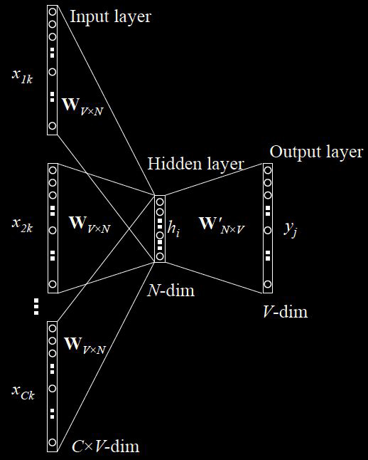
 - Skip-Gram 和 CBOW 相反，是根据某一个词来预测它的前 C 个词和后 C 个词。同样训练两个矩阵 $W$ 和 $W'$，其中，$W$ 矩阵是 lookup table。一般来说，Skip-Gram 的训练时间比 CBOW 要慢。

     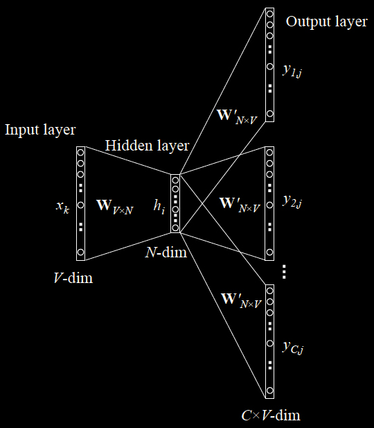

 为了加快训练速度，word2vec 采用了两种优化方式。
 - Hierarchical Softmax，用霍夫曼树代替神经网络，本质上是将 n 分类变成 log(n) 次二分类。
 - Negative Sampling，由于霍夫曼树中高频词离根结点较近，但是如果中心词是较生僻的词，那么就要消耗很长时间。简要来说就是从负样本中选取一部分来更新，而不是更新全部的权重。

#### 3. GloVe 模型

 GloVe 模型利用了词语的共现频率来计算相关性。首先引入词语的共现矩阵 $X$，其中 $X_{ij}$ 是在 word i 的上下文中 word j 的出现次数，$X_i = \sum_k X_{ik}$ 是出现在 word i 的上下文中所有词的出现次数，则共现概率为 $P_ij = P(j|i) = \frac{X_{ij}}{X_i}$，是word j 出现在 word i 上下文的概率。可以发现，共现概率的比例可以反映两个词的**相关度**。

### RNN / LSTM

#### 1. 为什么需要 RNN？

 循环神经网络（Recurrent Neural Network, RNN）。当给定的数据是序列型数据，如文本、音频等数据时，我们往往希望模型能够学习到给定数据的上下文环境。例如，对于一个句子，序列模型试图从同一个句子前面的单词推导出关系。

 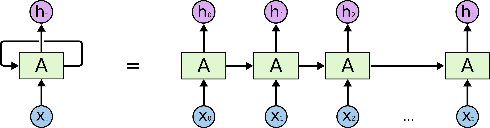

 在循环神经网络的每一个时间步骤（time step）中，我们取一个输入 $x_i$ 和上一个节点的权值 $h_{i-1}$ 作为输入，并产生一个输出 $y_i$ 和权值 $h_i$，这个权值又被传递到下一个时间步骤，直到输入序列被读取完毕。

 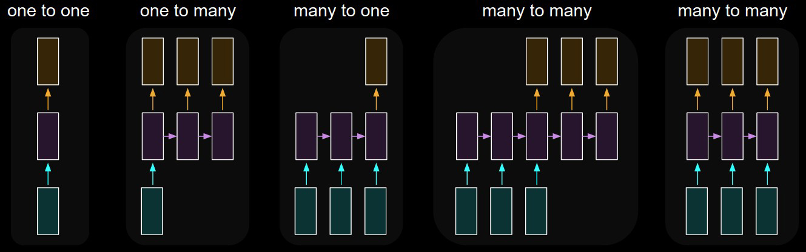

 普通的 RNN（Vanilla RNN）常使用 BP 算法来训练权值，但由于**梯度消失 / 梯度爆炸**问题，RNN 会丧失学习远距离信息的能力。为了解决远距离依赖问题，提出了 LSTM（Long Short-Term Memory）。

#### 2. LSTM 网络

 LSTM（Long Short-Term Memory）相对于普通 RNN 网络，能够显著的缓解长期依赖关系丢失的问题。LSTM 的主要思想是利用**门结构**来去除或添加单元之间信息传递的能力。LSTM 拥有三个门，来保护和控制单元状态，分别为**遗忘门**、**输入门**和**输出门**。

 - 遗忘门

     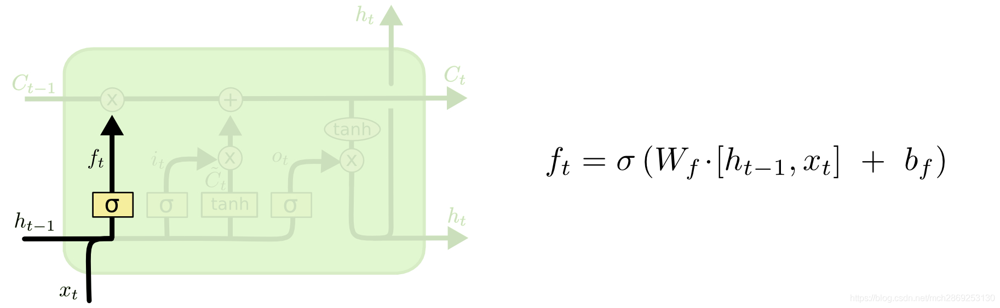
     第一步是决定从上一个单元中保留多少消息。将上一单元的状态 $h_{t-1}$ 和这一层的输入 $x_i$ 经过 sigmoid 层，输出一个 0-1 的值，代表要从上一层的单元状态保留多少信息。

 - 输入门

     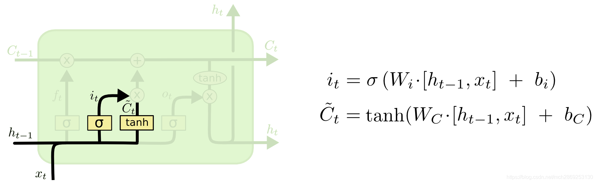
     这一步是决定在这一层的单元状态中保留多少信息。将上一单元的状态 $h_{t-1}$ 和这一层的输入 $x_i$ 分别经过 sigmoid 层和 tanh 层，得到一个候选的单元状态 $\tilde{C}_t$。

     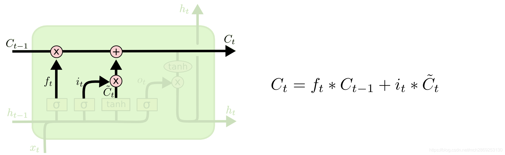
     随后，根据遗忘门得到的遗忘比例 $f_t$ 和这一层要输入的单元状态 $\tilde{C}_t$，得到这一层的最终单元状态 $C_t = f_t*C_{t-1} + i_t*\tilde{C}_t$。

 - 输出门

     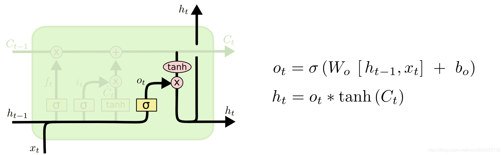
     最终，我们需要决定这一层的单元的输出状态。将上一单元的状态 $h_{t-1}$ 和这一层的输入 $x_i$ 经过 sigmoid 层，确定要输出的部分 $o_t$，再将这一层的单元状态 $C_t$ 经过 tanh 层，再与 $o_t$ 结合，得到最终的输出状态 $h_t$。

#### 3. GRU 网络

 与 LSTM 对比，GRU 网络更加简单，训练更加高效。GRU 去除了单元状态，将 LSTM 的 3 个门减少到 2 个，分别为更新门和重置门，分别决定了应该让多少信息通过单元，以及应该丢弃多少信息。

 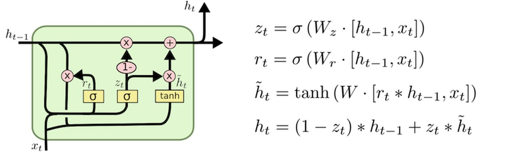

#### 4. 如何计算 LSTM 和 GRU 的参数量？

 一个单元内一共有四个非线性门 ($W[h_{t-1},x_t] + b$)，每一个门内的可训练变量包括一个矩阵 $W$ 和一个置项 $b$。

 因此，一个 LSTM 非线性门的参数即为 **(embed_size + hidden_size) * hidden_size +hidden_size**，LSTM 四个门的总参数量为 **((embed_size + hidden_size) * hidden_size +hidden_size) * 4**。

 同理，一个 GRU 单元的参数量为 **((embed_size + hidden_size) * hidden_size + hidden_size) * 3**。

#### 4. RNN / LSTM 的局限性

- 对于 RNN 来说，在访问一个单元前需要遍历之前所有的单元，使得在长文本下极度容易出现梯度消失问题。
- LSTM 利用门机制稍微缓解了 RNN 的梯度消失问题，但在超长文本前仍然存在该问题。
- 在 LSTM 中，在每一个单元中都有 4 个 MLP 层，需要消耗大量的计算资源，且模型本身不利于并行化。

### Attention Mechanism / Transformer

#### 1. Seq2Seq 中的 Self-Attention 机制

 在 Seq2Seq 中，我们使用 encoder 将输入文本转化为一个定长向量，再用 decoder 将该向量转换为输出文本。但是，在面对长文本时，我们很难在定长向量中保留完整的输入文本信息，因此在 decode 时会存在信息丢失的问题。为了缓解这个问题，我们引入了 Attention 机制。

 以机器翻译任务举例，在翻译到某一个单词时，我们希望能够注意到这个单词所对应的上下文，并结合之前已翻译的部分作出相应的翻译。这样，我们在 decoder 中就可以注意到输入文本的全部信息，而不只局限于那个定长的向量。

 Attention 的计算过程如下：

 - 得到 encoder 中的 hidden state $\overrightarrow{h_e} = (h_1, h_2, ..., h_n)$。
 - 假设当前翻译到的 decoder state 为 $\overrightarrow{s_{t-1}}$，则可以计算该状态与输入的每一个单元 $h_j$ 状态的关联性 $e_{tj} = a(s_{t-1},h_j)$，写成向量形式则为 $\overrightarrow{e_t} = a(\overrightarrow{s_{t-1}}, \overrightarrow{h})$，其中，$a$ 是相关性的计算，常见的计算方式有：
   - 直接点乘 $a(s_{t-1},h_j)=\overrightarrow{s_{t-1}}^T\cdot\overrightarrow{h}$；
   - 加权点乘 $a(s_{t-1},h_j)=\overrightarrow{s_{t-1}}^T\cdot W \cdot\overrightarrow{h}$，其中，$W$ 是可训练矩阵；
   - 多层感知机 $a(s_{t-1},h_j)=V \cdot \tanh(W_1 \cdot \overrightarrow{s_{t-1}} + W_2 \cdot \overrightarrow{h})$，其中，$V$、$W_1$、$W_2$ 都是可训练矩阵；
   - 缩放的点乘 $a(s_{t-1},h_j)=\frac{\overrightarrow{s_{t-1}}^T\cdot\overrightarrow{h}}{\sqrt{|\overrightarrow{h}|}}$。Softmax 函数对非常大的输入很敏感。这会使得梯度的传播出现问题，并且会导致学习的速度下降，甚至会导致学习的停止。那如果我们使用 $\sqrt{|\overrightarrow{h}|}$ 来对输入的向量做缩放，就能够防止进入到 softmax 函数的饱和区，使梯度过小。
   - $\operatorname{Attention}(Q,K,V)=\operatorname{softmax}\left(\frac{QK^T}{\sqrt{d_k}}+M\right)V$.
   在常用的初始化近似下，假设各维独立，\(q_i,k_i\) 均值为 0、方差为 1，且 q 和 k 独立，则：
   $\operatorname{Var}(q^Tk)=d_k$.
   **Softmax 函数对非常大的输入很敏感。variance 随 d_k 线性增长，standard deviation 随 sqrt(d_k) 增长。除以 sqrt(d_k) 后方差回到约 1。**

 - 对 $\overrightarrow{e_t}$ 进行 softmax 操作后得到 Attention 分布 $\overrightarrow{\alpha_t} = softmax(\overrightarrow{e_t})$，其中，$\alpha_{tj} = \frac{\exp(e_{tj})}{\sum_{i=1}^n \exp(e_{ti})}$。
 - 计算得到**上下文表示** $\overrightarrow{c_t}=\sum_{j=1}^n \alpha_{tj}\cdot h_j$。
 - 我们可以将该上下文表示利用到下一个时间步的状态生成 $s_t = f(s_{t-1}, y_{t-1}, c_t)$。

#### 2. Encoder 和 Decoder的Cross Attention

**在 Transformer 中，encoder 和 decoder 之间的交互是通过 Cross Attention 机制实现的。具体来说，decoder 在生成每个输出 token 时，会使用 encoder 的输出作为 Key 和 Value，而使用 decoder 当前的隐藏状态作为 Query。**

#### 3. 完整前向流程

 **Token IDs → embeddings → position information → attention → FFN → logits → token probabilities。**

 这条路线表示主要计算环节。Attention 与 FFN 会在多个 Transformer block 中重复，每个子层还有残差连接与 normalization；具体位置信息的注入位置取决于模型。

 | 阶段                 | 输入/输出形状           | 发生什么                                                          | 口述时的重点                            |
 | -------------------- | ----------------------- | ----------------------------------------------------------------- | --------------------------------------- |
 | Token IDs            | $[B,n]$                 | Tokenizer 把文本转换为整数 ID                                     | Token 不一定等于一个完整单词            |
 | Embeddings           | $[B,n,d]$               | 从可训练矩阵 $E$ 中查出 $E[t_i]$                                  | 将离散 ID 转为向量                      |
 | Position information | 表示通常仍为 $[B,n,d]$  | 绝对位置向量可与 embedding 相加；RoPE 则在 attention 内作用于 Q/K | 顺序信息必须通过相应机制进入模型        |
 | Attention            | $[B,n,d]$               | 各 head 生成 Q/K/V，计算匹配分数、mask、softmax，再加权聚合 V     | 在允许访问的位置之间交换信息            |
 | FFN                  | $[B,n,d]$               | 对每个 token 独立应用共享的非线性特征变换                         | 改变当前位置的特征，不直接跨 token 聚合 |
 | Logits               | $[B,n,V_{\text{ocab}}]$ | 最后隐藏表示经过词表线性投影；模型可能先做 final normalization    | Logits 是未归一化分数                   |
 | Token probabilities  | $[B,n,V_{\text{ocab}}]$ | 沿词表维度做 softmax                                              | 每个位置得到下一 token 的概率分布       |

#### 4. Q(Query), K(Key), V(Value)

 **Q、K、V 分别是 Query（查询）、Key（键）和 Value（值）。**

- **Q：当前位置想找什么信息。**
- **K：每个位置有什么特征，供 Q 判断是否相关。**
- **V：每个位置实际提供的信息。**

计算上，三者来自隐藏状态的不同线性投影：

 $Q=XW_Q,\quad K=XW_K,\quad V=XW_V$

**Q 和 K 决定关注哪里，V 决定从那里取什么信息。** 这些投影矩阵通过训练学到，上面的“想找什么”只是直观解释。

#### 5. Transformer

 既然我们知道 Attention 机制本身就可以获取上下文信息，那么我们可不可以将原本的 RNN 结构完全去掉，仅仅依赖于 Attention 模型呢？这样我们可以使得训练并行化，并且可以拥有全局的信息。根据这个思想，产生了 Transformer 模型。其模型结构如下：

 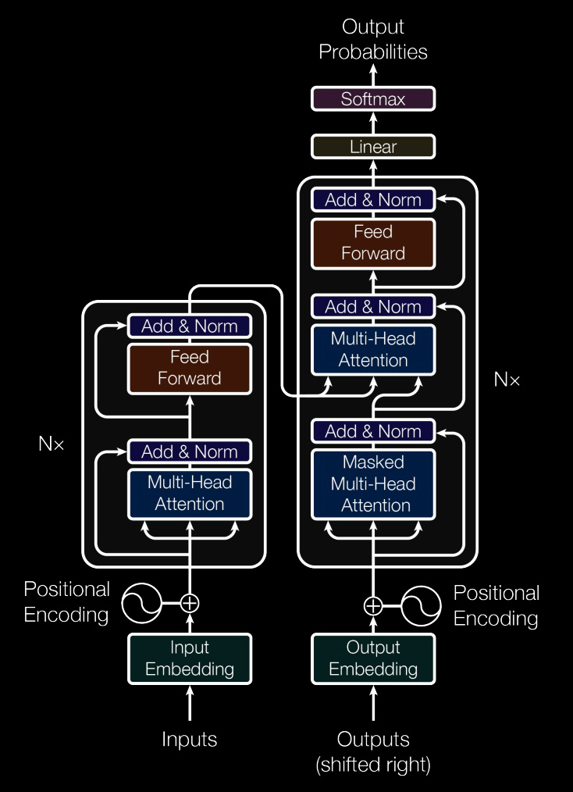

 - Self-Attention 机制

     Seq2Seq 中的 Attention 机制是在 decode 过程中，逐步计算对应的上下文表示，仿照这个思想，Self-Attention 就是在 encode 阶段，便考虑到每个输入单词与其他单词的关联性，从而得到具有上下文信息的 input embedding 信息。因此，对于 Self-Attention，其 Q, K, V 都来自于同一个输入矩阵，即 Q=K=V。

     Self-Attention 的计算过程如下：
   - 输入序列 $\overrightarrow{x}$；
   - 将 $\overrightarrow{x}$ 分别与对应 Q, K, V 的三个可训练矩阵 $W_q$, $W_k$, $W_v$ 点乘，得到 $Q=\overrightarrow{x}\cdot W_q$, $K=\overrightarrow{x}\cdot W_k$, $V=\overrightarrow{x}\cdot W_v$；
   - 计算 $Attention(Q,K,V)=softmax(\frac{Q\cdot K^T}{\sqrt{d_K}})\cdot V$，其中，$d_K$ 为 $K$ 的维度。

 - Multi-Head Attention

     为了使模型能够**看不同关系 输入序列的上下文信息表示**，同时引入多组 ($W_{qi}$, $W_{ki}$, $W_{vi}$) 矩阵，分别得到多个 ($Q_i$, $K_i$, $V_i$)，再将它们**按列拼接**，之后经过一个联合矩阵 $W_o$，得到最终的 Attention 表示。过程如图所示：

     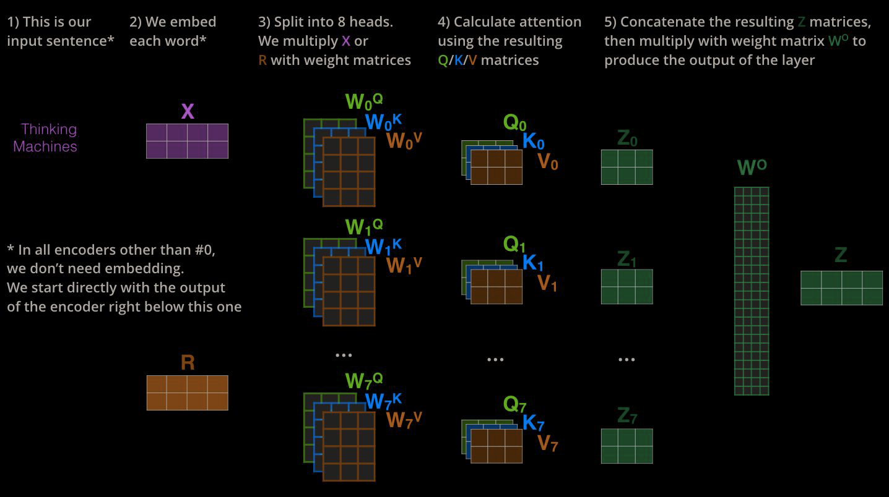

     注意，在 Transformer 的模型中，有多个 Multi-Head Attention 步骤。其中，encoder 中的 Attention 和 decoder 中的第一步 Attention 的步骤都仅以前一级的输出作为输入，而在 decoder 中的第二步 Attention 则不仅接受来自前一级的输出，还要接收 encoder 的输出。

     即，在第一种 Multi-Head Attention 中，有 $Q = K = V$，在第二种 Multi-Head Attention 中，则 $Q \neq K = V$: $Q$ 指的是 target 序列，而 $Q$ 和 $K$ 指的是输入序列。

 - Positional Encoding

     **Positional Encoding** 与 input embedding 具有相同的维度，便于相加。加法叠信号，乘法叠特征。

     但是，如果直接使用计数的方式来进行 encoding，即 $pos = 1, 2, ..., n - 1$，那么最后一个 token 的encoding 将会比第一个 token 大很多，与原 embedding 相加后会造成数据不平衡的现象。原论文作者们的方法是使用了不同频率的正弦和余弦函数来作为位置编码：
     $$
         \begin{aligned}
             PE_{(pos,2i)}   & = sin(pos/10000^{2i/d_{model}}) \\
             PE_{(pos,2i+1)} & = cos(pos/10000^{2i/d_{model}}) \\
         \end{aligned}
     $$

    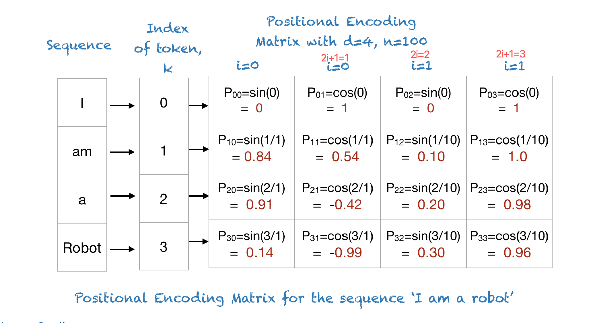
 - RoPE

     > RoPE（Rotary Position Embedding）是另一种位置编码方式。它通过旋转矩阵将位置信息注入到 Q/K 中，而不是直接加到 embedding 上。RoPE 的核心思想是将每个 token 的表示视为一个复数向量，并通过旋转操作来编码位置信息。这种方法能够更好地捕捉序列中相对位置的关系，尤其在长序列中表现优异。
     - 跟加法编码比最大区别?
       - 加法把位置和内容混在一起,不显式控制相对关系; RoPE让相对位置信息直接进入QK点积,更贴合注意力的计算方式
     - 为什么能capture相对位置信息?
       - RoPE把位置变成旋转角度,Query在位置m就转mθ,Key在位置n就转nθ;当算点积时,两个旋转的公共部分会抵消,最后只剩下(R_{n-m}),也就是只跟角度差(n-m)θ有关,也就是只跟相对距离(n-m)有关。直觉类比就是钟表两根指针,各自转到某个角,它们之间的夹角只看相差多少。
       - **旋转把绝对位置变成角度,点积时只剩角度差,所以是相对位置。**
     - 怎么拓展到更长的sequence?
       - 旋转角度是线性增长的,所以可以直接把RoPE矩阵扩展到更长的序列,不需要重新训练。

 - Add & Norm 层
   - Add 指的是 Residual Connection，$y=F(x)+x$. 与 ResNet 的原理相似，是将上一层的信息直接传到下一层，可以帮助解决多层神经网络训练困难的问题。同时，引入残差连接有助于减轻神经网络在深层退化的问题。
   - Norm 指的是 Layer Normalization，在层与层之间对每一行数据进行缩放。这样可以缓解梯度消失的状况，同时使模型更快收敛。
     > **Batch Normalization 和 Layer Normalization 的区别？**
     >
     > BN 中，我们将每一个 batch 中的数据**按列**进行缩放。而在 NLP 任务中，由于输入序列的长度是不确定的，且不同行同一位置的单词直接并没有直接联系，直接做缩放可能会影响原语义表达。因此，在 NLP 等序列型任务中，我们一般采用 Layer Normalization，即对每一行数据进行缩放。

#### 6. Layer Normalization
- Batch Normalization 和 Layer Normalization
  - Layer Normalization 是对每一token进行缩放，不依赖batch size, NLP任务序列长度不定, 更稳定
  - Batch Normalization 是对每一列数据进行缩放，适用于 CNN 等图像任务。

- Pre-norm 与 post-norm
 对一个 attention 或 FFN 子层 F，忽略 dropout：

 $\text{Post-norm: } y=\mathrm{LN}(x+F(x))$

 $\text{Pre-norm: } y=x+F(\mathrm{LN}(x)).$

 英文：
 **Pre-norm applies normalization before the attention or feed-forward transformation and keeps a direct residual path. Post-norm normalizes after adding the residual. Pre-norm generally makes deep Transformers easier to optimize and stable because gradients have a more direct path through the residual stream.**
 Post-norm在子层和残差加完之后再norm，更直观，浅层网络容易训练。

#### 7. Causal Mask 和 Padding Mask 各解决什么问题？

 **The causal mask blocks future positions, while the padding mask blocks artificial padding tokens. Both operate on attention logits before softmax, but they enforce different constraints.**

#### 8. Multi-head Attention 为什么有用？

 每个 head 用自己的投影形成注意力模式，可以在不同子空间中聚合不同位置的信息。单个 head 只给出一套加权聚合；多个 head 将多套结果拼接，再由 $W_O$ 融合。

 固定总隐藏维度时，通常让每个 head 使用 $d/h$ 维，控制总成本。不同 head 的分工由训练产生，并不保证一一对应语法、语义或指代等人工标签。详见 I-1、I-6。

 **英文短答：** “Multiple heads allow different attention patterns and representation subspaces to contribute to the result. Their outputs are concatenated and combined by an output projection.”

#### 9. RNN 与 Transformer 并行性

 RNN 难处理长文本，无法并行 优点：复杂度低

 **英文短答：** “A standard RNN has a recurrent dependency across time steps, even during teacher-forcing training. A Transformer can process known sequence positions in parallel, but standard autoregressive generation is still sequential across newly generated tokens.”

#### 10. Decoder 的 Embedding layer 架构、流程和数学原理。

目标 token ID $y_t$ 从词表矩阵 $E\in\mathbb R^{V_{\text{ocab}}\times d}$ 中查出一行 $E[y_t]$。等价地，可以用 one-hot 向量 $u_t$ 表示为 $u_tE$，但实现通常直接查表。

在原始 Transformer 中，输入表示为 $x_t=\sqrt d E[y_t]+PE(t)$，再使用 dropout。训练用右移后的目标 token；推理用提示和已生成 token。采用 RoPE 的模型通常在 Q/K 上加入旋转位置操作，而不必在输入中加绝对位置向量。输出词表 projection 可以与 $E$ 共享权重。

**英文短答：** “The decoder maps token IDs to learned vectors through an embedding lookup. It then incorporates position information, with the exact mechanism depending on the architecture.”

#### 11. Training 全流程中 Decoder 如何进行 Embedding？

假设目标为 `[A, B, EOS]`，decoder 输入为 `[BOS, A, B]`，三个位置的预测目标分别是 `[A, B, EOS]`。所有输入一次查表并加入位置信息，然后用 causal mask 同时计算三个位置的 logits。

Loss 经过输出层、decoder、必要时的 encoder 反向传播，也更新输入中用到的 embedding 行。若输入输出权重共享，embedding 还从输出词表投影接收梯度。模型不会在标准训练中先生成 A，再用生成结果预测 B。

**英文短答：** “During training, the decoder embeds a shifted ground-truth sequence. A causal mask allows all next-token losses to be computed in parallel without access to future targets.”

#### 12. Inference 全流程中 Decoder 如何进行 Embedding？

先将源输入交给 encoder，或将 prompt 直接交给 decoder-only 模型。Decoder 对已有前缀做 embedding、位置处理和前向计算，根据最后位置的 logits 选择下一个 token，再将它加入前缀并重复，直到 EOS 或长度上限。

使用 KV cache 时，后续步骤一般只需处理新增 token，旧 token 各层的 K/V 已缓存。新增 token 必须使用正确的绝对位置或 cache offset。缓存的是 K/V 等激活，不是把 embedding 矩阵更新一遍；普通推理不训练参数。

**英文短答：** “At inference, the decoder embeds the prompt and then each newly generated token. With a KV cache, previous key and value states are reused rather than recomputed.”

#### 13. BERT: Bi-directional Encoder Representation from Transformers

- 双向表示

    区别于 Bi-LSTM 的双向表示，分别正序和反序得到表示再进行拼接，BERT 中的双向指的是根据前文和后文来预测被 masked 的单词。

- Embedding

    BERT 中的 embedding 由三个部分组成：Token Embedding，Segment Embedding，Position Embedding。
    - Token Embedding 是词向量，其中，第一个词为 [CLS] 标记，可以用于之后的下游任务。
    - Segment Embedding 用于区分 BERT 输入的两个句子，之后的 pre-training 将会用到。
    - Position Embedding 由学习得到，而不是普通 Transformer 中的三角函数。

- Pre-training Tasks
    - Masked LM

        在训练过程中，将 15% 的单词用 [mask] 代替，让模型去预测被遮挡的单词，最终的损失函数只计算被遮盖的 token。

        但是如果一直用 [mask] 表示（实际预测时并不会遇到 [mask] 标记）会影响模型，因此作者设置了一下规则：80% 的时间用 [mask] 来代替被遮盖的单词，10% 的时间随机用另一个单词代替，剩下 10% 的时间保留原单词。

        值得注意的是，模型并不知道哪些单词被遮盖了，这使得模型能够关注到每一个单词，依赖上下文信息预测单词，赋予了模型一定的纠错能力。

    - Next Sentence Prediction

        对于输入的两个句子 A 和 B，让模型预测 B 是否应该是 A 的后一句。该任务的目的是让模型理解两个句子直接的关系。

- 为什么BERT在第一句前会加一个 [CLS] 标志?

    为了获得整个句子的语义表示，用于其他任务。一个没有明显语义的 [CLS] 标记会更加**公平**地融合句子中每个单词的语义，从而获得更加完整的句子表示。

- BERT 的优缺点？

    优点是建立在 Transformer 上，相对rnn更加高效，具有强大的信息提取能力，能捕捉更长距离的依赖。且双向模型比单向的 Transformer 效果更好；

    缺点则是该模型几乎无法修改，只能拿来直接用。由于只能预测 15% 的词，模型收敛较慢，需要强大算力支撑。

- 使用BERT预训练模型为什么最多只能输入 512 个词，最多只能两个句子合成一句？

    这是由于在预训练的时候，在参数中设置了 position embedding 的大小和 segment embedding 的大小，分别为 512 和 2。在这之外的单词和句子会没有与之对应的 embedding。

- BERT 的输入和输出分别是什么？

    输入是 token embedding，segment embedding 和 position embedding，输出是文本中各个字 / 词融合了全文语义信息后的向量表示。

- 计算 BERT 模型的参数数量？
    - 词向量参数：vocab_size=30522, hidden_size=768, max_position_embedding=512, token_type_embedding=2，因此参数量为 (30522 + 512 + 2) * 768。
    - Multi-head Attention：len = hidden_size = 768, $d_k$ = $d_q$ = $d_v$ = $d_{model}/n_{head}$ = 768 / 12 = 64，将12个头进行拼接后还要进行线性变换，因此参数量为 768 * 64 * 12 * 3 + 768 * 768。
    - 前馈网络参数：$\text{FFN}(x)=\max(0, xW_1+b_1)W_2 + b_2$，W_1 和 W_2 的参数量均为 768 * (768 * 4)，总参数量为 768 * 768 * 4 * 2。

    总参数量 = 词向量参数 + 12 (层数) * (Multi-head + 前馈网络) = 110M

### Scaling laws：内容、使用方法和启发

Scaling laws 是在特定数据分布、模型族和训练设置下，性能与参数量、数据量、计算量之间的**经验规律**。对语言模型，经典研究通常拟合 held-out next-token cross-entropy；它不是 “模型变大，所有能力都按同一规律提升”。[S1–S2]

一个常见形式是：

$$
L(N,D)\approx E+\frac{A}{N^\alpha}+\frac{B}{D^\beta},\qquad C\approx 6ND.
$$

N=参数量，D=训练 token 数，C=训练 FLOPs，E=拟合的渐近 loss 项。6ND 是 dense Transformer 常用粗估，假设和忽略项要记住；长上下文 attention 开销、MoE、不同训练实现可能需要更细的计算模型。
> a model's cross-entropy loss decreases following a power-law relationship as we increase the parameter count ($N$) and training data volume ($D$).From an engineering standpoint, this gives us two main takeaways. First, model performance is highly predictable, meaning we can run small-scale experiments to accurately forecast the performance of much larger models. Second, we face diminishing returns—as the model gets larger, achieving the same marginal drop in loss requires exponentially more parameters or data.

> For a standard dense Transformer, the total training compute (in FLOPs, denoted as $C$) is roughly proportional to the product of parameters and training tokens. We typically estimate this using the formula $C \approx 6ND$.This formula highlights a crucial reality: scaling up the model size and scaling up the dataset are equally expensive. Doubling the parameters costs just as much compute as doubling the training tokens.
- Kaplan 与 Chinchilla 的区别

  - Kaplan 等工作提出 loss 随规模的经验幂律，并研究固定预算下的分配。[S1]
  - Chinchilla 强调许多大模型相对数据量训练不足；其实验范围内，参数量和 token 数应随预算近似同步增加。[S2]
  - 典型概括是 \(N_{opt}\propto C^{0.5}\)、\(D_{opt}\propto C^{0.5}\)。**预算翻倍不是参数和数据都翻倍**，而是两者各约乘 sqrt(2)；两者都翻倍约需四倍预算。
  - “20 tokens per parameter” 是 Chinchilla 附近的经验比例，不是每个模型必须遵守的常数，更不是要把一个小数据集机械重复到 20 倍参数量。

> Scaling laws describe empirical relationships between model performance and resources such as parameter count, training data, and compute. For language models, the quantity being modeled is often held-out cross-entropy loss.

> The practical value is resource allocation. Under a fixed training budget, making the model larger is not always the best choice; the model also needs enough data. Chinchilla showed that, in its experimental setting, model size and training tokens should grow at roughly similar rates as compute increases.

> I would use small-scale experiments to estimate the trend for my own setting, then choose a model and data budget and validate the prediction at a larger scale. I would also include inference cost if the model will serve many requests.

> For agents, the related question is how to spend test-time compute. More retrieval, candidate solutions, or verification may help, but the gains depend on the task and the verifier. I would measure verified task success against total cost and allocate compute to the current bottleneck, rather than assuming that more parameters or longer reasoning always produce the best result.

## Training

### 阶段一：Pretraining

目标就是最朴素的 next-token prediction：

$$
\mathcal L=-\sum_t\log p_\theta(y_t\mid y_{<t})
$$

在海量文本上最小化这个交叉熵，模型被迫把语法、事实、推理模式全都压进权重里——因为要准确预测下一个词，这些都是必需的。

**数据比模型结构更决定上限**，工程上真正花时间的是：

- **去重**：近似重复的文档会让模型走向记忆而非泛化，也会浪费算力。通常做 MinHash / SimHash 级别的模糊去重。
- **质量过滤**：规则（长度、符号比例、语言识别）加分类器打分，把网页垃圾筛掉。
- **去污染**：把评测集从训练数据里洗出去，否则跑分虚高、决策全错。
- **配比**：网页、代码、书籍、论文、多语种的比例。代码数据能提升推理能力，是常见的「便宜加成」。
- **课程安排**：常见做法是训练末期提高高质量数据比例（annealing），以及分阶段把上下文窗口从 4k 扩到 128k，而不是全程用长序列（长序列太贵）。

产出的 base model **只会续写，不会听指令**。你问它「法国的首都是哪里」，它可能续写出「德国的首都是哪里？意大利的首都是哪里？」——因为训练语料里这种句子后面常常跟着更多同类问题。

### 阶段二：SFT（Supervised Fine-Tuning）

- **输入**：prompt 与人工/高质量模型示范回答。
- **输出**：SFT policy $\pi_{\text{SFT}}$。
- **目标**：让预训练模型学会对话格式、任务遵循和基本安全行为。

$$
\mathcal L_{\text{SFT}}
=-\sum_t\log \pi_\theta(y_t\mid x,y_{<t})
$$

就是逐 token 的 cross-entropy：给定 prompt $x$ 和已生成的前缀 $y_{<t}$，让模型把示范答案的下一个 token $y_t$ 的概率推高。注意它对示范里的每个 token 一视同仁，这正是 SFT 学不到偏好的原因。

### 阶段二：Reward Model

- **输入**：同一 prompt 下多个候选回答，以及人类偏好排序或成对比较。
- **输出**：奖励模型 $r_\phi(x,y)$。
- **目标**：预测人类更偏好哪个回答。

### 阶段三：RL Policy Optimization

- **输入**：prompt、当前 policy 采样回复、RM 奖励、reference policy。
- **输出**：对齐后的 policy。
- **目标**：最大化偏好奖励，同时用 KL 约束避免偏离参考模型过远：

$$
\max_\theta
\mathbb E_{x,y\sim\pi_\theta}
\left[r_\phi(x,y)
-\beta D_{\mathrm{KL}}
(\pi_\theta(\cdot|x)\Vert\pi_{\text{ref}}(\cdot|x))\right]
$$

这个目标函数是后面所有内容的总纲，两项在拔河：前一项要**分数高**（RM 觉得好），后一项要**别跑远**（离参考模型不能太离谱），$\beta$ 是这场拔河的力度旋钮。注意 $y\sim\pi_\theta$——回答是模型自己采样出来的，不是数据集里给定的，这正是它属于 RL 而不是监督学习的地方。

### PPO：经典 RLHF 的基石

RL 在游戏和机器人上跑得好好的，搬到 LLM 上却格外难训，原因有三个：

- **动作空间极大**：每一步要从整个词表（几万到十几万个 token）里挑一个。
- **轨迹很长**：一条回答几百上千个 token，等于几百上千步连续决策。
- **奖励来得极晚**：数学题、代码题往往要整段生成完、跑完单测才知道对不对，这叫 outcome reward。中间几百步全是「不知道好坏」。

三件事叠在一起的直接后果是**策略梯度的方差极大**：同一个 prompt 采样两次，回报可能天差地别，参数被推向完全不同的方向，训练极易不稳定。PPO 的每一个设计，都是围绕「把方差压下去、把单次更新限制住」展开的。

#### 为什么不是 REINFORCE 或 Q-learning？

**对比 REINFORCE**

$$
\nabla_\theta J
=\mathbb E[
\nabla_\theta\log\pi_\theta(y|x)(R-b)]
$$

读法：$\nabla_\theta\log\pi_\theta(y|x)$ 指向「让这条回答更容易被生成」的方向，前面乘的标量 $(R-b)$ 决定推还是拉——回报高于基线 $b$ 就正向推一把，低于基线就往回拽。$b$ 只为降方差，不改变梯度的期望。

它足够简洁，但整条回答只有一个标量在指挥几百步 token 的更新，方差大到难以直接使用。PPO 在此之上加了 value/advantage 估计、mini-batch 多轮复用同一批采样，以及 clipped objective，样本效率和稳定性都好得多。

**对比 Q-learning**

Q-learning 更适合离散且可反复探索的 Markov 环境。对 LLM：

- 状态是任意长的 token 前缀。
- 动作空间是整个大词表。
- 给每个「状态—动作」学一个 Q 值成本极高。
- 离线 bootstrapping 碰上分布外动作容易发散。

直接优化生成策略的 policy gradient 要自然得多。

#### 核心机制三件套

**① Clipped Objective：不许一步迈太远**

先定义新旧策略在同一个 token 上的概率比（importance sampling ratio）：

$$
r_t(\theta)
=\frac{\pi_\theta(a_t|s_t)}
{\pi_{\theta_{\text{old}}}(a_t|s_t)}
$$

$r_t>1$ 表示更新后模型更愿意吐出这个 token，$r_t<1$ 表示更不愿意。它衡量的就是「这一步把策略改动了多少」。

$$
\mathcal L_{\text{clip}}
=\mathbb E_t
\left[
\min\left(
r_tA_t,
\operatorname{clip}(r_t,1-\epsilon,1+\epsilon)A_t
\right)
\right]
$$

$A_t$ 是优势（advantage），表示这个 token 比预期好多少。式子读作：正常按 $r_tA_t$ 更新，但一旦 $r_t$ 跑出 $[1-\epsilon,1+\epsilon]$（常用 $\epsilon=0.2$）就换成截断版本，外面再套一个 $\min$ 取更保守的那个。

效果是**好 token 的概率最多提到 1.2 倍就不再给奖励，坏 token 最多压到 0.8 倍**，想再往前冲梯度直接归零。这正是名字里 proximal（近端）的由来：每次只在旧策略附近挪一小步，防止单次更新过猛毁掉模型能力。

**② Actor-Critic 双模型：把方差压下去**

除了负责生成的 policy（actor），PPO 还要训练一个与 policy 规模相近的 value model / critic，用来估计每个状态的价值 $V(s_t)$，进而算出优势：

$$
A_t\approx R_t-V(s_t)
$$

也就是「实际拿到的回报」减去「本来预期能拿多少」（实践中用 GAE 做更平滑的估计）。有了这个减法，梯度信号从「这条回答的绝对得分」变成「比预期好还是差」，方差大幅下降。

它其实就是 REINFORCE 里那个基线 $b$ 的升级版：$b$ 是一个全局常数，$V(s_t)$ 是随状态变化、并且学出来的基线。

**③ KL 惩罚：别跑离语言模型太远**

在 reward 里减去相对 reference model（通常就是 SFT 模型）的 KL 惩罚：

$$
\tilde r
=r_\phi(x,y)
-\beta D_{\mathrm{KL}}
(\pi_\theta\Vert\pi_{\text{ref}})
$$

防止模型为了刷高 RM 分数而偏离正常语言分布。这一项的调节是实操中最容易翻车的地方，下一节单独讲。

#### 痛点与局限

- **显存和计算开销极高**：训练时要同时驻留 4 个大模型——policy（actor，训练中）、critic（训练中）、reward model（推理）、reference model（推理）。其中 critic 通常和 policy 规模相近，等于凭空多出一个正在训练的大模型，显存直接爆炸。
- **调参复杂**：PPO 的成败很大程度上取决于 critic 拟合得好不好。critic 估不准 → advantage 有偏 → actor 被带偏 → 采样分布随之变化 → critic 更估不准。actor 与 critic 的这场博弈很容易导致训练崩盘。

后面的 DPO 和 GRPO，本质上都是在削减这套架构的成本。

### RLHF 训练的两大核心难题

上一节三件套里的 KL 惩罚，和它要防的 reward hacking，是实际跑 RLHF 时最容易翻车的两处。两者是一体两面：KL 是手段，防的就是 hacking。

#### ① KL 惩罚与 $\beta$ 调节

**作用**：扮演一根安全绳，防止模型为了拿高 RM 分数而丢掉原有的语言通顺度、语法能力和泛化能力。换个说法，它相当于在奖励最大化中加了 trust region / 正则项，同时降低 RM 在分布外区域被钻空子的风险。

**$\beta$ 过大**：模型过于保守，几乎不敢改变，输出黏在 SFT/reference 上，RL 信号被 KL 压死，奖励和胜率都提不动——等于 RL 优化无效。

**$\beta$ 过小**：策略快速漂移，语言质量下降，随之而来的是 reward hacking、模式化重复、输出越写越长、原有能力遗忘；监控上会看到 KL、entropy、长度或 reward 异常增长。

**工程实践**：不能只盯 reward 曲线，要同时观察

- RM reward 与独立人工 / LLM judge 的胜率；
- 每 token KL 和整条序列的 KL；
- 输出长度、entropy、重复率、拒答率；
- 各领域的能力回归测试。

常用做法是设一个 **target KL**，据此动态缩放 $\beta$：实际 KL 高于目标就调大 $\beta$ 收紧，低于目标就调小放松。

#### ② Reward Hacking

**现象**：RM 只是人类偏好的不完美代理（proxy）。RL 优化会主动去找 RM 的漏洞——只要某种行为能骗到高分，模型就会把它做到极致。

典型例子：客服模型的 RM 偏好「礼貌、详细」。RL 之后，模型对任何投诉都先长篇道歉、重复一遍用户的观点、再承诺一个兑现不了的补偿。RM 分数一路走高，而用户真正需要的「把问题解决掉」反而消失了。

**应对手段**：

- **数据层面**：偏好数据里加入针对冗长废话、讨好奉承（sycophancy）、虚假引用、格式投机的反例和 hard negatives，以及强调简洁性和事实性的正例。
- **奖励层面**：多维奖励（帮助性、正确性、安全、长度、风格分开建模）；长度惩罚（length penalty）；rule-based verifier、工具执行结果或事实核验做硬校验；RM ensemble 配不确定性估计。
- **约束层面**：KL 约束、长度约束和早停，避免对 RM 过优化。
- **评估隔离**：**严禁**用训练用的那个 RM 评估最终模型，必须换独立第三方 judge（更强的模型）或人工盲评；同时定期把新 policy 的高奖励样本捞出来人工审计，做 adversarial data collection。

一个实用的过优化信号：Best-of-N 里随着 N 增大，RM 分数继续升高但人工判定的质量开始下降，说明已经在刷分了。

### DPO

DPO（Direct Preference Optimization）从 KL 正则化的 RL 目标推导出最优策略与奖励之间的关系，把隐式奖励代回 Bradley-Terry 偏好模型，直接用偏好 pair 训练 policy，不需要显式 Reward Model、在线采样和 PPO。

典型目标：

$$
\mathcal L_{\text{DPO}}
=-\log\sigma\left(
\beta\left[
\log\frac{\pi_\theta(y_w|x)}{\pi_{\text{ref}}(y_w|x)}
-\log\frac{\pi_\theta(y_l|x)}{\pi_{\text{ref}}(y_l|x)}
\right]\right)
$$

怎么读这个式子：括号里两项形状完全一样，都是「当前模型相对参考模型，把这条回答的概率抬高了多少」——DPO 把这个比值的对数当作**隐式奖励**。于是 chosen 减 rejected，就是一个 Bradley-Terry 里的分数差，外面套上 $-\log\sigma(\cdot)$，正好就是第 4 节那个 RM 损失的形状。

区别只在于优化对象换了：RM 训练时调的是 $r_\phi$，DPO 直接调 $\pi_\theta$。所以它提高 chosen 相对 reference 的概率优势，同时压低 rejected 的相对优势。

这也意味着 DPO 的训练循环和 SFT 几乎一样：读一批离线 pair、前向、算 loss、反向——没有采样，没有 RM，没有 critic。$\beta$ 依然在（它来自原 RL 目标里的 KL 系数），控制允许偏离 reference 多远。

#### DPO 局限

- 偏好数据质量和覆盖范围决定上限。
- 不会主动探索超出数据的新推理策略。
- 对 chosen/rejected 长度、难度和噪声敏感。
- 对数学/代码等可验证任务，在线 RL 能利用执行反馈，往往更有潜力。

### GRPO：面向 Reasoning 的轻量化革命

针对 PPO 的显存和调参痛点，GRPO（Group Relative Policy Optimization）做了一个关键革新：**用同组样本的平均表现，替掉那个学出来的 critic**。

**① 取消 Critic**：完全摒弃独立的 value / critic model，直接省掉接近一半的训练显存与计算量。

**② Group Sampling（组内采样）**：对同一个 prompt，让旧策略一次性采样出一组 $G$ 个候选回答，各自得到奖励 $r_1,r_2,\ldots,r_G$。

**③ Group Relative Advantage（组内相对归一化）**：直接用这组奖励的均值和标准差算出每个回答的相对优势：

$$
A_i=\frac{r_i-\operatorname{mean}(r)}
{\operatorname{std}(r)+\epsilon}
$$

读法：$\operatorname{mean}(r)$ 充当 baseline，$\operatorname{std}(r)$ 把不同题目的奖励尺度拉齐，$\epsilon$ 防除零。答得比同组平均好，$A_i>0$，这条轨迹被强化；比平均差就被压下去。

关键在于**这个 baseline 是自适应的**：难题上大家都答不好、平均分低，你只要比同组稍好就是正优势；简单题上大家都对，优势自然趋近 0。它抵消的正是不同 prompt 之间的难度差异——而这本来是 PPO 里 critic 的职责。

**④ PPO 式更新**：拿着这个组内 advantage $A_i$，继续套用 PPO 的 ratio clipping 和 KL 正则去更新 policy。所以 GRPO 不是另起炉灶，而是把 PPO 的 advantage 来源换了。

#### 相比 PPO

- **省显存和计算**：去掉与 policy 规模相近的 critic，训练时只剩 policy、reference 和 RM/verifier。
- **相对比较更稳**：同一 prompt 的组内 baseline 天然消化了题目难度差异，也不存在 critic 估不准带崩 actor 的问题。
- **适合可验证任务**：一个 prompt 可以采样多条推理轨迹，用标准答案或单元测试直接打分，连 RM 都可以省掉。

#### 局限

- 每个 prompt 要采样 $G$ 条回答，rollout 成本高。
- 若组内奖励全相同（全对或全错），标准化后 $A_i$ 全是 0，这批数据几乎没有学习信号。
- 序列最终奖励广播到每个 token，信用分配仍然较粗。
- 组内均值/方差本身带采样噪声，$G$ 太小时不稳。
- 长度和 token-level clipping 的处理可能引入偏差

### 推理任务的奖励设计

前面几节的奖励都来自一个学出来的 RM。到了数学、代码这类**答案可验证**的推理任务，奖励的设计方式完全不同，也是当前推理模型（o1、R1 这条线）的核心。

#### 可验证奖励（RLVR）

奖励不再是模型打分，而是一个**程序**：数学题比对最终答案、代码跑单元测试、形式化证明送进检查器，再加一点格式奖励（比如是否把推理过程写进指定标签里）。

好处是根本性的：规则不会被说服。第 6 节讲的 reward hacking 之所以存在，是因为 RM 只是人类偏好的近似；而单元测试没有「被讨好」这个概念，模型只能真的把题做对。这就是为什么这条路线能放心地把 RL 跑得很久。

代价是适用面窄——只能用在答案可自动判定的领域，开放式写作、对话依然得靠 RM。

#### Outcome Reward vs. Process Reward

| 维度     | ORM（Outcome Reward Model） | PRM（Process Reward Model）       |
| -------- | --------------------------- | --------------------------------- |
| 打分对象 | 只看最终答案对不对          | 给推理过程的**每一步**打分        |
| 标注成本 | 低，有标准答案就能自动判    | 高，要人标或自动标每一步          |
| 信号密度 | 稀疏，整条轨迹只有一个分    | 稠密，每步都有反馈                |
| 主要问题 | 蒙对也给满分                | 标注贵、步骤边界难定义、易被 hack |

**ORM 的隐患**：模型完全可能靠一堆错误推理凑出正确答案，ORM 照样给满分——等于在奖励错误的推理模式。信用分配也粗：整条几千 token 的推理只有一个分，模型不知道是哪一步做对了。

**PRM 怎么标**：早期靠人工逐步标注（OpenAI 的 PRM800K）。后来有了自动化办法——从某一步出发多次 rollout，如果从这里出发能高频到达正确答案，就认为这一步是好的（Math-Shepherd 的思路），把「步骤质量」转化成「后续成功率」。

**现在的实践取向**：R1 的经验是，**outcome reward 加规则验证就足以激发长链推理**，PRM 在大规模 RL 里训练复杂且容易被 hack（模型学会写出「看起来很像正确步骤」的话）。所以主流 RL 训练转向可验证的 outcome reward。但 PRM 在**推理时的重排序**（Best-of-N 里给候选打分，见 [解码](#解码)）依然好用——那里不做梯度更新，模型没有机会去 hack 它。

#### RL 激发推理能力

DeepSeek-R1 报告里两个值得记住的观察：

- **R1-Zero**：完全跳过 SFT，直接在 base model 上用可验证奖励做 RL，模型**自己涌现出**了长链推理、回头检查、换一种解法这些行为——没人教它「要反思」，只是因为反思能提高答对率。代价是可读性差、中英文混杂。
- **R1**：先用少量高质量长推理数据做冷启动 SFT，再做 RL，兼顾了可读性和能力。

要注意 RL 的作用边界：它**强化的是模型已有的行为**，而不是凭空创造新能力。这也解释了为什么小模型直接做 RL 效果远不如从大模型蒸馏

### 知识蒸馏（Distillation）

用一个强模型（teacher）的输出去训练一个小模型（student）。它在 LLM 时代有两种完全不同的做法。

#### ① Logit 蒸馏（经典 Hinton 做法）

$$
\mathcal L=\alpha\underbrace{\operatorname{CE}(y,p_S)}_{\text{对真实标签}}
+(1-\alpha)\,\tau^2\underbrace{D_{\mathrm{KL}}(p_T^{(\tau)}\Vert p_S^{(\tau)})}_{\text{对齐 teacher 分布}}
$$

核心洞察是 teacher 的**完整概率分布里藏着「暗知识」（dark knowledge）**：它不只说「这是猫」，还顺带说了「有 10% 像狗、0.01% 像汽车」。这些类别之间的相对关系，信息量远大于 one-hot 标签——one-hot 只告诉你答案，teacher 的分布还告诉你「哪些答案错得不离谱」。

式子里两个细节：温度 $\tau$ 把两边的分布都调软，让暗知识（那些小概率的相对大小）显现出来；前面乘 $\tau^2$ 是因为软化会把梯度整体缩小 $\tau^2$ 倍，乘回来才能让这一项的权重不随温度漂移。

#### ② 序列级 / 数据蒸馏（LLM 时代的主流）

直接让 teacher 生成大量回答，student 拿这些回答当 SFT 数据训。

- 不需要 teacher 的 logits，只要能调用它就行，因此闭源模型也能当 teacher（尽管这通常违反其服务条款）。
- 实现上就是 SFT，没有任何新机制，这是它流行的最大原因。现在绝大多数开源小模型都这么来的。
- **一定要过滤**：只保留答案正确、通过单测的轨迹（即拒绝采样），否则等于在系统性地学习错误示范。

DeepSeek-R1 报告里一个值得记住的结论：把大模型的长链推理轨迹蒸馏进小模型，效果**显著优于**直接对小模型做 RL。推理能力可以「教」，但小模型自己「悟」很难——RL 只能强化模型已有的行为，而小模型压根没有那些行为可强化。

##### 注意

- student 会继承 teacher 的错误、风格和偏见，且在没有 verifier 过滤的情况下**基本无法超过 teacher**。
- 蒸馏出来的模型在被蒸馏的那类任务上很强，泛化到别的分布上则未必。

### 合成数据（Synthetic Data）

**为什么需要**：高质量人类数据既有限又贵，而某些能力几乎没有现成语料——多轮函数调用、长上下文推理、罕见语言、特定格式输出，网上根本不存在成规模的例子。

#### 常见造法

- **蒸馏式**：直接用更强的模型生成（见上一节）。
- **Self-Instruct 式**：给少量种子任务，让模型自己扩写出更多指令，再自己作答，人工只做抽检。
- **拒绝采样（STaR / RFT）**：对有标准答案的题目采样多条解法，**只保留答案正确的**拿去训练。这是把推理能力自举上去的主力方法。
- **程序化生成**：用代码、模板或形式化系统造题，天然自带标准答案。比如先随机生成一段代码再反推题面，或用符号计算库生成数学题。
- **改写原始语料**：把网页内容改写成问答对或教科书风格（Phi 系列的路子），提高信息密度。

#### 核心是「能不能自动判对错」

合成数据的价值上限，取决于你有没有一个可靠的验证器。有 verifier 的领域（数学答案匹配、代码跑单测、形式化证明检查）收益最大，因为可以放心地大规模生成再筛选；开放式写作最难，因为没人能自动判断「这段文案好不好」。

#### 风险

- **模型崩溃（model collapse）**：反复用自己的生成物训练自己，分布的尾部会逐渐消失，多样性坍缩，模型越来越平庸。缓解办法是始终保留真实数据作锚点，并做严格过滤，而不是无限自举。
- **错误会被放大**：一个事实错误被生成一万次，就成了模型眼中的「常识」。
- **评测污染**：合成题可能与评测集撞车，需要做污染检测。

### 4. 常见并行策略

训练时，GPU 内存主要用于保存：

- **Parameters**：模型参数；
- **Gradients**：每个参数的梯度；
- **Optimizer States**：例如 AdamW 的一阶和二阶动量；
- **Activations**：前向传播产生、反向传播需要的中间结果；
- **Temporary Buffers**：Attention、通信和算子使用的临时空间。

不同并行方法切分的是不同内容：

| 并行方法                       | 主要切分对象                 | 主要解决的问题       |
| ------------------------------ | ---------------------------- | -------------------- |
| Data Parallelism               | 训练数据                     | 提高整体吞吐         |
| ZeRO / FSDP                    | 参数、梯度、Optimizer States | 减少单卡模型状态     |
| Tensor Parallelism             | 单层中的矩阵计算             | 单层模型放不下       |
| Pipeline Parallelism           | 不同网络层                   | 整个模型放不下       |
| Sequence / Context Parallelism | 序列和激活值                 | 长上下文激活占用过大 |
| Expert Parallelism             | MoE Experts                  | MoE Expert 参数过大  |

实际训练通常不会只使用一种，而是根据内存、通信和集群拓扑组合使用。

#### Data Parallelism

Data Parallelism 的基本做法是：

1. 每张 GPU 保存一份完整模型；
2. 不同 GPU 处理不同数据；
3. 每张 GPU 独立完成前向和反向传播；
4. 通过 All-Reduce 同步梯度；
5. 所有 GPU 使用相同梯度更新参数。

#### DP 和 DDP 的区别

在 PyTorch 中：

- `DataParallel` 通常由一个进程控制多张 GPU，主卡容易成为瓶颈；
- `DistributedDataParallel` 通常每张 GPU 使用一个独立进程，通过 All-Reduce 同步梯度。

实际多 GPU 训练一般使用 DDP，而不是旧式的 `DataParallel`。

需要注意：

> Data Parallelism 并不会减少单张 GPU 保存的模型状态，只是把数据分给不同 GPU。

如果模型本身无法装入单卡，需要使用 FSDP、ZeRO、TP 或 PP。

#### ZeRO 与 FSDP

普通 Data Parallelism 在每张 GPU 上都保存完整的：

- Parameters；
- Gradients；
- Optimizer States。

ZeRO 的核心思想是：

> 既然不同 Data-Parallel Ranks 最终维护的是同一个模型，就不需要让每张 GPU 永久保存所有模型状态。

#### Tensor Parallelism（TP）

把单层矩阵乘法沿维度切到多卡。例如列并行和行并行线性层。适合模型单层过大时，但层内频繁 collective，对高速互联要求高。

Tensor Parallelism 的优点：

- 可以切分单个超大线性层；
- 降低每张 GPU 保存的参数和部分激活值；
- 适合单层参数已经无法放入一张 GPU 的模型。

主要代价：

- 几乎每一层都需要 Collective Communication；
- 对 GPU 间带宽和延迟要求很高；
- TP Degree 越大，单张 GPU 的矩阵越小，计算效率可能下降。

#### Pipeline Parallelism（PP）

Pipeline Parallelism 按网络深度切分模型。

例如，一个 48 层模型可以分成 4 个 Stage：

- Stage 1：第 1–12 层；
- Stage 2：第 13–24 层；
- Stage 3：第 25–36 层；
- Stage 4：第 37–48 层。

一个完整 Batch 会进一步切成多个 Micro-batches，在不同 Stage 之间流水执行。

Pipeline Parallelism 的优点：

- 每张 GPU 只保存部分网络层；
- 通信内容主要是 Stage 之间的激活值和梯度；
- 可以将模型扩展到多个节点。

主要问题是 Pipeline Bubble。流水线启动和结束阶段，会有部分 GPU 等待其他 Stage。

#### 实际选型

通常组合为 DP/FSDP + TP + PP，MoE 再加入 EP。原则是：

- TP 尽量限制在高速互联域内。
- PP 跨更慢节点也相对可行，但要减少 bubble。
- DP 扩全局吞吐。
- 并行度不是越高越好，通信、batch、内存和容错必须联合优化。

## 解码

### Greedy Search

$$
y_t=\arg\max_y p(y\mid y_{<t},x)
$$

每步都挑当前概率最大的那个。快、确定、可复现；缺点是每一步只顾眼前，容易陷进重复循环，开放生成时也偏平庸。

一个容易忽略的点：**贪心不等于最优**。整句概率最高的序列，未必每一步都取最大值——第一步让一点，后面可能赚回来更多。这正是 beam search 存在的理由。

适合抽取式任务、分类式输出、部分代码补全。

### Temperature

在 softmax 之前先把 logits 除以一个温度 $T$：

$$
p_i=\frac{\exp(z_i/T)}{\sum_j\exp(z_j/T)}
$$

- $T<1$：分数差被放大，分布更尖，模型更保守（$T\to0$ 就退化成 greedy）。
- $T=1$：原始分布。
- $T>1$：分数被压平，长尾 token 更容易被采到，更有创意，也更容易胡说。

注意它调的是**分布形状**，不是「随机不随机」这个开关——$T=0.7$ 依然是随机采样，只是采到冷门 token 的机会小了。

### Top-K Sampling

只保留概率最高的 $K$ 个 token，重新归一化后采样。

- 优点：直接砍掉长尾里的低质量 token。
- 缺点：$K$ 是固定的，不适应分布的尖锐程度。某一步前 5 个 token 已覆盖 99% 概率（此时 $K=50$ 会放进 45 个垃圾），另一步前 5 个只覆盖 40%（此时 $K=5$ 又砍掉了合理选项）。

### Top-P / Nucleus Sampling

选取累计概率刚好达到 $p$ 的最小 token 集合，再归一化采样。

- 优点：候选集大小**动态变化**——分布尖的时候只留几个，分布平的时候自动放宽，正好补上 Top-K 的短板。
- 缺点：仍有随机性，也不解决事实错误。

实践中 top-p（0.9 左右）配 temperature 是最常见的组合，两者叠加使用。

### Beam Search

每一步保留累计 log probability 最高的 $B$ 条候选序列，最后从中选一条。相比 greedy 更接近「整句概率最高」的序列。

- 优点：翻译、语音识别这类目标相对确定的任务上常有效。
- 缺点：成本随 beam size 线性增长；开放生成里偏好安全、短、重复的文本（高概率 ≠ 高质量）；需要配长度归一化，否则天然偏好短句。
- 现代 LLM 的对话/推理场景**基本不用 beam**，多样性和质量的性价比不如采样。

---

## 目录

| 部分 | 内容 |
| --- | --- |
| [第一部分：机器学习八股文](bagu.md) | 机器学习、深度学习、NLP、训练与解码 |
| [第二部分：ML Coding 基础](../11-ml-coding-basics.md) | CodeSignal、NumPy、Pandas、PyTorch、纯 Python 矩阵运算 |
| [第三部分：ML Coding 专题](../12-ml-coding.md) | Transformer、经典机器学习、神经网络层与 NLP 手写实现 |
