# Traditional Natural Language Processing

[返回目录](../README.md) · [上一篇：机器学习与深度学习](bagu.md) · [下一篇：LLM 训练与并行策略](bagu3.md)

## NLP 基本概念

### 1. 常见的文本相似度计算方法

 - 欧式距离，用于计算两等长**句子向量**的相似度。 $\text{distance} = \sqrt{(A-B)*(A-B)^T}$；
 - 余弦距离，用于计算两等长**句子向量**的相似度。 $\text{distance} = \frac{A*B^T}{|A|*|B|}$；
 - Jaccard 相似度。将句子看作单词的集合。则 A 与 B 的 Jaccard 相似度为：$\text{similarity} = \frac{|A\cap B|}{|A\cup B|}$；
 - TF-IDF。TF 是词频 (Term Frequency)，表示在一个文章中某个单词出现的频率；IDF 是逆文本频率指数 (Inverse Document Frequency)，表示含有该关键词的文档占所有文档的比例。TF-IDF 建立在以下假设上：对区别文档最有意义的词语应该是那些在**文档中出现频率高**，而在整个文档集合的**其他文档中出现频率少**的词语；
 - 最小编辑距离。一种经典的距离计算方法，用来度量字符串之间的差异。将字符串 A 不断修改（增删改），直至成为字符串 B，所需要的修改次数代表了字符串 A 和 B 的差异大小。常使用动态规划来计算最小编辑距离。

### 2. word2vec 模型

 在 NLP 中，我们希望用一个数学形式表示不同的单词，于是便有了词向量。最初的词向量是 one-hot 词向量，但这种向量维度过大，非常稀疏，且不能反映词与词之间的关系。于是便有了**分布式词向量**，即固定 embedding 的维度，embedding 中的每一个值都是通过计算不同单词的贡献得到的。

 训练 word2vec 模型主要有两种方式：CBOW 和 Skip-Gram。
 - CBOW 是让模型根据某个词前面的 C 个词和之后的 C 个词，预测这个词出现的概率。如图，训练过程其实就是学习这两个矩阵 $W$ 和 $W'$，其中，$W$ 矩阵又被叫做 lookup table，即所有词嵌入向量的词表。

     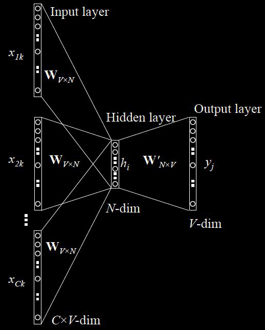
 - Skip-Gram 和 CBOW 相反，是根据某一个词来预测它的前 C 个词和后 C 个词。同样训练两个矩阵 $W$ 和 $W'$，其中，$W$ 矩阵是 lookup table。一般来说，Skip-Gram 的训练时间比 CBOW 要慢。

     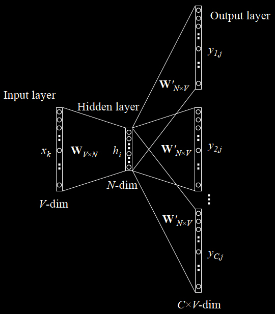

 为了加快训练速度，word2vec 采用了两种优化方式。
 - Hierarchical Softmax，用霍夫曼树代替神经网络，本质上是将 n 分类变成 log(n) 次二分类。
 - Negative Sampling，由于霍夫曼树中高频词离根结点较近，但是如果中心词是较生僻的词，那么就要消耗很长时间。简要来说就是从负样本中选取一部分来更新，而不是更新全部的权重。

2. BPE 依据绝对频次贪心合并子词；
3. **BERT (WordPiece) 分词优缺点：** 依据语言模型似然度（Likelihood）决定合并
* **优点：** 完美解决 OOV（未登录词）问题，平衡词表大小与表达能力。
* **缺点：** 对特定语言（如中文或多语言）敏感，对拼写错误或噪声较脆弱。
1. **输入长度受限原因：**
* 算力与显存的平方级爆炸（$O(n^2)$ 复杂度）。
* 绝对位置编码的外推极限。
* 推理时 KV Cache 巨大的显存开销。

### 3. GloVe 模型

 GloVe 模型利用了词语的共现频率来计算相关性。首先引入词语的共现矩阵 $X$，其中 $X_{ij}$ 是在 word i 的上下文中 word j 的出现次数，$X_i = \sum_k X_{ik}$ 是出现在 word i 的上下文中所有词的出现次数，则共现概率为 $P_ij = P(j|i) = \frac{X_{ij}}{X_i}$，是word j 出现在 word i 上下文的概率。可以发现，共现概率的比例可以反映两个词的**相关度**。

## RNN / LSTM

### 1. 为什么需要 RNN？

 循环神经网络（Recurrent Neural Network, RNN）。当给定的数据是序列型数据，如文本、音频等数据时，我们往往希望模型能够学习到给定数据的上下文环境。例如，对于一个句子，序列模型试图从同一个句子前面的单词推导出关系。

 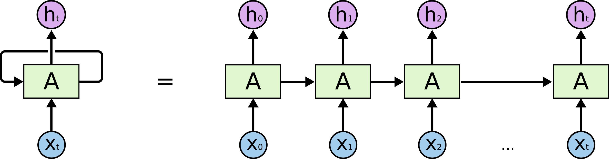

 在循环神经网络的每一个时间步骤（time step）中，我们取一个输入 $x_i$ 和上一个节点的权值 $h_{i-1}$ 作为输入，并产生一个输出 $y_i$ 和权值 $h_i$，这个权值又被传递到下一个时间步骤，直到输入序列被读取完毕。

 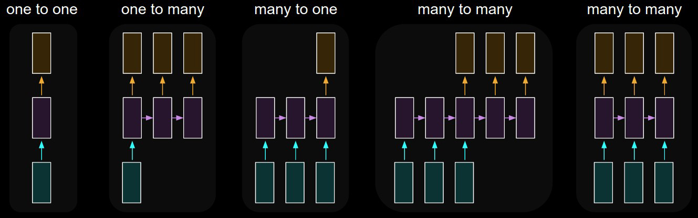

 普通的 RNN（Vanilla RNN）常使用 BP 算法来训练权值，但由于**梯度消失 / 梯度爆炸**问题，RNN 会丧失学习远距离信息的能力。为了解决远距离依赖问题，提出了 LSTM（Long Short-Term Memory）。

### 2. LSTM 网络

 LSTM（Long Short-Term Memory）相对于普通 RNN 网络，能够显著的缓解长期依赖关系丢失的问题。LSTM 的主要思想是利用**门结构**来去除或添加单元之间信息传递的能力。LSTM 拥有三个门，来保护和控制单元状态，分别为**遗忘门**、**输入门**和**输出门**。

 - 遗忘门

     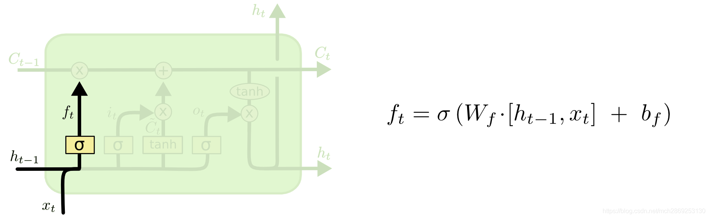
     第一步是决定从上一个单元中保留多少消息。将上一单元的状态 $h_{t-1}$ 和这一层的输入 $x_i$ 经过 sigmoid 层，输出一个 0-1 的值，代表要从上一层的单元状态保留多少信息。

 - 输入门

     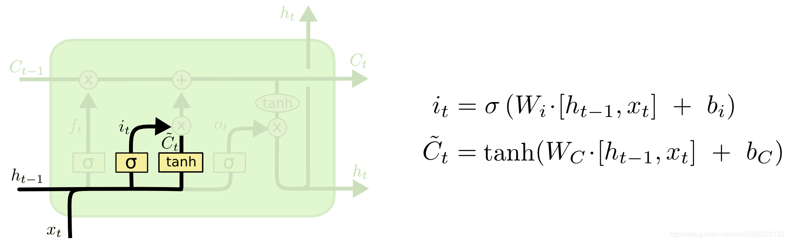
     这一步是决定在这一层的单元状态中保留多少信息。将上一单元的状态 $h_{t-1}$ 和这一层的输入 $x_i$ 分别经过 sigmoid 层和 tanh 层，得到一个候选的单元状态 $\tilde{C}_t$。

     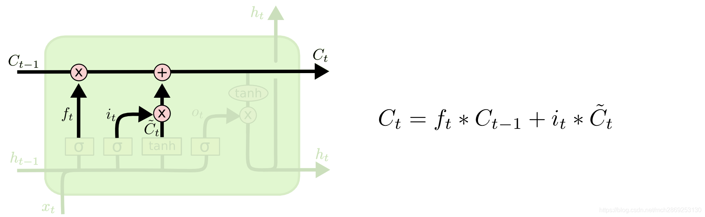
     随后，根据遗忘门得到的遗忘比例 $f_t$ 和这一层要输入的单元状态 $\tilde{C}_t$，得到这一层的最终单元状态 $C_t = f_t*C_{t-1} + i_t*\tilde{C}_t$。

 - 输出门

     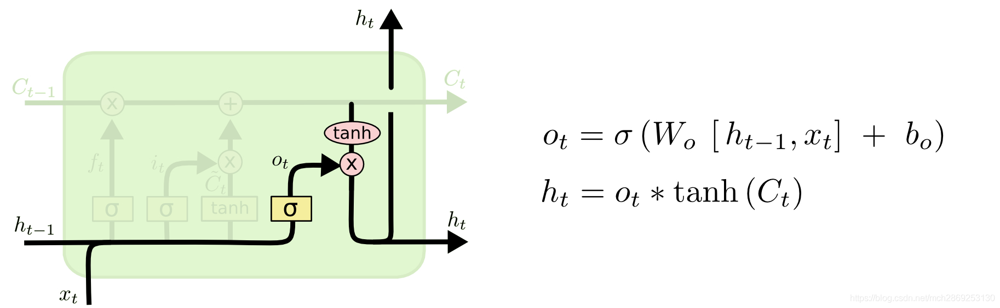
     最终，我们需要决定这一层的单元的输出状态。将上一单元的状态 $h_{t-1}$ 和这一层的输入 $x_i$ 经过 sigmoid 层，确定要输出的部分 $o_t$，再将这一层的单元状态 $C_t$ 经过 tanh 层，再与 $o_t$ 结合，得到最终的输出状态 $h_t$。

### 3. GRU 网络

 与 LSTM 对比，GRU 网络更加简单，训练更加高效。GRU 去除了单元状态，将 LSTM 的 3 个门减少到 2 个，分别为更新门和重置门，分别决定了应该让多少信息通过单元，以及应该丢弃多少信息。

 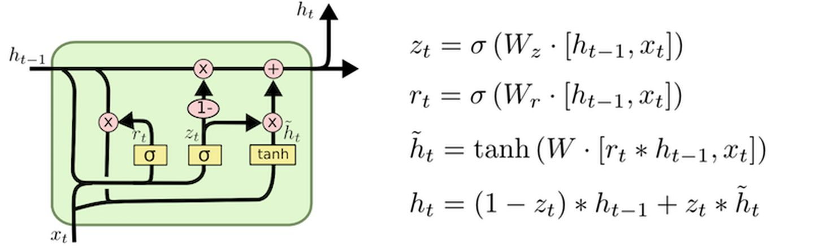

### 4. 如何计算 LSTM 和 GRU 的参数量？

 一个单元内一共有四个非线性门 ($W[h_{t-1},x_t] + b$)，每一个门内的可训练变量包括一个矩阵 $W$ 和一个置项 $b$。

 因此，一个 LSTM 非线性门的参数即为 **(embed_size + hidden_size) * hidden_size +hidden_size**，LSTM 四个门的总参数量为 **((embed_size + hidden_size) * hidden_size +hidden_size) * 4**。

 同理，一个 GRU 单元的参数量为 **((embed_size + hidden_size) * hidden_size + hidden_size) * 3**。

### 5. RNN / LSTM 的局限性

- 对于 RNN 来说，在访问一个单元前需要遍历之前所有的单元，使得在长文本下极度容易出现梯度消失问题。
- LSTM 利用门机制稍微缓解了 RNN 的梯度消失问题，但在超长文本前仍然存在该问题。
- 在 LSTM 中，在每一个单元中都有 4 个 MLP 层，需要消耗大量的计算资源，且模型本身不利于并行化。

# Attention Mechanism / Transformer

## 1. dot product Attention

Self-Attention 的计算过程如下：
- 输入序列 token 的表示矩阵 $X$；
- 将 $X$ 分别与对应 Q, K, V 的三个可训练矩阵 $W_q$, $W_k$, $W_v$ 点乘，得到 $Q=X \cdot W_q$, $K=X \cdot W_k$, $V= X \cdot W_v$；
- 计算 $Attention(Q,K,V)=softmax(\frac{Q\cdot K^T}{\sqrt{d_K}})\cdot V$，其中，$d_K$ 为 $K$ or $Q$ 的维度。
    > **为什么除以 $\sqrt{d_K}$？** Softmax 函数对非常大的输入很敏感。variance 随 d_k 线性增长，standard deviation 随 sqrt(d_k) 增长。除以 sqrt(d_k) 后方差回到约 1。

$\mathrm{softmax}(z)_i =\frac{e^{z_i-m}}{\sum_j e^{z_j-m}}, m=\max_j z_j$
  - > **为什么 attention 用 softmax？** 把匹配分数转成非负、总和为 1 的权重，让模型对 V 做加权聚合。
  - > **为什么减去最大值？** 防止指数运算溢出。

$X\in\mathbb R^{\text{Batch Size}\times\text{Seq Len}\times\text{Hidden Dim}}$

| 名称                | 含义                           | 例子                     |
| ------------------- | ------------------------------ | ------------------------ |
| **Batch_Size（B）** | 一次前向计算同时处理多少条序列 | 8 条文本                 |
| **Seq_Len（L）**    | 每条序列有多少个 token 位置    | 每条 128 个位置          |
| **Hidden_Dim（D）** | 每个 token 用多少维向量表示    | 每个 token 是 768 维向量 |

例如：$X.shape=[8,128,768]$ 表示 **8 条序列，每条 128 个 token 位置，每个位置有一个 768 维表示**。序列实际长度不同时，通常通过 padding 补齐，并用 mask 忽略补齐位置。

## 2. Encoder 和 Decoder的Cross Attention

    > decoder 在生成每个输出 token 时，会使用 encoder 的输出作为 Key 和 Value，而使用 decoder 当前的隐藏状态作为 Query。

## 3. 完整前向流程

 **Token IDs → embeddings → position information → attention → FFN → logits → token probabilities。**

 这条路线表示主要计算环节。Attention 与 FFN 会在多个 Transformer block 中重复，每个子层还有残差连接与 normalization；具体位置信息的注入位置取决于模型。

 | 阶段                 | 输入/输出形状           | 发生什么                                                          | 口述时的重点                            |
 | -------------------- | ----------------------- | ----------------------------------------------------------------- | --------------------------------------- |
 | Token IDs            | $[B,n]$                 | Tokenizer 把文本转换为整数 ID                                     | Token 不一定等于一个完整单词            |
 | Embeddings           | $[B,n,d]$               | 从可训练矩阵 $E$ 中查出 $E[t_i]$                                  | 将离散 ID 转为向量                      |
 | Position information | 表示通常仍为 $[B,n,d]$  | 绝对位置向量可与 embedding 相加；RoPE 则在 attention 内作用于 Q/K | 顺序信息必须通过相应机制进入模型        |
 | Attention            | $[B,n,d]$               | 各 head 生成 Q/K/V，计算匹配分数、mask、softmax，再加权聚合 V     | 在允许访问的位置之间交换信息            |
 | FFN                  | $[B,n,d]$               | 对每个 token 独立应用共享的非线性特征变换                         | 改变当前位置的特征，不直接跨 token 聚合 |
 | Logits               | $[B,n,V_{\text{ocab}}]$ | 最后隐藏表示经过词表线性投影；模型可能先做 final normalization    | Logits 是未归一化分数                   |
 | Token probabilities  | $[B,n,V_{\text{ocab}}]$ | 沿词表维度做 softmax                                              | 每个位置得到下一 token 的概率分布       |

## 4. Q(Query), K(Key), V(Value)

 **Q、K、V 分别是 Query（查询）、Key（键）和 Value（值）。**

- **Q：当前位置想找什么信息。**
- **K：每个位置有什么特征，供 Q 判断是否相关。**
- **V：每个位置实际提供的信息。**

计算上，三者来自隐藏状态的不同线性投影：

 $Q=XW_Q,\quad K=XW_K,\quad V=XW_V$

> **Q 和 K 决定关注哪里，V 决定从那里取什么信息。** 这些投影矩阵通过训练学到，上面的“想找什么”只是直观解释。

> **Weights 如何学到注意力：** 依靠海量文本训练时的反向传播和梯度下降，自适应调整权重矩阵。

> **为什么 attention 用点乘而不是加法？** 计算效率极高，矩阵乘法（$QK^T$）能被 GPU 底层硬件极致加速。

## 5. Transformer

 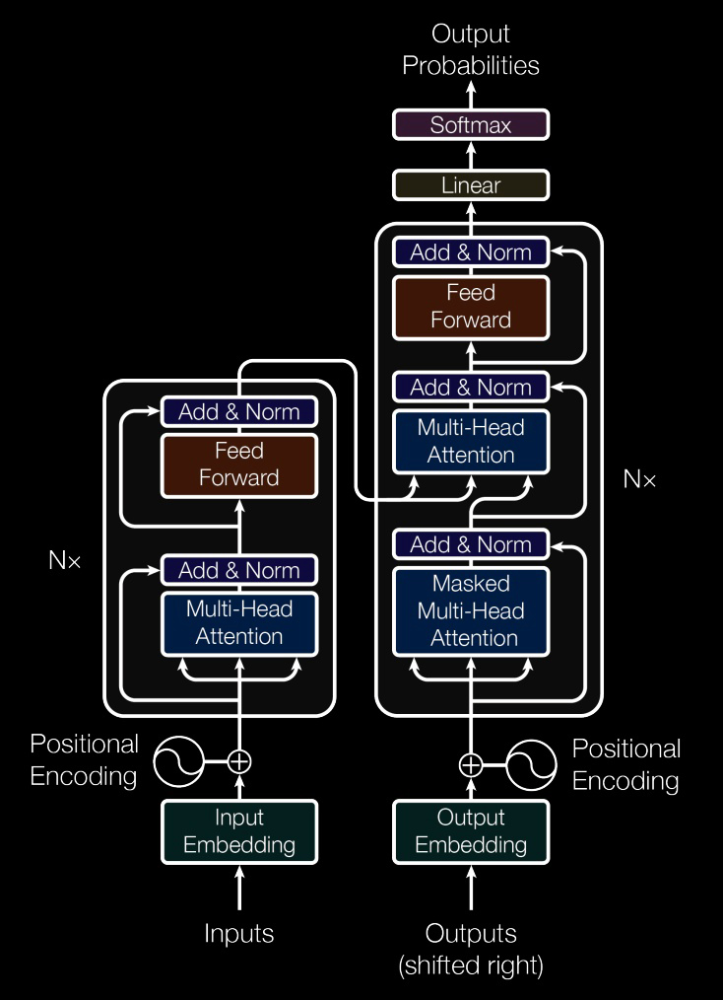

 - Multi-Head Attention

     > 为了使模型能够**让不同的 head 在不同的表示子空间里，同时学习不同的 token 关系**

     > 单个 head 对每个位置只产生一组注意力分布；多个 head 可以同时关注不同位置、提取不同信息。例如，一个关注局部搭配，另一个关注远距离依赖。多个 head 将多套结果拼接，再由 $W_O$ 融合。

     > **多头为什么要降维：** 保证总维度（$d_{model}$）不变，均分给各头，避免计算量和显存随头数成倍暴增（算力平衡）。

     > **head 越多越好吗？**  不一定。固定总维度时，head 越多，每个 head 越窄，可能限制单个 head 的表达能力，也可能产生冗余。

    > **为什么多个 head 的输出要 concat，而不是直接平均？** Concat 保留不同 head 的独立特征，再让 \(W_O\) 学习如何融合。 直接平均要求各 head 在对应维度上直接相加，会提前丢失它们各自的信息。Concat 后的输出投影可以学习更灵活的组合。

    注意
    | Attention 类型                    | Q 的来源                 | K、V 的来源        |
    | --------------------------------- | ------------------------ | ------------------ |
    | **Encoder self-attention**        | Encoder 当前层的输入表示 | 同一份表示         |
    | **Decoder masked self-attention** | Decoder 当前层的输入表示 | 同一份表示         |
    | **Decoder cross-attention**       | Decoder 前一个子层的输出 | Encoder 的最终输出 |

 - Positional Encoding

     **Positional Encoding** 与 input embedding 具有相同的维度，便于相加。加法叠信号，乘法叠特征。

     但是，如果直接使用计数的方式来进行 encoding，即 $pos = 1, 2, ..., n - 1$，那么最后一个 token 的encoding 将会比第一个 token 大很多，与原 embedding 相加后会造成数据不平衡的现象。原论文作者们的方法是使用了不同频率的正弦和余弦函数来作为位置编码：
     $$
         \begin{aligned}
             PE_{(pos,2i)}   & = sin(pos/10000^{2i/d_{model}}) \\
             PE_{(pos,2i+1)} & = cos(pos/10000^{2i/d_{model}}) \\
         \end{aligned}
     $$

    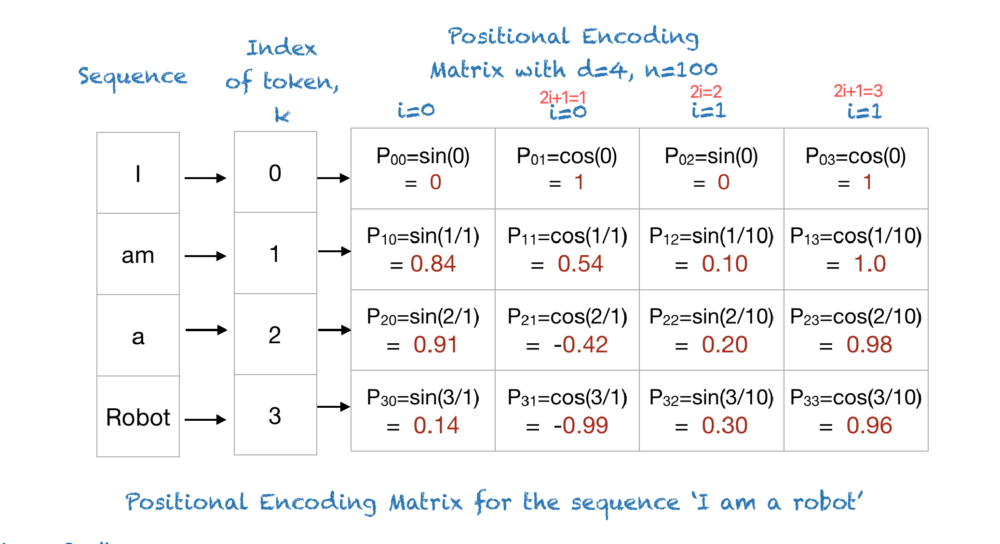
 - RoPE

    RoPE 按位置旋转 Q 和 K。简化表示：$q_m'=R_mq_m,\qquad k_n'=R_nk_n$

    二者的点乘为：$(q_m')^\top k_n' =q_m^\top R_m^\top R_nk_n =q_m^\top R_{n-m}k_n$

    **位置带来的影响通过相对位移 \(n-m\) 进入匹配分数。**

     > RoPE（Rotary Position Embedding）是另一种位置编码方式。它通过旋转矩阵将位置信息注入到 Q/K 中，而不是直接加到 embedding 上。RoPE 的核心思想是将每个 token 的表示视为一个复数向量，并通过旋转操作来编码位置信息。这种方法能够更好地捕捉序列中相对位置的关系，尤其在长序列中表现优异。
     - 跟加法编码比最大区别?
       - 加法把位置和内容混在一起,不显式控制相对关系; RoPE让相对位置信息直接进入QK点积,更贴合注意力的计算方式
     - 为什么能capture相对位置信息?
       - RoPE把位置变成旋转角度,Query在位置m就转mθ,Key在位置n就转nθ;当算点积时,两个旋转的公共部分会抵消,最后只剩下(R_{n-m}),也就是只跟角度差(n-m)θ有关,也就是只跟相对距离(n-m)有关。直觉类比就是钟表两根指针,各自转到某个角,它们之间的夹角只看相差多少。
       - **旋转把绝对位置变成角度,点积时只剩角度差,所以是相对位置。**
     - 怎么拓展到更长的sequence?
       - 旋转角度是线性增长的,所以可以直接把RoPE矩阵扩展到更长的序列,不需要重新训练。
     - 无限扩展上下文?
       - 不能。超过训练长度后，仍可能遇到位置分布变化和性能下降。

 - Residual Connection
   - Residual Connection，$y=F(x)+x$. 与 ResNet 的原理相似，**提供直接的信息和梯度通路，帮助深层网络训练**，可以帮助缓解深层神经网络训练困难的问题。同时，引入残差连接有助于减轻神经网络在深层退化的问题。

 - FFN 层
    > **Attention 负责跨 token 聚合信息，FFN 对每个 token 的表示做非线性变换。**

    > **为什么 FFN 先升维再降维？**  1. 升维：提供更多特征处理空间(升维不增加输入信息，提供更大的计算空间)。2. 非线性激活：让模型能学习复杂变换。3. 降维：融合特征，输出回模型维度。

    > **为什么 FFN 使用 SwiGLU 这类门控结构？** $\mathrm{FFN}(x) =\left[\mathrm{SiLU}(xW_g)\odot(xW_u)\right]W_d$
    普通 FFN：产生特征，再做非线性变换。SwiGLU：产生特征，同时根据输入计算调节系数，逐元素相乘后再输出。

  - 各层计算复杂度分析
    - Embedding 主要是查表
    - Attention 计算复杂度为 **$O(n^2 \cdot d)$**
      - 长度为 \(n\) 的序列中，每个位置都要与其他位置计算匹配，产生 \(n\times n\) 的分数矩阵。
    - FFN 计算复杂度为 **$O(n \cdot d^2)$**。
    > **FlashAttention 是否把计算复杂度降到线性** 没有。它用SRAM减少显存读写，避免完整存储注意力矩阵；只加速不降低复杂度。

## 6. Layer Normalization
- Batch Normalization 和 Layer Normalization
  - Layer Normalization 是对每一token进行缩放，不依赖batch size, NLP**序列长度不定**
  - Batch Normalization 是对每一列数据进行缩放，适用于 CNN 等图像任务。

- Pre-norm 与 post-norm
  - 对一个 attention 或 FFN 子层 F，忽略 dropout：

    $\text{Post-norm: } y=\mathrm{LN}(x+F(x))$

    $\text{Pre-norm: } y=x+F(\mathrm{LN}(x)).$

    英文：
    **Pre-norm applies normalization before the attention or feed-forward transformation and keeps a direct residual path. Post-norm normalizes after adding the residual. Pre-norm generally makes deep Transformers easier to optimize and stable because gradients have a more direct path through the residual stream.**

    Post-norm在子层和残差加完之后再norm，更直观，浅层网络容易训练。

> **为什么现在很多模型用 RMSNorm？** RMSNorm 根据特征的均方根进行缩放，通常不减去均值 $\mathrm{RMSNorm}(x) =g\odot\frac{x}{\sqrt{\frac1d\sum_i x_i^2+\epsilon}}$ **相比 LayerNorm，它简化了归一化计算。**
## 7. Causal Mask 和 Padding Mask 各解决什么问题？

 **The causal mask blocks future positions, while the padding mask blocks artificial padding tokens. Both operate on attention logits before softmax, but they enforce different constraints.**

## 8. RNN 与 Transformer 并行性

 RNN 难处理长文本，无法并行 优点：复杂度低

 **英文短答：** “A standard RNN has a recurrent dependency across time steps, even during teacher-forcing training. A Transformer can process known sequence positions in parallel, but standard autoregressive generation is still sequential across newly generated tokens.”

## 9. Decoder 的 Embedding layer 架构、流程和数学原理。

目标 token ID $y_t$ 从词表矩阵 $E\in\mathbb R^{V_{\text{ocab}}\times d}$ 中查出一行 $E[y_t]$。等价地，可以用 one-hot 向量 $u_t$ 表示为 $u_tE$，但实现通常直接查表。

在原始 Transformer 中，输入表示为 $x_t=\sqrt d E[y_t]+PE(t)$，再使用 dropout。训练用右移后的目标 token；推理用提示和已生成 token。采用 RoPE 的模型通常在 Q/K 上加入旋转位置操作，而不必在输入中加绝对位置向量。输出词表 projection 可以与 $E$ 共享权重。

**英文短答：** “The decoder maps token IDs to learned vectors through an embedding lookup. It then incorporates position information, with the exact mechanism depending on the architecture.”

## 10. Training 全流程中 Decoder 如何进行 Embedding？

假设目标为 `[A, B, EOS]`，decoder 输入为 `[BOS, A, B]`，三个位置的预测目标分别是 `[A, B, EOS]`。所有输入一次查表并加入位置信息，然后用 causal mask 同时计算三个位置的 logits。

Loss 经过输出层、decoder、必要时的 encoder 反向传播，也更新输入中用到的 embedding 行。若输入输出权重共享，embedding 还从输出词表投影接收梯度。模型不会在标准训练中先生成 A，再用生成结果预测 B。

**英文短答：** “During training, the decoder embeds a shifted ground-truth sequence. A causal mask allows all next-token losses to be computed in parallel without access to future targets.”

## 11. Inference 全流程中 Decoder 如何进行 Embedding？

先将源输入交给 encoder，或将 prompt 直接交给 decoder-only 模型。Decoder 对已有前缀做 embedding、位置处理和前向计算，根据最后位置的 logits 选择下一个 token，再将它加入前缀并重复，直到 EOS 或长度上限。

使用 KV cache 时，后续步骤一般只需处理新增 token，旧 token 各层的 K/V 已缓存。新增 token 必须使用正确的绝对位置或 cache offset。缓存的是 K/V 等激活，不是把 embedding 矩阵更新一遍；普通推理不训练参数。

**英文短答：** “At inference, the decoder embeds the prompt and then each newly generated token. With a KV cache, previous key and value states are reused rather than recomputed.”

## 12. BERT: Bi-directional Encoder Representation from Transformers

- 双向表示

    区别于 Bi-LSTM 的双向表示，分别正序和反序得到表示再进行拼接，BERT 中的双向指的是根据前文和后文来预测被 masked 的单词。

- Embedding

    BERT 中的 embedding 由三个部分组成：Token Embedding，Segment Embedding，Position Embedding。
    - Token Embedding 是词向量，其中，第一个词为 [CLS] 标记，可以用于之后的下游任务。
    - Segment Embedding 用于区分 BERT 输入的两个句子，之后的 pre-training 将会用到。
    - Position Embedding 由学习得到，而不是普通 Transformer 中的三角函数。

- Pre-training Tasks
    - Masked LM

        在训练过程中，将 15% 的单词用 [mask] 代替，让模型去预测被遮挡的单词，最终的损失函数只计算被遮盖的 token。

        但是如果一直用 [mask] 表示（实际预测时并不会遇到 [mask] 标记）会影响模型，因此作者设置了一下规则：80% 的时间用 [mask] 来代替被遮盖的单词，10% 的时间随机用另一个单词代替，剩下 10% 的时间保留原单词。

        值得注意的是，模型并不知道哪些单词被遮盖了，这使得模型能够关注到每一个单词，依赖上下文信息预测单词，赋予了模型一定的纠错能力。

    - Next Sentence Prediction

        对于输入的两个句子 A 和 B，让模型预测 B 是否应该是 A 的后一句。该任务的目的是让模型理解两个句子直接的关系。

- 为什么BERT在第一句前会加一个 [CLS] 标志?

    为了获得整个句子的语义表示，用于其他任务。一个没有明显语义的 [CLS] 标记会更加**公平**地融合句子中每个单词的语义，从而获得更加完整的句子表示。

- BERT 的优缺点？

    优点是建立在 Transformer 上，相对rnn更加高效，具有强大的信息提取能力，能捕捉更长距离的依赖。且双向模型比单向的 Transformer 效果更好；

    缺点则是该模型几乎无法修改，只能拿来直接用。由于只能预测 15% 的词，模型收敛较慢，需要强大算力支撑。

- 使用BERT预训练模型为什么最多只能输入 512 个词，最多只能两个句子合成一句？

    这是由于在预训练的时候，在参数中设置了 position embedding 的大小和 segment embedding 的大小，分别为 512 和 2。在这之外的单词和句子会没有与之对应的 embedding。

- BERT 的输入和输出分别是什么？

    输入是 token embedding，segment embedding 和 position embedding，输出是文本中各个字 / 词融合了全文语义信息后的向量表示。

- 计算 BERT 模型的参数数量？
    - 词向量参数：vocab_size=30522, hidden_size=768, max_position_embedding=512, token_type_embedding=2，因此参数量为 (30522 + 512 + 2) * 768。
    - Multi-head Attention：len = hidden_size = 768, $d_k$ = $d_q$ = $d_v$ = $d_{model}/n_{head}$ = 768 / 12 = 64，将12个头进行拼接后还要进行线性变换，因此参数量为 768 * 64 * 12 * 3 + 768 * 768。
    - 前馈网络参数：$\text{FFN}(x)=\max(0, xW_1+b_1)W_2 + b_2$，W_1 和 W_2 的参数量均为 768 * (768 * 4)，总参数量为 768 * 768 * 4 * 2。

    总参数量 = 词向量参数 + 12 (层数) * (Multi-head + 前馈网络) = 110M

# Scaling laws：内容、使用方法和启发

Scaling laws 是在特定数据分布、模型族和训练设置下，性能与参数量、数据量、计算量之间的**经验规律**。对语言模型，经典研究通常拟合 held-out next-token cross-entropy；它不是 “模型变大，所有能力都按同一规律提升”。[S1–S2]

一个常见形式是：

$$
L(N,D)\approx E+\frac{A}{N^\alpha}+\frac{B}{D^\beta},\qquad C\approx 6ND.
$$

N=参数量，D=训练 token 数，C=训练 FLOPs，E=拟合的渐近 loss 项。6ND 是 dense Transformer 常用粗估，假设和忽略项要记住；长上下文 attention 开销、MoE、不同训练实现可能需要更细的计算模型。
> a model's cross-entropy loss decreases following a power-law relationship as we increase the parameter count ($N$) and training data volume ($D$).From an engineering standpoint, this gives us two main takeaways. First, model performance is highly predictable, meaning we can run small-scale experiments to accurately forecast the performance of much larger models. Second, we face diminishing returns—as the model gets larger, achieving the same marginal drop in loss requires exponentially more parameters or data.

> For a standard dense Transformer, the total training compute (in FLOPs, denoted as $C$) is roughly proportional to the product of parameters and training tokens. We typically estimate this using the formula $C \approx 6ND$.This formula highlights a crucial reality: scaling up the model size and scaling up the dataset are equally expensive. Doubling the parameters costs just as much compute as doubling the training tokens.
- Kaplan 与 Chinchilla 的区别

  - Kaplan 等工作提出 loss 随规模的经验幂律，并研究固定预算下的分配。[S1]
  - Chinchilla 强调许多大模型相对数据量训练不足；其实验范围内，参数量和 token 数应随预算近似同步增加。[S2]
  - 典型概括是 \(N_{opt}\propto C^{0.5}\)、\(D_{opt}\propto C^{0.5}\)。**预算翻倍不是参数和数据都翻倍**，而是两者各约乘 sqrt(2)；两者都翻倍约需四倍预算。
  - “20 tokens per parameter” 是 Chinchilla 附近的经验比例，不是每个模型必须遵守的常数，更不是要把一个小数据集机械重复到 20 倍参数量。

> Scaling laws describe empirical relationships between model performance and resources such as parameter count, training data, and compute. For language models, the quantity being modeled is often held-out cross-entropy loss.

> The practical value is resource allocation. Under a fixed training budget, making the model larger is not always the best choice; the model also needs enough data. Chinchilla showed that, in its experimental setting, model size and training tokens should grow at roughly similar rates as compute increases.

> I would use small-scale experiments to estimate the trend for my own setting, then choose a model and data budget and validate the prediction at a larger scale. I would also include inference cost if the model will serve many requests.

> For agents, the related question is how to spend test-time compute. More retrieval, candidate solutions, or verification may help, but the gains depend on the task and the verifier. I would measure verified task success against total cost and allocate compute to the current bottleneck, rather than assuming that more parameters or longer reasoning always produce the best result.

# LLM 解码

## Greedy Search

$$
y_t=\arg\max_y p(y\mid y_{<t},x)
$$

每步都挑当前概率最大的那个。快、确定、可复现；缺点是每一步只顾眼前，容易陷进重复循环，开放生成时也偏平庸。

一个容易忽略的点：**贪心不等于最优**。整句概率最高的序列，未必每一步都取最大值——第一步让一点，后面可能赚回来更多。这正是 beam search 存在的理由。

适合抽取式任务、分类式输出、部分代码补全。

## Temperature

在 softmax 之前先把 logits 除以一个温度 $T$：

$$
p_i=\frac{\exp(z_i/T)}{\sum_j\exp(z_j/T)}
$$

- $T<1$：分数差被放大，分布更尖，模型更保守（$T\to0$ 就退化成 greedy）。
- $T=1$：原始分布。
- $T>1$：分数被压平，长尾 token 更容易被采到，更有创意，也更容易胡说。

注意它调的是**分布形状**，不是「随机不随机」这个开关——$T=0.7$ 依然是随机采样，只是采到冷门 token 的机会小了。

## Top-K Sampling

只保留概率最高的 $K$ 个 token，重新归一化后采样。

- 优点：直接砍掉长尾里的低质量 token。
- 缺点：$K$ 是固定的，不适应分布的尖锐程度。某一步前 5 个 token 已覆盖 99% 概率（此时 $K=50$ 会放进 45 个垃圾），另一步前 5 个只覆盖 40%（此时 $K=5$ 又砍掉了合理选项）。

## Top-P / Nucleus Sampling

选取累计概率刚好达到 $p$ 的最小 token 集合，再归一化采样。

- 优点：候选集大小**动态变化**——分布尖的时候只留几个，分布平的时候自动放宽，正好补上 Top-K 的短板。
- 缺点：仍有随机性，也不解决事实错误。

实践中 top-p（0.9 左右）配 temperature 是最常见的组合，两者叠加使用。

## Beam Search

每一步保留累计 log probability 最高的 $B$ 条候选序列，最后从中选一条。相比 greedy 更接近「整句概率最高」的序列。

- 优点：翻译、语音识别这类目标相对确定的任务上常有效。
- 缺点：成本随 beam size 线性增长；开放生成里偏好安全、短、重复的文本（高概率 ≠ 高质量）；需要配长度归一化，否则天然偏好短句。
- 现代 LLM 的对话/推理场景**基本不用 beam**，多样性和质量的性价比不如采样。

---

## 目录

| 部分 | 内容 |
| --- | --- |
| [第一部分（一）：机器学习与深度学习](bagu.md) | ML 基础、评估指标、经典算法、神经网络与优化 |
| [第一部分（二）：NLP、Transformer 与解码](bagu2.md) | 词向量、RNN / LSTM、Attention、Transformer、Scaling laws 与解码 |
| [第一部分（三）：LLM 训练与并行策略](bagu3.md) | 预训练、SFT、RLHF、DPO、GRPO、蒸馏、合成数据与并行训练 |
| [第二部分：ML Coding 基础](../11-ml-coding-basics.md) | CodeSignal、NumPy、Pandas、PyTorch、纯 Python 矩阵运算 |
| [第三部分：ML Coding 专题](../12-ml-coding.md) | Transformer、经典机器学习、神经网络层与 NLP 手写实现 |
