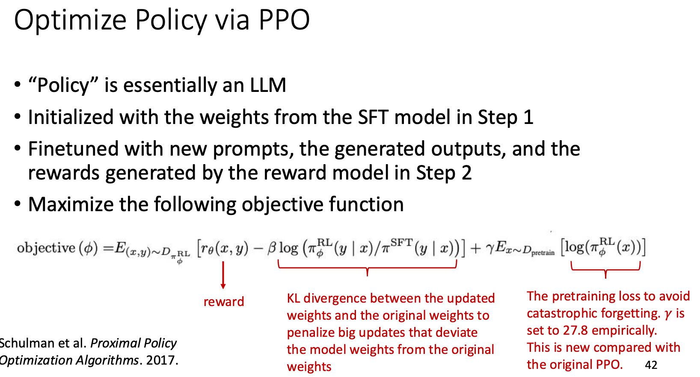

# LLM Training

[返回目录](../README.md) · [上一篇：NLP、Transformer 与解码](bagu2.md)

## 阶段一：Pretraining

目标就是最朴素的 next-token prediction：

$$
\mathcal L=-\sum_t\log p_\theta(y_t\mid y_{<t})
$$

在海量文本上最小化这个交叉熵，模型被迫把语法、事实、推理模式全都压进权重里——因为要准确预测下一个词，这些都是必需的。

**数据比模型结构更决定上限**，工程上真正花时间的是：

- **去重**：近似重复的文档会让模型走向记忆而非泛化，也会浪费算力。通常做 MinHash / SimHash 级别的模糊去重。
- **质量过滤**：规则（长度、符号比例、语言识别）加分类器打分，把网页垃圾筛掉。
- **去污染**：把评测集从训练数据里洗出去，否则跑分虚高、决策全错。
- **配比**：网页、代码、书籍、论文、多语种的比例。代码数据能提升推理能力，是常见的「便宜加成」。
- **课程安排**：常见做法是训练末期提高高质量数据比例（annealing），以及分阶段把上下文窗口从 4k 扩到 128k，而不是全程用长序列（长序列太贵）。

产出的 base model **只会续写，不会听指令**。你问它「法国的首都是哪里」，它可能续写出「德国的首都是哪里？意大利的首都是哪里？」——因为训练语料里这种句子后面常常跟着更多同类问题。

## 阶段二：SFT（Supervised Fine-Tuning）

- **输入**：prompt 与人工/高质量模型示范回答。
- **输出**：SFT policy $\pi_{\text{SFT}}$。
- **目标**：让预训练模型学会对话格式、任务遵循和基本安全行为。

$$
\mathcal L_{\text{SFT}}
=-\sum_t\log \pi_\theta(y_t\mid x,y_{<t})
$$

就是逐 token 的 cross-entropy：给定 prompt $x$ 和已生成的前缀 $y_{<t}$，让模型把示范答案的下一个 token $y_t$ 的概率推高。注意它对示范里的每个 token 一视同仁，这正是 SFT 学不到偏好的原因。

## 阶段三：Reward Model

- **输入**：同一 prompt 下多个候选回答，以及人类偏好排序或成对比较。
- **输出**：奖励模型 $r_\phi(x,y)$。
- **目标**：预测人类更偏好哪个回答。

## 阶段四：RL Policy Optimization

- **输入**：prompt、当前 policy 采样回复、RM 奖励、reference policy。
- **输出**：对齐后的 policy。
- **目标**：最大化偏好奖励，同时用 KL 约束避免偏离参考模型过远：

$$
\max_\theta
\mathbb E_{x,y\sim\pi_\theta}
\left[r_\phi(x,y)
-\beta D_{\mathrm{KL}}
(\pi_\theta(\cdot|x)\Vert\pi_{\text{ref}}(\cdot|x))\right]
$$

这个目标函数是后面所有内容的总纲，两项在拔河：前一项要**分数高**（RM 觉得好），后一项要**别跑远**（离参考模型不能太离谱），$\beta$ 是这场拔河的力度旋钮。注意 $y\sim\pi_\theta$——回答是模型自己采样出来的，不是数据集里给定的，这正是它属于 RL 而不是监督学习的地方。

## PPO：经典 RLHF 的基石

RL 在游戏和机器人上跑得好好的，搬到 LLM 上却格外难训，原因有三个：

- **动作空间极大**：每一步要从整个词表（几万到十几万个 token）里挑一个。
- **轨迹很长**：一条回答几百上千个 token，等于几百上千步连续决策。
- **奖励来得极晚**：数学题、代码题往往要整段生成完、跑完单测才知道对不对，这叫 outcome reward。中间几百步全是「不知道好坏」。

三件事叠在一起的直接后果是**策略梯度的方差极大**：同一个 prompt 采样两次，回报可能天差地别，参数被推向完全不同的方向，训练极易不稳定。PPO 的每一个设计，都是围绕「把方差压下去、把单次更新限制住」展开的。

### 为什么不是 REINFORCE 或 Q-learning？

**对比 REINFORCE**

$$
\nabla_\theta J
=\mathbb E[
\nabla_\theta\log\pi_\theta(y|x)(R-b)]
$$

读法：$\nabla_\theta\log\pi_\theta(y|x)$ 指向「让这条回答更容易被生成」的方向，前面乘的标量 $(R-b)$ 决定推还是拉——回报高于基线 $b$ 就正向推一把，低于基线就往回拽。$b$ 只为降方差，不改变梯度的期望。

它足够简洁，但整条回答只有一个标量在指挥几百步 token 的更新，方差大到难以直接使用。PPO 在此之上加了 value/advantage 估计、mini-batch 多轮复用同一批采样，以及 clipped objective，样本效率和稳定性都好得多。

**对比 Q-learning**

Q-learning 更适合离散且可反复探索的 Markov 环境。对 LLM：

- 状态是任意长的 token 前缀。
- 动作空间是整个大词表。
- 给每个「状态—动作」学一个 Q 值成本极高。
- 离线 bootstrapping 碰上分布外动作容易发散。

直接优化生成策略的 policy gradient 要自然得多。

### 核心机制三件套

**① Clipped Objective：不许一步迈太远**

先定义新旧策略在同一个 token 上的概率比（importance sampling ratio）：

$$
r_t(\theta)
=\frac{\pi_\theta(a_t|s_t)}
{\pi_{\theta_{\text{old}}}(a_t|s_t)}
$$

$r_t>1$ 表示更新后模型更愿意吐出这个 token，$r_t<1$ 表示更不愿意。它衡量的就是「这一步把策略改动了多少」。

$$
\mathcal L_{\text{clip}}
=\mathbb E_t
\left[
\min\left(
r_tA_t,
\operatorname{clip}(r_t,1-\epsilon,1+\epsilon)A_t
\right)
\right]
$$

$A_t$ 是优势（advantage），表示这个 token 比预期好多少。式子读作：正常按 $r_tA_t$ 更新，但一旦 $r_t$ 跑出 $[1-\epsilon,1+\epsilon]$（常用 $\epsilon=0.2$）就换成截断版本，外面再套一个 $\min$ 取更保守的那个。

效果是**好 token 的概率最多提到 1.2 倍就不再给奖励，坏 token 最多压到 0.8 倍**，想再往前冲梯度直接归零。这正是名字里 proximal（近端）的由来：每次只在旧策略附近挪一小步，防止单次更新过猛毁掉模型能力。

**② Actor-Critic 双模型：把方差压下去**

除了负责生成的 policy（actor），PPO 还要训练一个与 policy 规模相近的 value model / critic，用来估计每个状态的价值 $V(s_t)$，进而算出优势：

$$
A_t\approx R_t-V(s_t)
$$

也就是「实际拿到的回报」减去「本来预期能拿多少」（实践中用 GAE 做更平滑的估计）。有了这个减法，梯度信号从「这条回答的绝对得分」变成「比预期好还是差」，方差大幅下降。

它其实就是 REINFORCE 里那个基线 $b$ 的升级版：$b$ 是一个全局常数，$V(s_t)$ 是随状态变化、并且学出来的基线。

**③ KL 惩罚：别跑离语言模型太远**

在 reward 里减去相对 reference model（通常就是 SFT 模型）的 KL 惩罚：

$$
\tilde r
=r_\phi(x,y)
-\beta D_{\mathrm{KL}}
(\pi_\theta\Vert\pi_{\text{ref}})
$$

防止模型为了刷高 RM 分数而偏离正常语言分布。这一项的调节是实操中最容易翻车的地方，下一节单独讲。

### 痛点与局限

- **显存和计算开销极高**：训练时要同时驻留 4 个大模型——policy（actor，训练中）、critic（训练中）、reward model（推理）、reference model（推理）。其中 critic 通常和 policy 规模相近，等于凭空多出一个正在训练的大模型，显存直接爆炸。
- **调参复杂**：PPO 的成败很大程度上取决于 critic 拟合得好不好。critic 估不准 → advantage 有偏 → actor 被带偏 → 采样分布随之变化 → critic 更估不准。actor 与 critic 的这场博弈很容易导致训练崩盘。

后面的 DPO 和 GRPO，本质上都是在削减这套架构的成本。

## RLHF 训练的两大核心难题

上一节三件套里的 KL 惩罚，和它要防的 reward hacking，是实际跑 RLHF 时最容易翻车的两处。两者是一体两面：KL 是手段，防的就是 hacking。

### ① KL 惩罚与 $\beta$ 调节

**作用**：扮演一根安全绳，防止模型为了拿高 RM 分数而丢掉原有的语言通顺度、语法能力和泛化能力。换个说法，它相当于在奖励最大化中加了 trust region / 正则项，同时降低 RM 在分布外区域被钻空子的风险。

**$\beta$ 过大**：模型过于保守，几乎不敢改变，输出黏在 SFT/reference 上，RL 信号被 KL 压死，奖励和胜率都提不动——等于 RL 优化无效。

**$\beta$ 过小**：策略快速漂移，语言质量下降，随之而来的是 reward hacking、模式化重复、输出越写越长、原有能力遗忘；监控上会看到 KL、entropy、长度或 reward 异常增长。

**工程实践**：不能只盯 reward 曲线，要同时观察

- RM reward 与独立人工 / LLM judge 的胜率；
- 每 token KL 和整条序列的 KL；
- 输出长度、entropy、重复率、拒答率；
- 各领域的能力回归测试。

常用做法是设一个 **target KL**，据此动态缩放 $\beta$：实际 KL 高于目标就调大 $\beta$ 收紧，低于目标就调小放松。

### ② Reward Hacking

**现象**：RM 只是人类偏好的不完美代理（proxy）。RL 优化会主动去找 RM 的漏洞——只要某种行为能骗到高分，模型就会把它做到极致。

典型例子：客服模型的 RM 偏好「礼貌、详细」。RL 之后，模型对任何投诉都先长篇道歉、重复一遍用户的观点、再承诺一个兑现不了的补偿。RM 分数一路走高，而用户真正需要的「把问题解决掉」反而消失了。

**应对手段**：

- **数据层面**：偏好数据里加入针对冗长废话、讨好奉承（sycophancy）、虚假引用、格式投机的反例和 hard negatives，以及强调简洁性和事实性的正例。
- **奖励层面**：多维奖励（帮助性、正确性、安全、长度、风格分开建模）；长度惩罚（length penalty）；rule-based verifier、工具执行结果或事实核验做硬校验；RM ensemble 配不确定性估计。
- **约束层面**：KL 约束、长度约束和早停，避免对 RM 过优化。
- **评估隔离**：**严禁**用训练用的那个 RM 评估最终模型，必须换独立第三方 judge（更强的模型）或人工盲评；同时定期把新 policy 的高奖励样本捞出来人工审计，做 adversarial data collection。

一个实用的过优化信号：Best-of-N 里随着 N 增大，RM 分数继续升高但人工判定的质量开始下降，说明已经在刷分了。

## DPO

DPO（Direct Preference Optimization）从 KL 正则化的 RL 目标推导出最优策略与奖励之间的关系，把隐式奖励代回 Bradley-Terry 偏好模型，直接用偏好 pair 训练 policy，不需要显式 Reward Model、在线采样和 PPO。

典型目标：

$$
\mathcal L_{\text{DPO}}
=-\log\sigma\left(
\beta\left[
\log\frac{\pi_\theta(y_w|x)}{\pi_{\text{ref}}(y_w|x)}
-\log\frac{\pi_\theta(y_l|x)}{\pi_{\text{ref}}(y_l|x)}
\right]\right)
$$

怎么读这个式子：括号里两项形状完全一样，都是「当前模型相对参考模型，把这条回答的概率抬高了多少」——DPO 把这个比值的对数当作**隐式奖励**。于是 chosen 减 rejected，就是一个 Bradley-Terry 里的分数差，外面套上 $-\log\sigma(\cdot)$，正好就是第 4 节那个 RM 损失的形状。

区别只在于优化对象换了：RM 训练时调的是 $r_\phi$，DPO 直接调 $\pi_\theta$。所以它提高 chosen 相对 reference 的概率优势，同时压低 rejected 的相对优势。

这也意味着 DPO 的训练循环和 SFT 几乎一样：读一批离线 pair、前向、算 loss、反向——没有采样，没有 RM，没有 critic。$\beta$ 依然在（它来自原 RL 目标里的 KL 系数），控制允许偏离 reference 多远。

### DPO 局限

- 偏好数据质量和覆盖范围决定上限。
- 不会主动探索超出数据的新推理策略。
- 对 chosen/rejected 长度、难度和噪声敏感。
- 对数学/代码等可验证任务，在线 RL 能利用执行反馈，往往更有潜力。

## GRPO：面向 Reasoning 的轻量化革命

针对 PPO 的显存和调参痛点，GRPO（Group Relative Policy Optimization）做了一个关键革新：**用同组样本的平均表现，替掉那个学出来的 critic**。

**① 取消 Critic**：完全摒弃独立的 value / critic model，直接省掉接近一半的训练显存与计算量。

**② Group Sampling（组内采样）**：对同一个 prompt，让旧策略一次性采样出一组 $G$ 个候选回答，各自得到奖励 $r_1,r_2,\ldots,r_G$。

**③ Group Relative Advantage（组内相对归一化）**：直接用这组奖励的均值和标准差算出每个回答的相对优势：

$$
A_i=\frac{r_i-\operatorname{mean}(r)}
{\operatorname{std}(r)+\epsilon}
$$

读法：$\operatorname{mean}(r)$ 充当 baseline，$\operatorname{std}(r)$ 把不同题目的奖励尺度拉齐，$\epsilon$ 防除零。答得比同组平均好，$A_i>0$，这条轨迹被强化；比平均差就被压下去。

关键在于**这个 baseline 是自适应的**：难题上大家都答不好、平均分低，你只要比同组稍好就是正优势；简单题上大家都对，优势自然趋近 0。它抵消的正是不同 prompt 之间的难度差异——而这本来是 PPO 里 critic 的职责。

**④ PPO 式更新**：拿着这个组内 advantage $A_i$，继续套用 PPO 的 ratio clipping 和 KL 正则去更新 policy。所以 GRPO 不是另起炉灶，而是把 PPO 的 advantage 来源换了。

### 相比 PPO

- **省显存和计算**：去掉与 policy 规模相近的 critic，训练时只剩 policy、reference 和 RM/verifier。
- **相对比较更稳**：同一 prompt 的组内 baseline 天然消化了题目难度差异，也不存在 critic 估不准带崩 actor 的问题。
- **适合可验证任务**：一个 prompt 可以采样多条推理轨迹，用标准答案或单元测试直接打分，连 RM 都可以省掉。

### 局限

- 每个 prompt 要采样 $G$ 条回答，rollout 成本高。
- 若组内奖励全相同（全对或全错），标准化后 $A_i$ 全是 0，这批数据几乎没有学习信号。
- 序列最终奖励广播到每个 token，信用分配仍然较粗。
- 组内均值/方差本身带采样噪声，$G$ 太小时不稳。
- 长度和 token-level clipping 的处理可能引入偏差

## 推理任务的奖励设计

前面几节的奖励都来自一个学出来的 RM。到了数学、代码这类**答案可验证**的推理任务，奖励的设计方式完全不同，也是当前推理模型（o1、R1 这条线）的核心。

### 可验证奖励（RLVR）

奖励不再是模型打分，而是一个**程序**：数学题比对最终答案、代码跑单元测试、形式化证明送进检查器，再加一点格式奖励（比如是否把推理过程写进指定标签里）。

好处是根本性的：规则不会被说服。第 6 节讲的 reward hacking 之所以存在，是因为 RM 只是人类偏好的近似；而单元测试没有「被讨好」这个概念，模型只能真的把题做对。这就是为什么这条路线能放心地把 RL 跑得很久。

代价是适用面窄——只能用在答案可自动判定的领域，开放式写作、对话依然得靠 RM。

### Outcome Reward vs. Process Reward

| 维度     | ORM（Outcome Reward Model） | PRM（Process Reward Model）       |
| -------- | --------------------------- | --------------------------------- |
| 打分对象 | 只看最终答案对不对          | 给推理过程的**每一步**打分        |
| 标注成本 | 低，有标准答案就能自动判    | 高，要人标或自动标每一步          |
| 信号密度 | 稀疏，整条轨迹只有一个分    | 稠密，每步都有反馈                |
| 主要问题 | 蒙对也给满分                | 标注贵、步骤边界难定义、易被 hack |

**ORM 的隐患**：模型完全可能靠一堆错误推理凑出正确答案，ORM 照样给满分——等于在奖励错误的推理模式。信用分配也粗：整条几千 token 的推理只有一个分，模型不知道是哪一步做对了。

**PRM 怎么标**：早期靠人工逐步标注（OpenAI 的 PRM800K）。后来有了自动化办法——从某一步出发多次 rollout，如果从这里出发能高频到达正确答案，就认为这一步是好的（Math-Shepherd 的思路），把「步骤质量」转化成「后续成功率」。

**现在的实践取向**：R1 的经验是，**outcome reward 加规则验证就足以激发长链推理**，PRM 在大规模 RL 里训练复杂且容易被 hack（模型学会写出「看起来很像正确步骤」的话）。所以主流 RL 训练转向可验证的 outcome reward。但 PRM 在**推理时的重排序**（Best-of-N 里给候选打分，见 [解码](bagu2.md#llm-解码)）依然好用——那里不做梯度更新，模型没有机会去 hack 它。

### RL 激发推理能力

DeepSeek-R1 报告里两个值得记住的观察：

- **R1-Zero**：完全跳过 SFT，直接在 base model 上用可验证奖励做 RL，模型**自己涌现出**了长链推理、回头检查、换一种解法这些行为——没人教它「要反思」，只是因为反思能提高答对率。代价是可读性差、中英文混杂。
- **R1**：先用少量高质量长推理数据做冷启动 SFT，再做 RL，兼顾了可读性和能力。

要注意 RL 的作用边界：它**强化的是模型已有的行为**，而不是凭空创造新能力。这也解释了为什么小模型直接做 RL 效果远不如从大模型蒸馏

## 知识蒸馏（Distillation）

用一个强模型（teacher）的输出去训练一个小模型（student）。它在 LLM 时代有两种完全不同的做法。

### ① Logit 蒸馏（经典 Hinton 做法）

$$
\mathcal L=\alpha\underbrace{\operatorname{CE}(y,p_S)}_{\text{对真实标签}}
+(1-\alpha)\,\tau^2\underbrace{D_{\mathrm{KL}}(p_T^{(\tau)}\Vert p_S^{(\tau)})}_{\text{对齐 teacher 分布}}
$$

核心洞察是 teacher 的**完整概率分布里藏着「暗知识」（dark knowledge）**：它不只说「这是猫」，还顺带说了「有 10% 像狗、0.01% 像汽车」。这些类别之间的相对关系，信息量远大于 one-hot 标签——one-hot 只告诉你答案，teacher 的分布还告诉你「哪些答案错得不离谱」。

式子里两个细节：温度 $\tau$ 把两边的分布都调软，让暗知识（那些小概率的相对大小）显现出来；前面乘 $\tau^2$ 是因为软化会把梯度整体缩小 $\tau^2$ 倍，乘回来才能让这一项的权重不随温度漂移。

### ② 序列级 / 数据蒸馏（LLM 时代的主流）

直接让 teacher 生成大量回答，student 拿这些回答当 SFT 数据训。

- 不需要 teacher 的 logits，只要能调用它就行，因此闭源模型也能当 teacher（尽管这通常违反其服务条款）。
- 实现上就是 SFT，没有任何新机制，这是它流行的最大原因。现在绝大多数开源小模型都这么来的。
- **一定要过滤**：只保留答案正确、通过单测的轨迹（即拒绝采样），否则等于在系统性地学习错误示范。

DeepSeek-R1 报告里一个值得记住的结论：把大模型的长链推理轨迹蒸馏进小模型，效果**显著优于**直接对小模型做 RL。推理能力可以「教」，但小模型自己「悟」很难——RL 只能强化模型已有的行为，而小模型压根没有那些行为可强化。

#### 注意

- student 会继承 teacher 的错误、风格和偏见，且在没有 verifier 过滤的情况下**基本无法超过 teacher**。
- 蒸馏出来的模型在被蒸馏的那类任务上很强，泛化到别的分布上则未必。

## 合成数据（Synthetic Data）

**为什么需要**：高质量人类数据既有限又贵，而某些能力几乎没有现成语料——多轮函数调用、长上下文推理、罕见语言、特定格式输出，网上根本不存在成规模的例子。

### 常见造法

- **蒸馏式**：直接用更强的模型生成（见上一节）。
- **Self-Instruct 式**：给少量种子任务，让模型自己扩写出更多指令，再自己作答，人工只做抽检。
- **拒绝采样（STaR / RFT）**：对有标准答案的题目采样多条解法，**只保留答案正确的**拿去训练。这是把推理能力自举上去的主力方法。
- **程序化生成**：用代码、模板或形式化系统造题，天然自带标准答案。比如先随机生成一段代码再反推题面，或用符号计算库生成数学题。
- **改写原始语料**：把网页内容改写成问答对或教科书风格（Phi 系列的路子），提高信息密度。

### 核心是「能不能自动判对错」

合成数据的价值上限，取决于你有没有一个可靠的验证器。有 verifier 的领域（数学答案匹配、代码跑单测、形式化证明检查）收益最大，因为可以放心地大规模生成再筛选；开放式写作最难，因为没人能自动判断「这段文案好不好」。

### 风险

- **模型崩溃（model collapse）**：反复用自己的生成物训练自己，分布的尾部会逐渐消失，多样性坍缩，模型越来越平庸。缓解办法是始终保留真实数据作锚点，并做严格过滤，而不是无限自举。
- **错误会被放大**：一个事实错误被生成一万次，就成了模型眼中的「常识」。
- **评测污染**：合成题可能与评测集撞车，需要做污染检测。

# 常见并行策略

训练时，GPU 内存主要用于保存：

- **Parameters**：模型参数；
- **Gradients**：每个参数的梯度；
- **Optimizer States**：例如 AdamW 的一阶和二阶动量；
- **Activations**：前向传播产生、反向传播需要的中间结果；
- **Temporary Buffers**：Attention、通信和算子使用的临时空间。

不同并行方法切分的是不同内容：

| 并行方法                       | 主要切分对象                 | 主要解决的问题       |
| ------------------------------ | ---------------------------- | -------------------- |
| Data Parallelism               | 训练数据                     | 提高整体吞吐         |
| ZeRO / FSDP                    | 参数、梯度、Optimizer States | 减少单卡模型状态     |
| Tensor Parallelism             | 单层中的矩阵计算             | 单层模型放不下       |
| Pipeline Parallelism           | 不同网络层                   | 整个模型放不下       |
| Sequence / Context Parallelism | 序列和激活值                 | 长上下文激活占用过大 |
| Expert Parallelism             | MoE Experts                  | MoE Expert 参数过大  |

实际训练通常不会只使用一种，而是根据内存、通信和集群拓扑组合使用。

## Data Parallelism

Data Parallelism 的基本做法是：

1. 每张 GPU 保存一份完整模型；
2. 不同 GPU 处理不同数据；
3. 每张 GPU 独立完成前向和反向传播；
4. 通过 All-Reduce 同步梯度；
5. 所有 GPU 使用相同梯度更新参数。

## DP 和 DDP 的区别

在 PyTorch 中：

- `DataParallel` 通常由一个进程控制多张 GPU，主卡容易成为瓶颈；
- `DistributedDataParallel` 通常每张 GPU 使用一个独立进程，通过 All-Reduce 同步梯度。

实际多 GPU 训练一般使用 DDP，而不是旧式的 `DataParallel`。

需要注意：

> Data Parallelism 并不会减少单张 GPU 保存的模型状态，只是把数据分给不同 GPU。

如果模型本身无法装入单卡，需要使用 FSDP、ZeRO、TP 或 PP。

## ZeRO 与 FSDP

普通 Data Parallelism 在每张 GPU 上都保存完整的：

- Parameters；
- Gradients；
- Optimizer States。

ZeRO 的核心思想是：

> 既然不同 Data-Parallel Ranks 最终维护的是同一个模型，就不需要让每张 GPU 永久保存所有模型状态。

## Tensor Parallelism（TP）

把单层矩阵乘法沿维度切到多卡。例如列并行和行并行线性层。适合模型单层过大时，但层内频繁 collective，对高速互联要求高。

Tensor Parallelism 的优点：

- 可以切分单个超大线性层；
- 降低每张 GPU 保存的参数和部分激活值；
- 适合单层参数已经无法放入一张 GPU 的模型。

主要代价：

- 几乎每一层都需要 Collective Communication；
- 对 GPU 间带宽和延迟要求很高；
- TP Degree 越大，单张 GPU 的矩阵越小，计算效率可能下降。

## Pipeline Parallelism（PP）

Pipeline Parallelism 按网络深度切分模型。

例如，一个 48 层模型可以分成 4 个 Stage：

- Stage 1：第 1–12 层；
- Stage 2：第 13–24 层；
- Stage 3：第 25–36 层；
- Stage 4：第 37–48 层。

一个完整 Batch 会进一步切成多个 Micro-batches，在不同 Stage 之间流水执行。

Pipeline Parallelism 的优点：

- 每张 GPU 只保存部分网络层；
- 通信内容主要是 Stage 之间的激活值和梯度；
- 可以将模型扩展到多个节点。

主要问题是 Pipeline Bubble。流水线启动和结束阶段，会有部分 GPU 等待其他 Stage。

## 实际选型

通常组合为 DP/FSDP + TP + PP，MoE 再加入 EP。原则是：

- TP 尽量限制在高速互联域内。
- PP 跨更慢节点也相对可行，但要减少 bubble。
- DP 扩全局吞吐。
- 并行度不是越高越好，通信、batch、内存和容错必须联合优化。

---

## 目录

| 部分                                                  | 内容                                                            |
| ----------------------------------------------------- | --------------------------------------------------------------- |
| [第一部分（一）：机器学习与深度学习](bagu.md)         | ML 基础、评估指标、经典算法、神经网络与优化                     |
| [第一部分（二）：NLP、Transformer 与解码](bagu2.md)   | 词向量、RNN / LSTM、Attention、Transformer、Scaling laws 与解码 |
| [第一部分（三）：LLM 训练与并行策略](bagu3.md)        | 预训练、SFT、RLHF、DPO、GRPO、蒸馏、合成数据与并行训练          |
| [第二部分：ML Coding 基础](../11-ml-coding-basics.md) | CodeSignal、NumPy、Pandas、PyTorch、纯 Python 矩阵运算          |
| [第三部分：ML Coding 专题](../12-ml-coding.md)        | Transformer、经典机器学习、神经网络层与 NLP 手写实现            |
